# NextGalleryApp – Architecture

This document describes the architecture of the NextGalleryApp Android app. The product scope, feature list and roadmap live in the [README](../README.md); the reasoning behind choices and open questions are in [DESIGN_DECISIONS.md](DESIGN_DECISIONS.md); implementation steps are in [TODO.md](TODO.md).

## Contents

1. [Goals and constraints](#1-goals-and-constraints)
2. [Layered overview](#2-layered-overview)
3. [Modules](#3-modules)
4. [Data model](#4-data-model)
5. [Key flows](#5-key-flows)
6. [Navigation](#6-navigation)
7. [State management](#7-state-management)
8. [Threading and concurrency](#8-threading-and-concurrency)
9. [Caching](#9-caching)
10. [Error handling](#10-error-handling)
11. [Security and privacy](#11-security-and-privacy)
12. [Performance](#12-performance)
13. [Testing strategy](#13-testing-strategy)

---

## 1. Goals and constraints

The goals are in the [README](../README.md#goals). The ones that shape the architecture:

| Constraint | Architectural consequence |
| --- | --- |
| Fast with tens of thousands of images | Local Room index is the only thing grids query; Paging 3 everywhere; precomputed section index for fast scroll. |
| Local first, offline | Nextcloud is an optional layer; no screen except `:feature:remote` blocks on the network. Upload badges come from a Room cache. |
| No tracking, no Google Play Services | Only AndroidX, Kotlin, OkHttp, Coil, Telephoto, osmdroid, Tink. No Firebase, no Play Services location/maps, no analytics. |
| Min/target SDK 37 (Android 17) only, reference device Pixel 10a | No API-level branches or legacy code paths; `GENERATION_MODIFIED`, trash/write requests and partial media access are always available. Performance targets (section 12) are measured on the Pixel 10a. |
| Visual design delivered later (Claude Design) | All visual values live in `NextGalleryTheme` in `:core:ui`; features use theme tokens only, so the design can be applied in one module. |
| v1 scope: images only | JPEG, PNG, WebP, HEIC/HEIF, GIF (static first frame) can be viewed; only JPEG and PNG can be edited (D29). Video is excluded at query time (`MediaStore.Images` only). |
| GPL v3, no public distribution yet (D27, D28) | Only GPL-3.0-compatible, non-proprietary dependencies, so an F-Droid release stays possible later. |
| Single Nextcloud account in v1 | Credential store and settings hold one account; the schema does not key data by account. |
| Uploads are done by the Nextcloud app (D31) | No upload queue, no foreground service, no upload notifications. The app only hands images over and checks the upload status. |

## 2. Layered overview

The app uses **MVVM with unidirectional data flow** on top of an **Android-independent core**. Each screen's ViewModel exposes one immutable `StateFlow<UiState>` and accepts UI events through a single `onEvent(event)` function. Repositories are the single source of truth: the UI never talks to MediaStore, Room or WebDAV directly. Room is the source of truth for the local index. Kotlin coroutines and `Flow` are used throughout.

All business logic (repositories, indexing, matching, editing geometry, clustering, upload-status logic) lives in pure Kotlin/JVM modules with no `android.*` dependency, so it is tested with plain JUnit on CI. Android APIs are reached through small interfaces (**ports**) declared in `:core:data` and implemented by thin **adapters** in Android modules (`:core:database`, `:core:media`, `:core:platform`). Adapters only translate between the platform and `:core:model` types; they make no decisions.

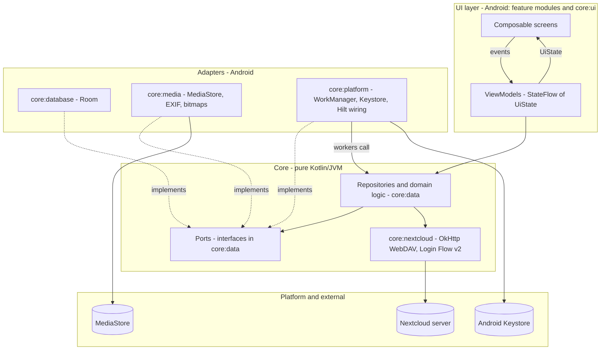

Rules:

- **UI layer**: Compose only renders `UiState` and emits events. No business logic in composables.
- **ViewModel**: maps repository flows into `UiState`, handles events, launches one-shot work in `viewModelScope`. Exposes one-off effects (system confirmation dialogs, snackbars, navigation) through a `Channel`-backed `Flow<UiEffect>`. ViewModels use no `android.*` classes: route arguments arrive through Hilt assisted injection (not `SavedStateHandle.toRoute`, which needs `Bundle`), and system dialogs are passed as an opaque `PlatformConfirmation` (see 3.3). ViewModel tests are plain JVM tests without Robolectric.
- **Repository** (`:core:data`): combines ports and the Nextcloud client, owns caching policy and all decisions. Returns `Flow` for observable data and `suspend` functions returning `AppResult` for commands.
- **Ports** (`:core:data`): interfaces in terms of `:core:model` types (content URIs as `String`, no `Uri`, `Bitmap` or `Cursor`).
- **Adapters**: thin wrappers around one platform technology each; no cross-source logic and no branching beyond mapping. Room entities, cursors and bitmaps never leave their adapter module.
- **Domain models** (`:core:model`) are plain Kotlin classes used across all layers.

## 3. Modules

### 3.1 Build setup

- Gradle Kotlin DSL; dependencies and versions in `gradle/libs.versions.toml`.
- Convention plugins in `build-logic/convention`:
  - `nextgallery.android.application` – `:app` defaults (SDK levels, Java/Kotlin toolchain 21, R8 config).
  - `nextgallery.android.library` – Android library defaults.
  - `nextgallery.android.library.compose` – enables Compose and adds the Compose BOM.
  - `nextgallery.android.feature` – library + compose + Hilt + dependencies every feature needs (`:core:ui`, `:core:data`, `:core:model`, Navigation Compose, lifecycle-viewmodel-compose).
  - `nextgallery.android.hilt` – Hilt + KSP.
  - `nextgallery.android.room` – Room + KSP + schema export directory (`<module>/schemas`).
  - `nextgallery.jvm.library` – pure Kotlin/JVM modules (`:core:model`, `:core:common`, `:core:data`, `:core:nextcloud`): `kotlin("jvm")`, toolchain 21, `javax.inject` for `@Inject` constructors (Hilt bindings for them live in Android modules), JUnit/MockK/Turbine/coroutines-test.
  - `nextgallery.android.test` – shared Android test dependencies (Robolectric 4.17+, androidx.test) and the `AndroidJUnitRunner` setup for instrumented tests.
- A JVM module cannot depend on an Android library (Gradle cannot resolve an AAR for a `kotlin("jvm")` module), so the Android-free core is enforced by the build itself.

### 3.2 Module dependency graph

Feature modules depend only on core modules, never on each other. `:app` is the only module that knows all features and wires navigation between them. Adapter modules depend on `:core:data` (to implement its ports), not the other way round.

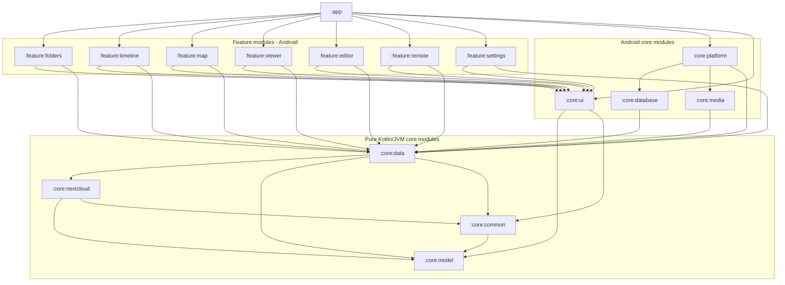

`:core:ui` additionally depends on Coil (it provides the shared image loading composables); the Coil `ImageLoader` itself is configured in `:app` (see [9.1](#91-thumbnails-and-images)).

### 3.3 Module responsibilities

Package root and application ID: `net.drehtuer.nextgallery` (D26). Class names below are the intended public surface; internals may grow.

#### `:app`

| Class | Responsibility |
| --- | --- |
| `NextGalleryApplication` | `@HiltAndroidApp`; implements `Configuration.Provider` (HiltWorkerFactory) and `SingletonImageLoader.Factory` (Coil). Triggers `IndexScheduler.onAppStart()`. |
| `MainActivity` | Single activity, edge-to-edge, hosts `NextGalleryNavHost`. Handles `ACTION_VIEW`/`ACTION_SEND` intents later. |
| `NextGalleryNavHost` | Navigation Compose graph; maps each feature's navigation callbacks to routes of other features. |
| `TopLevelDestination` | Enum of bottom-bar destinations (Folders, Timeline, Map, Nextcloud). |
| `ImageLoaderModule` | Hilt module building the Coil `ImageLoader` (memory + disk cache, MediaStore thumbnail fetcher, authenticated Nextcloud preview fetcher). |

#### `:core:model` (pure Kotlin)

| Type | Notes |
| --- | --- |
| `MediaItem` | `id: Long` (MediaStore `_ID`), `contentUri: String`, `relativePath`, `displayName`, `mimeType`, `sizeBytes`, `width`, `height`, `orientation`, `dateTakenMillis` (resolved, see 5.1), `dateModifiedMillis`, `location: GeoPoint?`, `bucketId`. |
| `Folder` | `bucketId`, `relativePath`, `displayName`, `itemCount`, `coverItemId`, `latestDateMillis`. |
| `FolderRule` | `relativePath`, `type: RuleType { INCLUDE, EXCLUDE }`. |
| `GeoPoint` | `latitude`, `longitude` (validated ranges). |
| `RemoteFile` | `path`, `name`, `isDirectory`, `sizeBytes`, `contentType`, `etag`, `fileId`, `lastModifiedMillis`, `checksums: Map<ChecksumType, String>`, `hasPreview`. |
| `UploadState` | sealed: `Unknown`, `NotUploaded`, `Uploaded(verifiedByChecksum: Boolean)`. |
| `CertificateInfo` | `host`, `subject`, `issuer`, `notBefore`, `notAfter`, `sha256Fingerprint`, `changedFromPinned: Boolean`. |
| `ViewContext` | `Folder(bucketId)`, `Timeline`, `Map` – used by the selection overview to decide which selected items the current view can show. |
| `EditOperation` | sealed: `Rotate(quarterTurns)`, `Crop(rect: NormalizedRect, aspect)`, `Scale(targetWidth, targetHeight)`, `PenStroke(points: List<NormalizedPoint>, colorArgb, widthFraction)`. Coordinates are normalized (0..1) relative to the image *after* previous operations, so they are resolution independent. |
| `AspectRatio` | `Free`, `Original`, `Square`, `FourThree`, `SixteenNine`. |
| `NextcloudAccount` | `serverUrl`, `loginName`, `userId` (no secret). |
| `TimelineSection` | `year`, `month`, `day`, `firstIndex`, `count` (for headers and fast-scroll index). |
| `MediaAccess` | `Full`, `Partial`, `Denied`. |
| `PlatformConfirmation` | Opaque wrapper (`handle: Any`) around a system confirmation request. The `:core:media` adapter puts an `IntentSender` inside; `:core:ui` launches it. Core and ViewModels only pass it through, and tests use any placeholder object. |
| `SortOrder`, `GridDensity`, `AppSettings` | User preferences. |

#### `:core:common` (pure Kotlin)

- `AppResult<T>` – `Success(value)` / `Failure(error: AppError)`; `AppError` sealed (`Io`, `NotFound`, `Network`, `Auth`, `Server(code)`, `InsufficientMemory(requiredBytes, availableBytes)`, `UntrustedCertificate(info: CertificateInfo)`, `NotLoggedIn`, `Cancelled`, `Unknown(cause)`).
- `DispatcherProvider` interface (`io`, `default`, `main`) + `@Dispatcher(IO|DEFAULT)` qualifier; Hilt bindings live in `:core:platform`.
- `Clock` abstraction (testable time), `TimeZoneProvider`.
- Utilities: `RelativePaths` (normalize, `isUnder`, join), `debounceLatest`, `runCatchingCancellable` (never swallows `CancellationException`), byte/size formatting helpers.

#### `:core:data` (pure Kotlin/JVM)

The heart of the app. Depends on `:core:model`, `:core:common`, `:core:nextcloud`, `paging-common` and `datastore-preferences-core` (both JVM artifacts). No Android dependency.

Ports (implemented by adapters):

| Port | Implemented in | Purpose |
| --- | --- | --- |
| `MediaScanSource` | `:core:media` | `fullScan()`, `changesSince(generation)`, `allIds()`, `mediaStoreVersion()`, `noMediaPaths()`. |
| `MediaChangeSource` | `:core:media` | `Flow<Unit>` of MediaStore change notifications. |
| `ExifSource` | `:core:media` | Raw EXIF values (date strings, offset, GPS, camera fields) for a content URI. |
| `MediaContentSource` | `:core:media` | `openInputStream(contentUri)`, size, for checksums. |
| `MediaWriteSink` | `:core:media` | Insert pending copy / open for overwrite / publish; returns `PlatformConfirmation` when the system must confirm. |
| `MediaDeleteSource` | `:core:media` | Trash, untrash and permanent delete requests as `PlatformConfirmation`. |
| `ImageRenderer` | `:core:media` | Decode at a max size, apply a list of `RenderStep`s (matrices, crops, strokes computed by `EditGeometry`), encode. |
| `MediaPermissionSource` | `:core:media` | Currently granted media permissions as strings. |
| `MediaIndexStore` | `:core:database` | Index reads/writes; paged queries returned as `Flow<PagingData<MediaItem>>` (the Room adapter builds the `Pager` and maps entities). |
| `FolderRuleStore`, `UploadStateStore`, `RemoteCacheStore`, `SyncStateStore` | `:core:database` | Room tables behind model-typed interfaces. |
| `WorkScheduler` | `:core:platform` | `enqueueIndex(mode)`, `scheduleUploadStateSync()`, `requestUploadStateSync()`. |
| `NextcloudAppSource` | `:core:platform` | `isInstalled()` for `com.nextcloud.client`. |
| `SecretCipher` | `:core:platform` | `encrypt(bytes)` / `decrypt(bytes)` backed by Tink + Android Keystore. |
| `MemoryInfoSource` | `:core:platform` | `availableBytes()` from `ActivityManager.MemoryInfo`, minus a safety margin. |

Repositories (interfaces + `Default…` implementations with `@Inject` constructors):

| Repository | Responsibility |
| --- | --- |
| `MediaRepository` | Paged folder/timeline grids, item lookup, viewer id lists, location items for map, image details (EXIF on demand), share URIs. |
| `FolderRepository` | Folder list with counts/covers, filtered by folder rules. |
| `FolderRulesRepository` | Include/exclude rules; changes trigger re-index of the affected scope. |
| `IndexRepository` | Full scan, incremental sync, deletion detection (`MediaIndexer`); publishes `IndexStatus` flow. |
| `DeleteRepository` | Delete/trash requests; removes rows after confirmed result. |
| `EditRepository` | Edit pipeline: `EditGeometry` → `ImageRenderer` → `MediaWriteSink`, EXIF policy. |
| `NextcloudRepository` | Login flow, account state, remote browsing (with `remote_cache`), preview requests. |
| `UploadStateRepository` | Folder mapping, PROPFIND comparison, checksum confirmation, `upload_state` cache. |
| `UploadHandoffRepository` | Prepares a hand-off to the Nextcloud app: filters out items already uploaded, returns a `ShareSpec` targeted at `com.nextcloud.client`, and requests an upload-state refresh when the app returns to the foreground. |
| `SelectionRepository` | App-wide selection (`StateFlow<Set<MediaId>>`): toggle, range, select all, clear, and `overview(context: ViewContext)` marking which selected items the given view can show. In-memory singleton. |
| `TrustedCertificateRepository` | Pinned certificates per host (`TrustedCertificateStore`, DataStore): accept, remove, list. |
| `SettingsRepository` | DataStore (Preferences, JVM artifact) for `AppSettings`; the file location is provided by `:core:platform`. |
| `AccountStore` | Account + app password in DataStore, encrypted through `SecretCipher`. |

Pure logic (each class unit-tested on the JVM):

- `IndexScheduler` – decides full vs incremental, debounces `MediaChangeSource`, calls `WorkScheduler`.
- `MediaIndexer` – full/incremental sync algorithm, batching, deletion detection.
- `DateResolver`, `ExifDateParser` – `DATE_TAKEN` → EXIF `DateTimeOriginal` (+ offset) → `DATE_MODIFIED`.
- `FolderRuleMatcher`, `NoMediaMatcher` – is a relative path indexed given rules and `.nomedia` paths?
- `MediaAccessResolver` – granted permissions → `MediaAccess`.
- `FolderMapping` – local relative path → `<remoteRoot>/<relative path>`.
- `UploadStateMatcher`, `ChecksumCalculator` (streams SHA-1 / MD5 of an `InputStream`), `ChecksumParser`.
- `SelectionRepresentability` – can a view context show an item (Map: has GPS; Folder: same bucket; Timeline: always, since every item has a resolved date).
- `EditSession` / `EditHistory`, `CropMath`, `ScaleMath`, `EditGeometry` (operations → output size and `RenderStep`s), `MemoryBudget` (fits / refuse with required vs available bytes), `EditableFormats` (JPEG, PNG).
- `GridClusterer`, `SectionIndexBuilder`, `ScrollbarMath`.

#### `:core:nextcloud` (pure Kotlin/JVM)

| Class | Responsibility |
| --- | --- |
| `NextcloudHttpClient` | Provides the base `OkHttpClient` (TLS defaults, timeouts, user agent `NextGalleryApp/<version>`) and the authenticated client with `BasicAuthInterceptor` reading credentials through a `CredentialsProvider` interface. |
| `LoginFlowV2Client` | `POST <server>/index.php/login/v2` → `{ login URL, poll token, endpoint }`; `poll()` until success, timeout (20 min) or cancellation. |
| `WebDavClient` | `propfind(path, depth)` → `List<RemoteFile>` (requested props: `d:getcontentlength`, `d:getcontenttype`, `d:getetag`, `d:getlastmodified`, `d:resourcetype`, `oc:fileid`, `oc:checksums`, `nc:has-preview`); `get(path): InputStream`. Read-only: uploading is done by the Nextcloud app (D31). Paths are under `remote.php/dav/files/<userId>/`. |
| `PropfindParser` | Multistatus parser on the XmlPullParser API (`compileOnly`; provided by Android at runtime, kxml2 on the JVM test classpath). |
| `PreviewUrlBuilder` | Builds `index.php/core/preview?fileId=…&x=…&y=…&a=1` URLs. |
| `ServerUrlNormalizer` | Adds `https://`, strips trailing `/` and `/index.php`. |
| `PinningTrustManager` | `X509TrustManager` that first delegates to the platform trust manager (system + user CAs) and otherwise accepts only a certificate pinned for that host; an unknown certificate fails with `UntrustedCertificateException(chain)`. A matching `HostnameVerifier` accepts a pinned certificate even when the hostname does not match. |
| `CertificateInfoMapper` | `X509Certificate` → `CertificateInfo` (subject, issuer, validity, SHA-256). |
| `NextcloudErrorMapper` | Maps HTTP codes / IO exceptions to `AppError` (incl. `UntrustedCertificateException` → `UntrustedCertificate`). |

#### `:core:database` (Android adapter)

- `GalleryDatabase` (Room, `exportSchema = true`, explicit `Migration`s from v1 on; schemas checked in).
- Entities: `MediaEntity`, `FolderEntity` (Room view or table, see 4), `FolderRuleEntity`, `UploadStateEntity`, `RemoteFileCacheEntity`, `SyncStateEntity`.
- DAOs:
  - `MediaDao` – `upsertAll`, `deleteByIds`, `deleteNotIn(generation)`, `pagingByBucket(bucketId): PagingSource<Int, MediaEntity>`, `pagingTimeline(): PagingSource`, `observeWithLocation(bounds)`, `getById`, `observeIdsInBucket` (viewer pager), `timelineSections(tzOffset...)`.
  - `FolderDao` – `observeFolders(sort)`.
  - `FolderRuleDao` – `observeRules`, `replaceAll`.
  - `UploadStateDao` – `observeForMedia(ids)`, `upsertAll`, `deleteForFolder`.
  - `RemoteFileCacheDao` – `replaceFolder(parentPath, files)`, `observeFolder(parentPath)`.
  - `SyncStateDao` – last generation per volume.
- `Room…Store` classes implementing the `:core:data` store ports, with entity ↔ model mappers; Hilt module binding them.

#### `:core:media` (Android adapter)

| Class | Implements | Responsibility |
| --- | --- | --- |
| `MediaStoreScanner` | `MediaScanSource` | Queries `MediaStore.Images.Media` per external volume in batches of 500, using `GENERATION_MODIFIED` for incremental scans; `.nomedia` paths via `MediaStore.Files`. |
| `MediaStoreChangeObserver` | `MediaChangeSource` | `ContentObserver` on `MediaStore.Images.Media.EXTERNAL_CONTENT_URI` as `callbackFlow`. |
| `AndroidExifSource` | `ExifSource` | `androidx.exifinterface` on `MediaStore.setRequireOriginal(uri)` streams; returns raw tag values, parsing happens in `ExifDateParser`. |
| `ContentResolverContentSource` | `MediaContentSource` | Opens content URIs. |
| `MediaStoreWriter` | `MediaWriteSink` | Inserts a pending copy (`IS_PENDING`), overwrites via `createWriteRequest`, copies EXIF (`ExifWriter`). |
| `MediaStoreDeleter` | `MediaDeleteSource` | `createTrashRequest` / `createDeleteRequest` wrapped in `PlatformConfirmation`. |
| `BitmapImageRenderer` | `ImageRenderer` | `ImageDecoder` decode, applies `RenderStep`s with `Matrix`/`Canvas`/`Path`, encodes JPEG/PNG. |
| `AndroidMediaPermissionSource` | `MediaPermissionSource` | `checkSelfPermission` for the media permissions. |

#### `:core:platform` (Android adapter and wiring)

- Workers (`@HiltWorker`, thin): `IndexWorker` → `IndexRepository.sync()`, `UploadStateSyncWorker` → `UploadStateRepository.refreshAll()`. Each maps `AppResult` to `Result.success/retry/failure`.
- `WorkManagerScheduler` implements `WorkScheduler` (unique work names, constraints, backoff).
- `KeystoreSecretCipher` implements `SecretCipher` (Tink AEAD, keyset wrapped by an Android Keystore master key).
- `ActivityManagerMemoryInfo` implements `MemoryInfoSource`.
- `PackageManagerNextcloudAppSource` implements `NextcloudAppSource` (manifest `<queries>` entry for `com.nextcloud.client`).
- Hilt modules: `DispatchersModule`, `DataStoreModule` (file locations), `RepositoryModule` (binds `:core:data` interfaces to `Default…` implementations), `NextcloudModule`, `ApplicationScopeModule`.

#### `:core:ui`

- `NextGalleryTheme` (Material 3, light/dark). Placeholder colours, typography, shapes and spacing until the Claude Design delivery replaces them (DESIGN_DECISIONS.md D22). Takes the user's accent colour from `AppSettings` (D34).
- `ThumbnailGrid` – `LazyVerticalGrid` driven by `LazyPagingItems<GridItem>`; supports headers (`GridItem.Header`), selection, a greyed-out state (selection overview), upload badges, stable keys.
- `FastScrollbar` – draggable thumb; drag fraction ↔ index math lives in `ScrollbarMath` (`:core:data`); shows a bubble label (e.g. "March 2024").
- `SelectionTopBar` – total selection count (across all views), select all, share, delete, upload (hand-off), open selection overview.
- `CertificateWarningDialog` – shows `CertificateInfo` with a warning; Accept / Cancel.
- `MediaThumbnail` – Coil `AsyncImage` with placeholder, fixed size request, badge slot.
- `PermissionGate` – requests media permissions, shows rationale, handles partial access ("Manage selected photos").
- `rememberConfirmationLauncher()` – launches a `PlatformConfirmation` (unwraps the `IntentSender`) and reports the result.
- `ErrorState`, `EmptyState`, `LoadingState` composables; `UiText` (string resource or raw).

#### Feature modules

Each feature contains: `XxxRoute` (serializable route object/class), `XxxScreen` (stateless composable), `XxxViewModel` (assisted-injected with its route), `XxxUiState`, `XxxEvent`, and `NavGraphBuilder.xxxScreen(onNavigate…)` extension consumed by `:app`.

| Module | Screens | Notes |
| --- | --- | --- |
| `:feature:folders` | Folder list, folder grid, selection overview | Default start destination. The selection overview (D33) lists all selected images and greys out those the calling view (`ViewContext`) cannot show; other features open it through `:app` navigation. |
| `:feature:timeline` | Timeline grid | Sticky year/month/day headers; scrollbar label = month/year. |
| `:feature:map` | Map | `MapRenderer` interface + `OsmdroidMapRenderer` (AndroidView); clusters come from `GridClusterer` in `:core:data`; tapping a cluster opens a grid of its items. |
| `:feature:viewer` | Full-screen pager, info sheet | `HorizontalPager` + Telephoto `ZoomableAsyncImage`; also used for remote images through a different source argument. |
| `:feature:editor` | Editor | Crop overlay, pen canvas, save dialog; `EditSession` from `:core:data`. |
| `:feature:remote` | Nextcloud login, remote folder browser | Remote grid uses preview API thumbnails. |
| `:feature:settings` | Settings, folder rules, appearance (accent colour), Nextcloud account, remote root, accepted certificates | |

## 4. Data model

### 4.1 Room schema

`media` is a mirror of the subset of MediaStore that passes the folder rules, enriched with resolved date and GPS. Folders are derived from `media` (an aggregated query/`@DatabaseView`), so no separate write path can get out of sync.

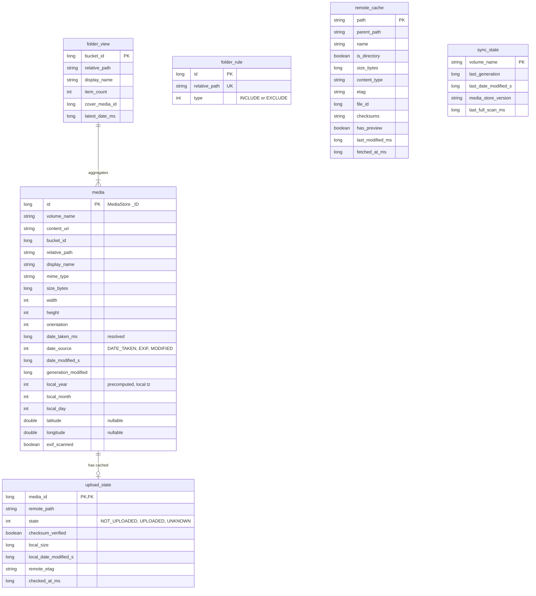

Notes:

- **Indexes**: `media(bucket_id, date_taken_ms DESC)`, `media(date_taken_ms DESC)`, `media(local_year, local_month, local_day)`, `media(latitude, longitude)` partial use via `WHERE latitude IS NOT NULL`, `remote_cache(parent_path)`.
- `upload_state.media_id` has an `ON DELETE CASCADE` foreign key to `media`.
- `local_year/month/day` are computed at index time in the device time zone. On time zone change (`ACTION_TIMEZONE_CHANGED`) `IndexWorker` recomputes them (cheap bulk update; no MediaStore access).
- `sync_state.media_store_version` stores `MediaStore.getVersion(volume)`; if it changes, generation numbers are invalid and a full scan runs.
- `remote_cache` is keyed by full remote path; `checksums` is the raw `oc:checksums` string (e.g. `SHA1:… MD5:…`).
- Grids query `media` only. A folder excluded by rules is never inserted; rule changes delete/insert affected rows (index-time filtering). Query-time filtering (`FolderRuleMatcher` translated to SQL `relative_path` prefix conditions) covers the window between a rule change and the re-index finishing.

### 4.2 DataStore

| Store | Content |
| --- | --- |
| `settings.preferences_pb` | Sort order, grid density, start destination, accent colour, remote root, save-copy-vs-overwrite default, pen colour/width. |
| `trusted_certs.preferences_pb` | Pinned certificates: host → SHA-256 fingerprint and the details shown when it was accepted. |
| `credentials.pb` | Tink-encrypted blob: server URL, login name, user id, app password. |

## 5. Key flows

### 5.1 Initial indexing and incremental sync

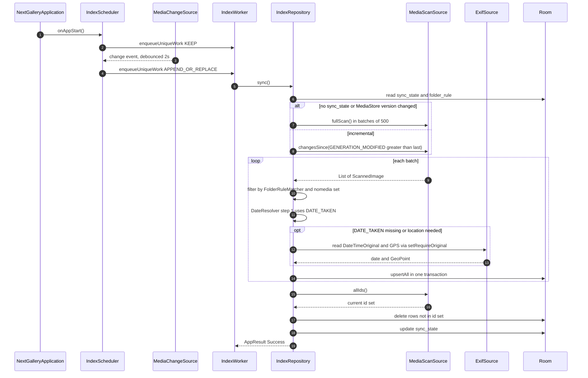

Details:

- Deletions are not reported by generation queries, so each sync compares ID sets (`allIds()` is a projection-only cursor; ~fast even at 50k rows). Rows are removed in chunks of 900 (SQLite variable limit).
- EXIF reading is the expensive part. GPS is read only for JPEG/HEIF/WebP during the scan, and in a **second pass** (`exif_scanned = false` rows) after the grid-relevant data is committed, so folders appear quickly on first launch. Date fallback order: `DATE_TAKEN` → EXIF `DateTimeOriginal` (with `OffsetTimeOriginal` when present) → `DATE_MODIFIED`.
- Without `ACCESS_MEDIA_LOCATION`, `setRequireOriginal` throws / GPS is redacted; location is then left null and the map shows a hint.
- With partial access, the scan only sees user-selected images; the index is rebuilt from scratch whenever the selection changes (detected on resume via the permission state).
- `IndexWorker` is expedited for the first scan, runs as normal work otherwise, and reports progress through `setProgress` for the UI's indexing indicator.

### 5.2 Opening a folder grid with paging

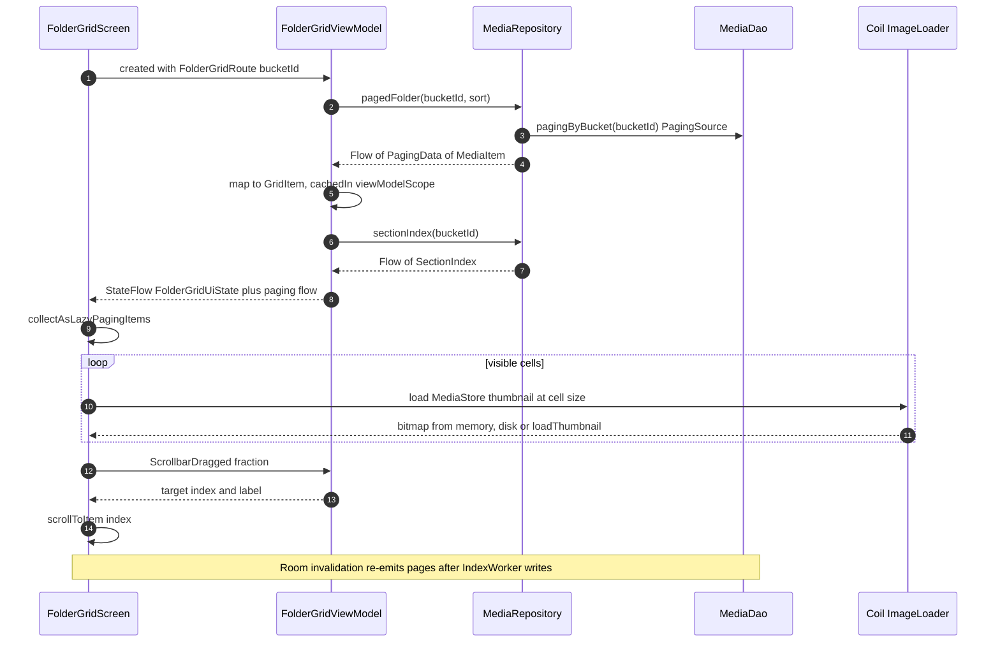

- Page size 120 (multiple of common column counts), prefetch distance 2 pages, `enablePlaceholders = true` so the total count is known and the fast scroll thumb maps 1:1 to positions.
- Upload badges: the grid collects `UploadStateRepository.observeStates(visibleIds)`; the map is combined per cell, not via a SQL join, so the paging query stays simple and cheap.

### 5.3 Full-screen viewer

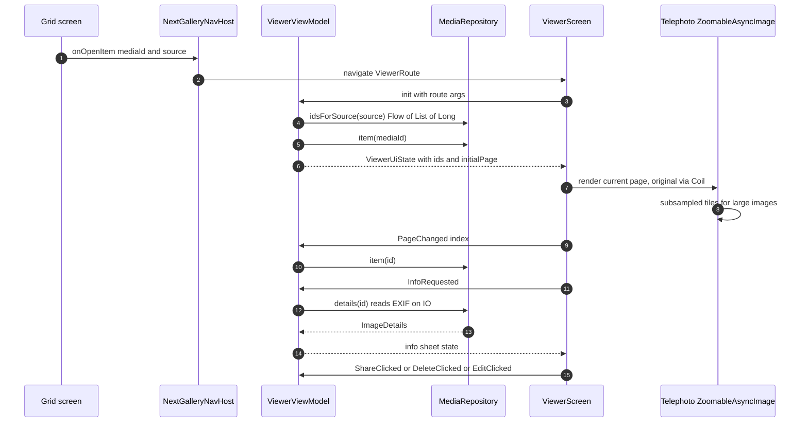

- `source` is a sealed route argument: `Folder(bucketId)`, `Timeline`, `MapCluster(ids)`, `Remote(parentPath)`. The id list is a lightweight `Flow<List<Long>>` (50k longs ≈ 400 KB) so the pager knows its size; items are loaded per page.
- Adjacent pages are preloaded at screen size via Coil; full-resolution tiles only for the visible page.
- Share uses `Intent.ACTION_SEND`/`ACTION_SEND_MULTIPLE` with MediaStore content URIs and `FLAG_GRANT_READ_URI_PERMISSION`.

### 5.4 Editing and saving

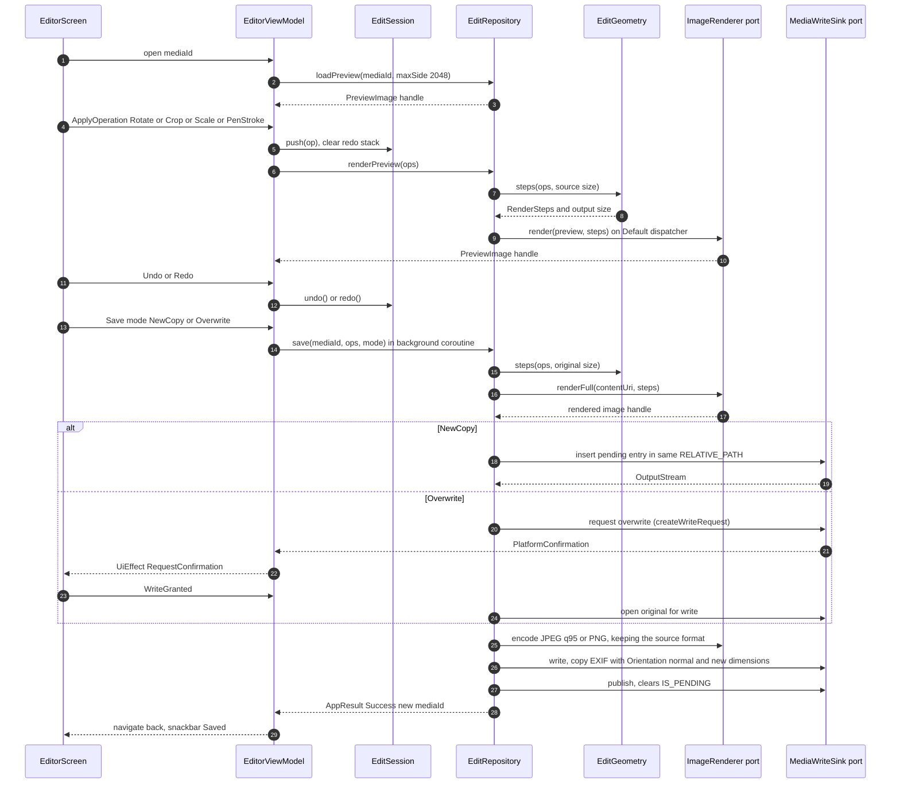

- `EditSession` is a plain class (`operations`, `undoStack`, `redoStack`, `canUndo`, `canRedo`) — fully unit-testable without Android.
- `EditGeometry` (pure, `:core:data`) turns operations into `RenderStep`s (3×3 matrices, crop rects, stroke paths in pixels) for a given source size; normalized coordinates make preview and full-resolution rendering identical in output geometry. The `BitmapImageRenderer` adapter only applies the steps with `Matrix`, `Canvas` and `Path`.
- Rendered images cross the port as an opaque `PreviewImage(handle, width, height)`; `:core:ui` draws it, so `EditorViewModel` never touches `Bitmap`.
- Original EXIF orientation is applied first (bake-in), which is why the output orientation is reset to normal.
- Memory guard (D30): `MemoryBudget` (pure, `:core:data`) estimates the bytes a step needs (source + output bitmap, 4 bytes per pixel) and compares them with `MemoryInfoSource.availableBytes()` (`:core:platform`, from `ActivityManager.MemoryInfo` minus a safety margin; bitmap pixels live in native memory, so the Java heap limit is not the right measure). It is checked when a `Scale` is applied and before the full-resolution render on save. If the estimate does not fit, the operation is refused with `AppError.InsufficientMemory(requiredBytes, availableBytes)` and the editor shows why. Nothing is ever saved at a reduced size without the user asking for it.
- Only JPEG and PNG sources can be edited, and the output keeps the source format (D29). The viewer hides the Edit action for other formats.

### 5.5 Delete with trash

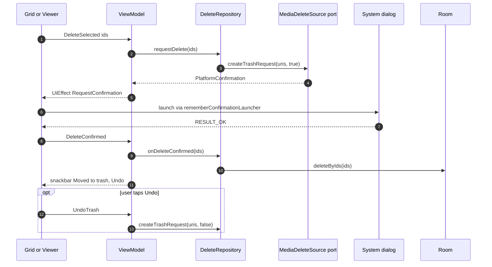

- Room rows are removed optimistically after confirmation so the grid updates instantly; the next `IndexWorker` run reconciles regardless. Untrash re-inserts via the next incremental sync (the item gets a new generation).
- `createDeleteRequest` (permanent) is offered as a secondary action (setting or long-press option).

### 5.6 Nextcloud Login Flow v2

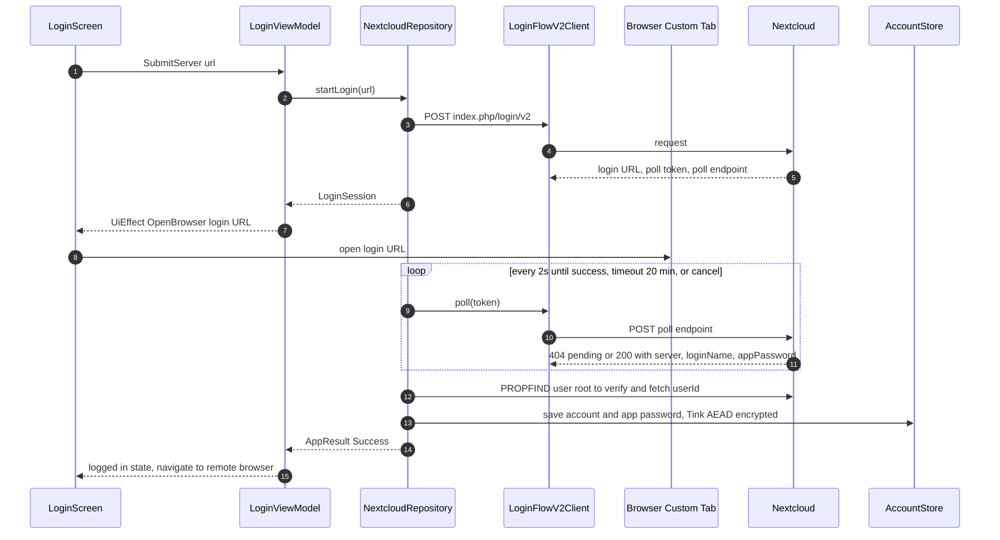

- Server URL normalization: add `https://` if missing, strip trailing `/` and `/index.php`; `http://` is rejected in release builds (see 11).
- Polling runs in `viewModelScope`; leaving the screen cancels it. The poll token is never persisted.
- Logout (D35): `DELETE ocs/v2.php/core/apppassword` (best effort), then `AccountStore.clear()`, clear `remote_cache`, `upload_state` and Coil's remote cache entries. While logged out, `NextcloudRepository` returns `AppError.NotLoggedIn` for every remote call without touching the network; the Nextcloud tab shows a login-required hint, and badges and the Upload action are hidden.
- Untrusted certificate (D32): any remote call can fail with `UntrustedCertificate(info)`. The ViewModel emits an effect that shows `CertificateWarningDialog`; on Accept, `TrustedCertificateRepository.accept(info)` pins it and the call is retried.

### 5.7 Upload-state check

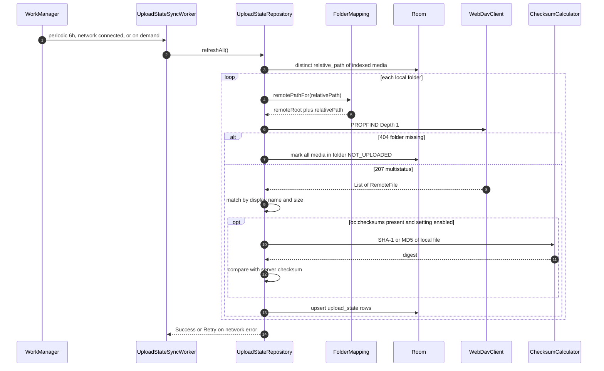

- Skip rule: a folder whose remote `etag` and local max(`date_modified`) are unchanged since `checked_at_ms` is not re-compared.
- Checksums are only computed for name+size matches, and only once per (`media_id`, `local_date_modified_s`) since the result is stored with `checksum_verified`.
- Grid badges read `upload_state` only; a missing row means `Unknown` (no badge or a neutral one).
- Nextcloud does not always compute checksums for files uploaded via other clients; absence of `oc:checksums` means "Uploaded (size match)".

### 5.8 Upload hand-off to the Nextcloud app

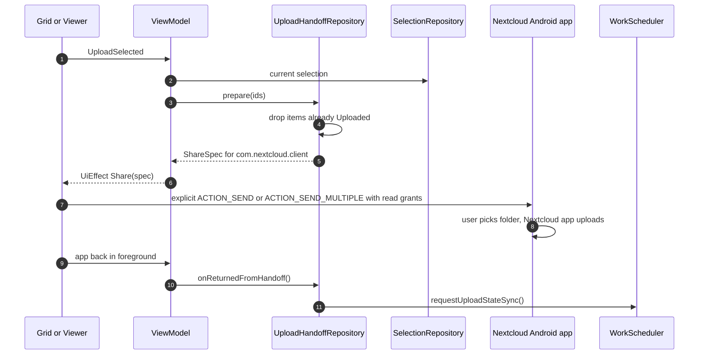

- The Nextcloud app handles target folder, name conflicts, chunking, retries and progress; NextGalleryApp cannot see its progress.
- Badges update once the next upload-state check finds the files on the server. If the user chose a folder outside the configured remote root, or the Nextcloud app renamed a file, the badge stays "not uploaded" (D13).
- If `NextcloudAppSource.isInstalled()` is false, the Upload action is disabled and explains that the Nextcloud app is required.

## 6. Navigation

Single activity, Navigation Compose with type-safe `@Serializable` routes. Each feature exposes its route types and a `NavGraphBuilder` extension; `:app` connects them. Bottom navigation for the four top-level destinations; settings from the top app bar.

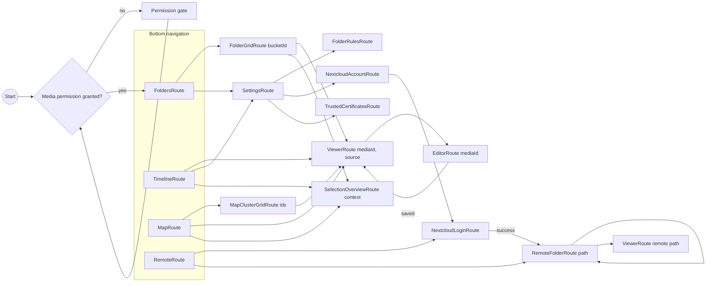

Rules:

- Route arguments carry only IDs/paths, never full objects. Large ID lists (map clusters) are passed via a short-lived `SavedStateHandle`-backed holder in the repository keyed by a token, not through the route.
- Feature screens receive navigation lambdas (`onOpenItem: (Long, ViewerSource) -> Unit`) instead of a `NavController`.
- Deep links (`ACTION_VIEW` of an image) open `ViewerRoute` directly (post-v1).

## 7. State management

Pattern per screen:

```kotlin
data class FolderGridUiState(
    val title: String = "",
    val sectionIndex: SectionIndex = SectionIndex.Empty,
    val selectionCount: Int = 0, // app-wide, from SelectionRepository
    val uploadBadgesEnabled: Boolean = false, // logged in and Nextcloud app installed
    val isIndexing: Boolean = false,
    val error: UiText? = null,
)

sealed interface FolderGridEvent {
    data class ItemClicked(val id: Long) : FolderGridEvent
    data class ItemLongPressed(val id: Long) : FolderGridEvent
    data object ClearSelection : FolderGridEvent
    data object DeleteSelected : FolderGridEvent
    data object ShareSelected : FolderGridEvent
    data object UploadSelected : FolderGridEvent
    data class DeleteResult(val confirmed: Boolean) : FolderGridEvent
}

sealed interface FolderGridEffect {
    data class OpenViewer(val id: Long) : FolderGridEffect
    data class RequestConfirmation(val request: PlatformConfirmation) : FolderGridEffect
    data class Share(val spec: ShareSpec) : FolderGridEffect // also used for the Nextcloud hand-off
    data class ShowMessage(val text: UiText, val undo: Boolean) : FolderGridEffect
}

@HiltViewModel(assistedFactory = FolderGridViewModel.Factory::class)
class FolderGridViewModel @AssistedInject constructor(
    @Assisted private val route: FolderGridRoute,
    private val savedStateHandle: SavedStateHandle,
    private val media: MediaRepository,
    private val delete: DeleteRepository,
    private val selection: SelectionRepository,
    private val upload: UploadHandoffRepository,
) : ViewModel() {
    @AssistedFactory interface Factory { fun create(route: FolderGridRoute): FolderGridViewModel }
    val items: Flow<PagingData<GridItem>> = media.pagedFolder(route.bucketId).cachedIn(viewModelScope)
    val state: StateFlow<FolderGridUiState> = /* combine(...).stateIn(viewModelScope, WhileSubscribed(5_000), FolderGridUiState()) */
    val effects: Flow<FolderGridEffect> = /* Channel(BUFFERED).receiveAsFlow() */
    fun onEvent(event: FolderGridEvent) { /* ... */ }
}
```

`PagingData` is exposed as a separate flow (not inside `UiState`) because it must be `cachedIn` and collected with `collectAsLazyPagingItems`.

Other screens (abbreviated):

| Screen | UiState fields |
| --- | --- |
| Folders | `folders: List<Folder>`, `access: MediaAccess`, `isIndexing`, `indexProgress` |
| Timeline | `sectionIndex` (year/month labels), `selectionCount`, `isIndexing` (+ separate paging flow with `GridItem.Header`) |
| Map | `clusters: List<MapCluster>` for current viewport + zoom, `itemsWithoutLocation: Int`, `locationPermissionMissing: Boolean` |
| Viewer | `ids: List<Long>`, `currentIndex`, `current: MediaItem?`, `details: ImageDetails?`, `chromeVisible`, `infoSheetVisible` |
| Editor | `preview: PreviewImage?`, `tool: EditTool`, `cropRect`, `aspect`, `penColor`, `penWidth`, `canUndo`, `canRedo`, `isSaving`, `saveMode` |
| Remote browser | `path`, `entries: List<RemoteFile>`, `isRefreshing`, `isOffline` (shows cached `remote_cache` data), `error` |
| Login | `serverUrl`, `step: Idle / WaitingForBrowser / Verifying / Done`, `error` |
| Settings | `settings: AppSettings`, `rules: List<FolderRule>`, `account: NextcloudAccount?`, `queueCount` |

Process death: the route is restored by Navigation and passed in again through the assisted factory (`hiltViewModel<FolderGridViewModel, FolderGridViewModel.Factory> { it.create(route) }`); transient UI (selection, editor operations) is saved via `SavedStateHandle` where cheap (selection as `LongArray`, editor operations serialized with kotlinx.serialization).

## 8. Threading and concurrency

| Work | Where it runs |
| --- | --- |
| Compose rendering, state collection | Main |
| Room queries | Room's own executor (suspend DAOs / Flow / PagingSource) |
| MediaStore cursors, EXIF, file I/O, checksums, OkHttp | `Dispatchers.IO` via injected `DispatcherProvider` |
| Bitmap transforms (editor preview/full render), clustering, section index computation | `Dispatchers.Default` |
| Indexing, upload-state sync | WorkManager `CoroutineWorker`s (survive process death; unique work names) |

Rules:

- No `GlobalScope`. Long-lived app-level collectors (ContentObserver → scheduler) run in an `@ApplicationScope CoroutineScope` (`SupervisorJob + Default`) provided by Hilt.
- Unique work names: `index` (one at a time; `APPEND_OR_REPLACE` coalesces triggers), `upload-state-sync` (periodic, `UPDATE`; plus a one-shot `upload-state-refresh` after a hand-off).
- Room writes in batches inside `withTransaction`; the indexer yields between batches (`ensureActive()`), so cancellation is prompt.
- Editor full-resolution save runs in `viewModelScope` with `NonCancellable` around the final MediaStore commit (write + clear `IS_PENDING`), so a half-written entry is never left visible. A pending entry left by a crash is cleaned up on next start (pending items older than 1 day are deleted by `MediaWriteSink.cleanupPending()`).
- Flows from repositories are cold; ViewModels convert with `stateIn(viewModelScope, SharingStarted.WhileSubscribed(5_000), initial)`.

## 9. Caching

### 9.1 Thumbnails and images

- Single Coil 3 `ImageLoader` (app singleton) with:
  - Memory cache: 20 % of app memory.
  - Disk cache: `cacheDir/image_cache`, 250 MB (configurable later).
  - Custom `MediaStoreThumbnailFetcher` for local grid cells: `ContentResolver.loadThumbnail(uri, Size, signal)` — uses the system thumbnail cache, which is faster than decoding originals. Cache key includes `id + date_modified + size bucket`, so edited images refresh.
  - Size buckets (e.g. 256 / 512 px) instead of exact sizes to maximise cache hits across grid densities.
- Viewer: Telephoto's `ZoomableAsyncImage` uses Coil for the screen-sized image and sub-sampled tiles for full resolution; tiles are not disk-cached (originals are local).
- Hardware bitmaps enabled for grids; disabled in the editor (needs software bitmaps).

### 9.2 Remote previews and files

- `NextcloudPreviewFetcher` requests `core/preview?fileId=…&x=…&y=…` through the authenticated OkHttp client; cache key is `fileId + etag + size bucket`, so a changed remote file is re-fetched. Stored in the same Coil disk cache.
- Opening a remote image full screen fetches a large preview first (e.g. 2048 px), and the original via WebDAV `GET` only when zooming beyond preview resolution. Originals are streamed into Coil's disk cache, never into the MediaStore. There is no offline mode for remote files; the Nextcloud app's "available offline" covers that (D37).
- `remote_cache` table holds the last PROPFIND result per folder for instant display and offline browsing; refreshed on open (stale-while-revalidate) and on pull-to-refresh.

### 9.3 Index and upload state

- The Room index is the cache of MediaStore; it is reconciled incrementally, so app start shows data immediately and syncs in background.
- `upload_state` caches server comparison results; badges never wait on the network.
- Section indexes (timeline headers / fast scroll labels) are computed via `GROUP BY` queries on precomputed `local_year/month/day` columns and cached in the ViewModel until Room invalidates.

## 10. Error handling

- Data sources throw; **repositories catch** and return `AppResult` / emit errors in flows. `CancellationException` is always rethrown (`runCatchingCancellable`).
- `AppError` is mapped to user-visible `UiText` in the ViewModel (one mapper per feature, using shared strings in `:core:ui`).
- Categories:
  - **Permission**: missing media permission → `PermissionGate`; partial access → banner with "select more"; missing `ACCESS_MEDIA_LOCATION` → map hint, no crash.
  - **User confirmation**: trash, delete and write requests → `UiEffect.RequestConfirmation(PlatformConfirmation)`; this is a normal flow, not an error.
  - **Stale data**: item deleted outside the app while opened → `NotFound`; the viewer skips to the next page and the grid refreshes via index sync.
  - **Network** (`IOException`, timeouts): remote browser shows cached data with an offline banner; workers return `Result.retry()`.
  - **Auth** (401): account marked as "needs re-login"; workers stop with failure; a persistent banner links to login.
  - **Server** (5xx, 507 insufficient storage): queue entry `FAILED` with reason; retry for 5xx, no retry for 507.
  - **Decode/encode** (corrupt file): thumbnail shows an error placeholder; editor refuses to save with a message.
  - **Insufficient memory** (`AppError.InsufficientMemory`): the editor refuses the scale or save and tells the user how much memory the image needs and how much is available (D30).
- Crashes: no crash reporting service (no tracking). Uncaught exceptions use the default handler; an opt-in local log export may be added later.
- Logging: a thin `Logger` interface in `:core:common`, backed by `android.util.Log` in debug and stripped below `WARN` in release via R8 rules. Never log URLs with credentials, app passwords, or file names in release.

## 11. Security and privacy

- **Credentials**: Login Flow v2 only; the account password is never seen by the app. The app password is stored in a DataStore file encrypted with a Tink `Aead` (AES256-GCM); the Tink keyset is encrypted by an Android Keystore master key (`AndroidKeysetManager`, `android-keystore://` URI). No `EncryptedSharedPreferences` (deprecated).
- Credentials excluded from backup: `android:dataExtractionRules` / `fullBackupContent` exclude the credentials store and Tink keyset prefs (Keystore keys do not survive restore anyway).
- **TLS**: platform defaults via OkHttp; `network_security_config.xml` disallows cleartext traffic, so v1 accepts `https://` servers only (cleartext for debug builds only, via a debug-only config). User-installed CAs (`<certificates src="user"/>`) are trusted in addition to system CAs. Any other certificate is only trusted after the user accepts it in a warning dialog; it is then pinned per host by SHA-256 fingerprint (`PinningTrustManager`, D32). A changed certificate triggers the warning again. The same OkHttp client is used for WebDAV, the preview API and Coil, so all remote traffic follows the same rule.
- Authorization header added only for requests to the configured server host (interceptor checks host), so redirects to other hosts never leak credentials.
- **No tracking**: no analytics, no crash reporting SDKs, no Google Play Services. osmdroid tile requests go to OSM tile servers with a proper user agent (required by OSM tile usage policy); this is the only third-party network traffic and is triggered only by opening the map.
- **Least privilege**: only `READ_MEDIA_IMAGES`, `READ_MEDIA_VISUAL_USER_SELECTED`, `ACCESS_MEDIA_LOCATION`, `INTERNET`, `ACCESS_NETWORK_STATE`, plus a `<queries>` entry for `com.nextcloud.client`. No foreground service or notification permission (uploads are done by the Nextcloud app). Destructive actions go through system dialogs.
- Shared URIs are MediaStore content URIs with temporary read grants; no `FileProvider` exposing app storage.

## 12. Performance

Targets (measured on the reference Pixel 10a, Android 17): warm start to first folder grid < 1 s with an existing index; no dropped frames at the display refresh rate when scrolling and fast scrolling a 50 000-image library; first full index of 50 000 images in under ~1 minute without EXIF pass.

- **Query only Room** for grids; MediaStore is touched only by the indexer.
- **Paging 3 with placeholders** gives a stable item count, so `LazyVerticalGrid` can jump anywhere; Room's `PagingSource` uses `LIMIT/OFFSET` on indexed columns. For very deep jumps, the grid requests the page around the target via `scrollToItem` and placeholders render until loaded.
- **Fast-scroll section index**: computed once per data version via aggregated SQL (`SELECT local_year, local_month, COUNT(*) … GROUP BY …`), turned into cumulative `firstIndex` offsets. Dragging the thumb is O(log n) (binary search in sections) and does not load items until the drag settles (throttled `scrollToItem`, e.g. every 32 ms).
- **Timeline headers**: header items are inserted with `PagingData.insertSeparators` (day changes); sticky header text is derived from the first visible item's date, not from a separate list.
- **Stable keys and content types** in lazy grids (`key = id`, `contentType = header/item`) to avoid recomposition and enable reuse.
- **Thumbnails**: system `loadThumbnail` + size buckets + memory cache; no crossfade during fast scroll; requests cancelled when cells leave the screen (Coil does this per composable).
- **Indexing**: projection limited to needed columns; batched transactions; EXIF read deferred to a second pass; ContentObserver debounced; incremental sync via generation numbers touches only changed rows.
- **Map**: clustering computed on `Default` for the viewport only, from a lightweight `(id, lat, lon)` projection; recomputed on zoom/pan with debounce.
- **Memory**: viewer limits decoded size to screen size except visible tiles; editor preview max 2048 px side.
- **Baseline profiles** (`:baselineprofile` module, added once screens are stable) and R8 full mode for release builds; Macrobenchmark for startup and grid scrolling.
- Compose stability: `UiState` classes are immutable data classes with `kotlinx.collections.immutable` collections or `@Immutable` where needed.

## 13. Testing strategy

Principles: every function gets a unit test; tests are small, independent and non-overlapping (each behaviour is asserted in exactly one test at the lowest layer that owns it). Tools: JUnit 4, MockK, Turbine, kotlinx-coroutines-test (`runTest`, `StandardTestDispatcher` via an injected `DispatcherProvider`), Robolectric for the thin Android adapters, Room in-memory databases, OkHttp `MockWebServer`, Compose UI tests. Because the logic sits in pure JVM modules (section 2), the large majority of tests are plain JUnit tests without any Android runtime. Instrumented tests run locally only, where Robolectric cannot reproduce the behaviour (see 13.1).

| Layer / module | What is tested | How | Runs on CI |
| --- | --- | --- | --- |
| `:core:model`, `:core:common` | Model validation (`GeoPoint` ranges, `NormalizedRect`), `AppResult` helpers, `RelativePaths`, `runCatchingCancellable` | Plain JVM JUnit | Yes |
| `:core:data` | All domain logic: `MediaIndexer` (full vs incremental vs version change), `IndexScheduler`, `DateResolver`/`ExifDateParser`, `FolderRuleMatcher`, `MediaAccessResolver`, `FolderMapping`, `UploadStateMatcher`, `UploadHandoffRepository`, `SelectionRepository` and `SelectionRepresentability`, checksums, `EditSession`/`EditGeometry`, `GridClusterer`, `SectionIndexBuilder`, `ScrollbarMath`, repositories, `AccountStore` (fake `SecretCipher`) | Plain JVM JUnit + hand-written fake ports, MockK, Turbine | Yes |
| `:core:nextcloud` | PROPFIND parsing, request building (headers, depth, body), Login Flow v2 polling states, error mapping, auth interceptor host check, URL normalisation, `PinningTrustManager` (CA-signed, pinned, unknown, changed certificate) | Plain JVM JUnit, `MockWebServer` (with `okhttp-tls` self-signed `HeldCertificate`s), kxml2 parser | Yes |
| ViewModels (feature modules) | Event → state transitions, effects emitted, paging flow wiring | Local unit tests without Robolectric: `runTest` + Turbine, fake repositories, route passed to the constructor | Yes |
| `:core:database` | Each DAO query (paging order, rule filtering, section aggregation, cascade deletes), migrations, entity ↔ model mapping | Robolectric + in-memory Room; `MigrationTestHelper` with exported schemas | Yes |
| `:core:media` | Cursor → `ScannedImage` mapping (`MatrixCursor`), EXIF tag extraction from fixture files, request construction | Robolectric, fixtures in `src/test/resources` | Yes |
| `:core:platform` | Workers map `AppResult` to `Result` (success / retry / failure), `WorkManagerScheduler` enqueues the right unique work | Robolectric, `TestListenableWorkerBuilder`, `WorkManagerTestInitHelper` | Yes |
| UI | Key screens: folder grid (selection, fast-scroll label), viewer (paging, info sheet), editor (undo/redo buttons enabled state), login steps, permission gate | Compose UI tests (`createComposeRule`) on Robolectric | Yes |
| Platform behaviour | See 13.1 | Instrumented tests (`src/androidTest`) | No – local emulator / Pixel 10a |
| Performance | Startup, grid scroll jank | Macrobenchmark on the Pixel 10a (later) | No |

Test doubles: hand-written fakes for repositories (`FakeMediaRepository`) live next to the tests that need them; fakes of ports and repositories shared by several modules go into Gradle `testFixtures` of `:core:data`. MockK is used for leaf collaborators. Test names follow `functionName_condition_expectedResult`.

CI (when added): `./gradlew lint test` on every push (`test` runs the JVM modules' tests and the Android modules' local unit tests, including Robolectric). There is no emulator in CI: instrumented tests run locally with `./gradlew connectedDebugAndroidTest` on an API 37 emulator or the Pixel 10a before merging changes that touch an adapter.

### 13.1 Robolectric and on-device tests

Robolectric 4.17 is the first release that supports SDK 37. Since `minSdk` is 37, it is the minimum usable version. Robolectric's SDK 36+ runtimes need JDK 21, so the build toolchain, local development and CI all use JDK 21. The `--add-opens` JVM flags from the Robolectric setup guide are set in the test convention plugin.

Robolectric's shadows do not reproduce some platform behaviour. These parts are covered by instrumented tests in `src/androidTest`, run locally on an API 37 emulator or the Pixel 10a with `./gradlew connectedDebugAndroidTest`. Since adapters hold no logic, these tests only check that the platform call works; everything around it is tested on the JVM.

| Area | Why Robolectric is not enough | On-device test |
| --- | --- | --- |
| MediaStore queries (`MediaStoreScanner`) | The shadow `ContentResolver` has no real MediaStore provider (`GENERATION_MODIFIED`, `IS_TRASHED`, `.nomedia` handling). | Insert test images through `MediaStore`, assert the scanner's results, delete them afterwards. |
| `ContentResolver.loadThumbnail` (Coil fetcher) | Not backed by the system thumbnail cache. | Thumbnail returned at the requested size bucket. |
| EXIF GPS with `setRequireOriginal` | Location redaction depends on the real permission and provider. | GPS read with `ACCESS_MEDIA_LOCATION` granted, null without. |
| Android Keystore (`KeystoreSecretCipher`) | Robolectric has no `AndroidKeyStore` provider. | Encrypt/decrypt round trip with a Keystore-wrapped keyset. |
| HEIC display (viewer, thumbnails) | Native graphics in Robolectric may not include the platform HEIF codec. | A HEIC fixture decodes and displays. |
| Trash, delete and write requests | The system confirmation dialogs only exist on a device. | Intent sender launches; confirmation itself is a manual check. |
| osmdroid map | `MapView` rendering and tile loading need a real view hierarchy and network. | Map screen shows clusters for geotagged fixtures (emulator: needs network). |

A behaviour tested on the device is not tested again in Robolectric (no overlap); the JVM tests cover the logic around it with fakes.
