# NextGalleryApp – Architecture

This document describes the architecture of the NextGalleryApp Android app. The product scope, feature list and roadmap live in the [README](../README.md); the reasoning behind choices and open questions are in [DESIGN_DECISIONS.md](DESIGN_DECISIONS.md); implementation steps are in [TODO.md](TODO.md).

## Contents

1. [Goals and constraints](#1-goals-and-constraints)
2. [Layered overview](#2-layered-overview)
3. [Modules](#3-modules)
4. [Data model](#4-data-model)
5. [Key flows](#5-key-flows)
6. [Navigation](#6-navigation)
7. [State management](#7-state-management)
8. [Threading and concurrency](#8-threading-and-concurrency)
9. [Caching](#9-caching)
10. [Error handling](#10-error-handling)
11. [Security and privacy](#11-security-and-privacy)
12. [Performance](#12-performance)
13. [Testing strategy](#13-testing-strategy)

---

## 1. Goals and constraints

The goals are in the [README](../README.md#goals). The ones that shape the architecture:

| Constraint | Architectural consequence |
| --- | --- |
| Fast with tens of thousands of images | Local Room index is the only thing grids query; Paging 3 everywhere; precomputed section index for fast scroll. |
| Local first, offline | Nextcloud is an optional layer; only `:feature:remote` and the Nextcloud account screen in `:feature:settings` (sign-in, remote root picker) make network calls. Upload badges come from a Room cache. |
| No tracking, no Google Play Services | Only AndroidX, Kotlin and kotlinx (coroutines, serialization), Hilt (Dagger), OkHttp, Coil, Telephoto, osmdroid, Tink. No Firebase, no Play Services location/maps, no analytics. |
| Min/target SDK 37 (Android 17) only, reference device Pixel 10a | No API-level branches or legacy code paths; `GENERATION_MODIFIED`, trash/write requests and partial media access are always available. Performance targets (section 12) are measured on the Pixel 10a. |
| Visual design delivered later (Claude Design) | All visual values live in `NextGalleryTheme` in `:core:ui`; features use theme tokens only, so the design can be applied in one module. |
| v1 scope: images only | JPEG, PNG, WebP, HEIC/HEIF, GIF (static first frame) can be viewed; only JPEG and PNG can be edited (D29). Video is excluded at query time (`MediaStore.Images` only). |
| GPL v3, no public distribution yet (D27, D28) | Only GPL-3.0-compatible, non-proprietary dependencies, so an F-Droid release stays possible later. |
| Single Nextcloud account in v1 | Credential store and settings hold one account; the schema does not key data by account. |
| Uploads are done by the Nextcloud app (D31) | No upload queue, no foreground service, no upload notifications. The app only hands images over and checks the upload status. |

## 2. Layered overview

The app uses **MVVM with unidirectional data flow** on top of an **Android-independent core**. Each screen's ViewModel exposes one immutable `StateFlow<UiState>` and accepts UI events through a single `onEvent(event)` function. Repositories are the single source of truth: the UI never talks to MediaStore, Room or WebDAV directly. Room is the source of truth for the local index. Kotlin coroutines and `Flow` are used throughout.

All business logic (repositories, indexing, matching, editing geometry, clustering, upload-status logic) lives in pure Kotlin/JVM modules with no `android.*` dependency, so it is tested with plain JUnit on CI. Android APIs are reached through small interfaces (**ports**) declared in `:core:data` and implemented by thin **adapters** in Android modules (`:core:database`, `:core:media`, `:core:platform`). Adapters only translate between the platform and `:core:model` types; they make no decisions.

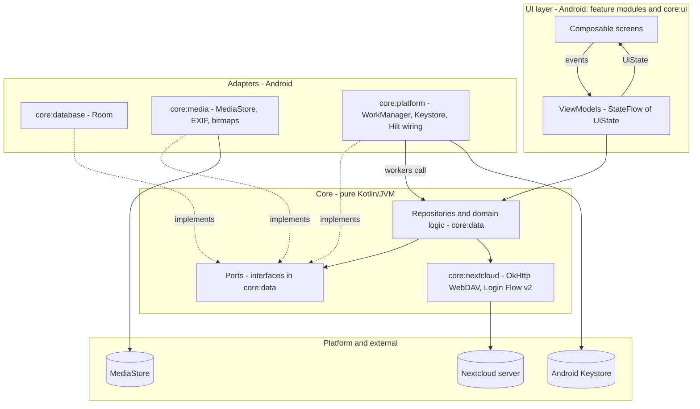

Rules:

- **UI layer**: Compose only renders `UiState` and emits events. No business logic in composables.
- **ViewModel**: maps repository flows into `UiState`, handles events, launches one-shot work in `viewModelScope`. Exposes one-off effects (system confirmation dialogs, snackbars, navigation) through a `Channel`-backed `Flow<UiEffect>`. ViewModels use no `android.*` classes: route arguments arrive through Hilt assisted injection (not `SavedStateHandle.toRoute`, which needs `Bundle`), and system dialogs are passed as an opaque `PlatformConfirmation` (see 3.3). ViewModel tests are plain JVM tests without Robolectric.
- **Repository** (`:core:data`): combines ports and the Nextcloud client, owns caching policy and all decisions. Returns `Flow` for observable data and `suspend` functions returning `AppResult` for commands.
- **Ports** (`:core:data`): interfaces in terms of `:core:model` types (content URIs as `String`, no `Uri`, `Bitmap` or `Cursor`).
- **Adapters**: thin wrappers around one platform technology each; no cross-source logic and no branching beyond mapping. Room entities, cursors and bitmaps never leave their adapter module.
- **Domain models** (`:core:model`) are plain Kotlin classes used across all layers.

## 3. Modules

### 3.1 Build setup

- Gradle Kotlin DSL; dependencies and versions in `gradle/libs.versions.toml`.
- Convention plugins in `build-logic/convention`:
  - `nextgallery.android.application` – `:app` defaults (SDK levels, application ID, Kotlin toolchain 21, R8 config, version from the Git tag, release signing from `keystore.properties`). It also fails the build if a proprietary group such as `com.google.android.gms` or `com.google.firebase` reaches a shipped classpath.
  - `nextgallery.android.benchmark` – `:benchmark`, a `com.android.test` module for Macrobenchmark and the Baseline Profile generator. Its debug variant is off, so `assembleDebug` and `connectedDebugAndroidTest` leave it alone; CI only compiles it.
  - `nextgallery.android.library` – Android library defaults.
  - `nextgallery.android.compose` – enables Compose and adds the Compose BOM.
  - `nextgallery.android.feature` – library + compose + Hilt + the kotlinx-serialization plugin (for the routes) + dependencies every feature needs (`:core:ui`, `:core:data`, `:core:model`, `:core:common`, Navigation Compose, hilt-lifecycle-viewmodel-compose, lifecycle-runtime-compose, lifecycle-viewmodel-compose, kotlinx-serialization-json).
  - `nextgallery.android.hilt` – Hilt + KSP.
  - `nextgallery.android.room` – Room + KSP + schema export directory (`<module>/schemas`).
  - `nextgallery.jvm.library` – pure Kotlin/JVM modules (`:core:model`, `:core:common`, `:core:data`, `:core:nextcloud`): `kotlin("jvm")`, toolchain 21, `javax.inject` for `@Inject` constructors (Hilt bindings for them live in Android modules), JUnit/MockK/Turbine/coroutines-test.
  - `nextgallery.android.test` – shared Android test dependencies (Robolectric 4.17+, androidx.test), the `AndroidJUnitRunner` setup for instrumented tests and JaCoCo unit test coverage. Applied by the application and library plugins.
  - `nextgallery.detekt`, `nextgallery.ktlint` – static analysis (`config/detekt/detekt.yml`, `.editorconfig`), applied by every base plugin.
- Shared conventions:
  - Android namespaces are derived from the project path (`:core:database` → `net.drehtuer.nextgallery.core.database`; `:app` → `net.drehtuer.nextgallery`).
  - `compileSdk` 37 with `compileSdkMinor = 0` (platform `android-37.0`); AGP 9 compiles Kotlin itself (built-in Kotlin), so Android modules do not apply `org.jetbrains.kotlin.android`.
  - Lint runs with `warningsAsErrors`; `config/lint/lint.xml` only disables "newer version available" checks.
  - The feature plugin fails the build if a `:feature:*` module declares a dependency on another `:feature:*` module.
  - Espresso is pinned to 3.7.0 for tests, because the version pulled in by Compose UI test calls an API removed in SDK 37.
- The build environment is a devcontainer (`.devcontainer/`: JDK 21, Android SDK platform `android-37.0`, build-tools 36.0.0); CI builds inside the same image (`devcontainers/ci`).
- **Release build**: R8 full mode with `isMinifyEnabled` and `isShrinkResources`; `app/proguard-rules.pro` holds the app's rules, explained there. Without `keystore.properties` the APK is unsigned. The `androidx.baselineprofile` plugin adds the `nonMinifiedRelease` and `benchmarkRelease` build types to `:app`, which use the debug key; they are for a device only.
- **Licences**: the AboutLibraries Gradle plugin reads the POM files of what ships, writes `R.raw.aboutlibraries` in `:app` and fails the build on a licence outside `Apache-2.0`, `MIT`, `BSD-2-Clause` and `BSD-3-Clause`. `LicenceCatalog` in `:core:data` parses it for the licences screen; the plugin's runtime library is not used.
- **Only visible on a device with the release build** (R8 can break what no build notices), so check each of these once with `benchmarkRelease`, or a signed release:
  - every screen opens, including those with arguments (`ViewerRoute`, `FolderGridRoute`, `EditorRoute`, `RemoteViewerRoute`, `NextcloudAccountRoute`, `SelectionOverviewRoute`), since Navigation finds their serializers by reflection;
  - the index builds and survives a restart (Room `_Impl` classes), and `IndexWorker` and `UploadStateSyncWorker` run (WorkManager and Hilt workers, found by class name);
  - signing in, closing the app and still being signed in (Tink and the Android Keystore, its protobuf found by field name), and logging out;
  - browsing, previews, opening and moving on a server, with a CA certificate and with a self-signed one (OkHttp, the pinning trust manager);
  - the map: tiles load and stay cached, clusters and their sheet, zoom (osmdroid has no rules of its own, and looks up `bonuspack_bubble` and its archive classes by name);
  - place names in the details sheet (the GeoNames asset), the licence list (`R.raw.aboutlibraries`), the launcher icon and About's icon (resource shrinking);
  - editing and saving a copy, and overwriting after the system's confirmation; sharing; the upload hand-off.
- A JVM module cannot depend on an Android library (Gradle cannot resolve an AAR for a `kotlin("jvm")` module), so the Android-free core is enforced by the build itself.

### 3.2 Module dependency graph

Feature modules depend only on core modules, never on each other. `:app` is the only module that knows all features and wires navigation between them. Adapter modules depend on `:core:data` (to implement its ports), not the other way round.

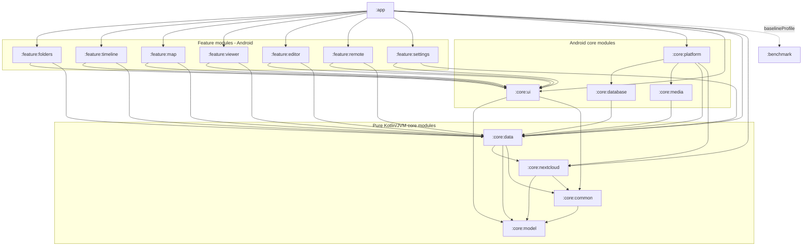

Every module except `:benchmark` also depends on `:core:model` directly, and every feature on `:core:common` too (the feature convention plugin adds both); those edges are left out for readability. `:benchmark` is not a dependency of the app: the `baselineprofile` plugin only takes the generated profile from it.

`:core:ui` additionally depends on Coil and paging-compose (it provides the shared image loading and grid composables); the Coil `ImageLoader` itself is configured in `:app` (see [9.1](#91-thumbnails-and-images)).

### 3.3 Module responsibilities

Package root and application ID: `net.drehtuer.nextgallery` (D26). Class names below are the intended public surface; internals may grow.

#### `:benchmark`

Macrobenchmarks (`GalleryBenchmarks`), the Baseline Profile generator (`BaselineProfileGenerator`) and the journeys they share (`Journeys.kt`). They need a real device with photos and an unlocked screen, so they are not part of the instrumented suite.

#### `:app`

| Class | Responsibility |
| --- | --- |
| `NextGalleryApplication` | `@HiltAndroidApp`; implements `Configuration.Provider` (HiltWorkerFactory) and `SingletonImageLoader.Factory` (Coil). Starts `AddedFolderObserver` and `UploadStateSyncObserver` in a scope not tied to an activity, and clears `RemoteShareCache` (D48). |
| `MainActivity` | Single activity, edge-to-edge, applies the theme mode, accent and grid columns from `MainViewModel` to `NextGalleryTheme` and the system bars, and hosts `NextGalleryAppContent`. An `ACTION_VIEW` intent with an `image/*` content URI (`externalImageUri()`) shows `ExternalImageScreen` instead. `ACTION_SEND` is not received. |
| `MainViewModel` | `MainUiState`: the media access level and the appearance settings. On the first resume it calls `IndexScheduler.onAppStart` and `EditRepository.cleanupPending`, later `onAccessChanged`; it runs `IndexScheduler.observeMediaChanges()` while access is not denied. |
| `NextGalleryAppContent` | The gate before the navigation: a loading indicator until the access is known, `MediaAccessRequest` when it is denied, otherwise the bottom bar, `LimitedAccessBanner` with partial access, and `NextGalleryNavHost`. |
| `NextGalleryNavHost` | Navigation Compose graph; maps each feature's navigation callbacks to routes of other features. The top-level routes (`FoldersRoute`, `MapRoute`, `NextcloudRoute`, `SettingsGraphRoute`) are in `Routes.kt`. |
| `TopLevelDestination` | Enum of bottom-bar destinations (Folders, Timeline, Map, Nextcloud). |
| `ImageLoaderModule` | Hilt module building the Coil `ImageLoader` for local images (memory + disk cache, MediaStore thumbnail fetcher, no network fetcher) and the `@RemoteImageLoader` for server images (own memory and 500 MB disk cache, all requests through the authenticated OkHttp client). `RemoteImageCacheModule` wipes the latter at logout and provides `NextcloudHttpConfig` (`allowCleartext` only in debug builds). |

#### `:core:model` (pure Kotlin)

| Type | Notes |
| --- | --- |
| `MediaItem` | `id: MediaId` (value class around the MediaStore `_ID`), `volumeName`, `contentUri: String`, `bucketId`, `bucketName`, `relativePath`, `displayName`, `mimeType`, `sizeBytes`, `width`, `height`, `orientation`, `dateTakenMillis` (resolved, see 5.1), `dateSource`, `takenLocalDate`, `dateModifiedSeconds`, `generationModified`, `location: GeoPoint?`, `exifScanned`. |
| `Folder` | `bucketId`, `name`, `relativePath`, `itemCount`, `coverItem: MediaItem` (newest image). |
| `AddedFolder` | `volumeName`, `relativePath`: a folder the user added (D55). Covers the folder and its subfolders. |
| `VirtualFolder`, `VirtualFolderSummary` | `id`, `name`, `bucketIds`: shows several real folders together (D55); the summary adds `itemCount` and `coverItem` (newest image of the members, or null). |
| `GeoPoint` | `latitude`, `longitude` (validated ranges); `formatted()` gives "45.62° N, 10.68° E". |
| `GeoBounds` | `south`, `west`, `north`, `east`; `west > east` crosses the antimeridian. `encode()` / `decode()` for route arguments. |
| `MapCamera`, `Viewport` | What the map should show (centre, zoom), and what it shows right now (with bounds). |
| `GeotaggedImage` | `id`, `location`, `dateTakenMillis`: the light form of an image for clustering. |
| `Cluster` | `center`, `items`; derives `count`, `coverId` (newest image) and `bounds` (holds exactly its images, because they come from one grid cell). |
| `Place`, `ClusterTitle`, `MapCluster` | A place from the bundled list; a cluster's name (largest place, number of other places); a cluster as the map shows it (with title and cover). |
| `RemoteItem` | `path` (decoded, relative to the user's files, root `/`), `name`, `isDirectory`, `size`, `mime`, `etag`, `lastModifiedMillis`, `fileId`, `checksums` (raw `oc:checksums`), `permissions` (raw `oc:permissions`), `hasPreview`, `childCount`. |
| `RemotePaths` | Decoded server paths: `normalize`, `parent`, `name`, `join`, `ancestors`, `isValidName`. |
| `RemoteImageUrls` | Preview and original URL of an item. Screens get this instead of the account, so its secret stays out of UI state. |
| `UploadState` | sealed: `Unknown`, `NotUploaded`, `Uploaded(verifiedByChecksum: Boolean)`. |
| `CertificateInfo` | `host`, `subject`, `issuer`, `notBeforeMillis`, `notAfterMillis`, `sha256Fingerprint`, `pinnedFingerprint` (the certificate accepted earlier, if this one differs), `changedFromPinned`. |
| `MediaSource` | The list a viewer pages through: `Folder(bucketId)`, `VirtualFolder(bucketIds)`, `Timeline`, `Map(bounds)`. |
| `ImageDetails` | What the image info sheet shows: file values plus formatted EXIF values. |
| `ShareSpec` | Content URIs and MIME type to share; `:core:ui` turns it into an intent. |
| `TrashEffect` | The next UI step when moving images to the trash: confirmation, message with undo, or failure. |
| `ViewContext` | `Folder(bucketId)`, `VirtualFolder(bucketIds)`, `Timeline`, `Map` – used by the selection overview to decide which selected items the current view can show. |
| `EditOperation` | sealed: `Rotate(quarterTurns)`, `Crop(rect: NormalizedRect)`, `Scale(targetWidth, targetHeight)`, `PenStroke(points: List<NormalizedPoint>, colorArgb, widthFraction)`. Coordinates are normalized (0..1) relative to the image *after* previous operations, so they are resolution independent. |
| `EditHistory`, `CropMath`, `ScaleMath`, `GeometryMapper` | Undo and redo over the operations; the crop frame and its ratios; sizes for the scale tool; normalized coordinates through operations. |
| `PreviewImage` | Opaque wrapper (`handle: Any`, width, height) around a rendered image. `:core:media` puts a `Bitmap` inside, `:core:ui` draws it. |
| `AspectRatio` | `FREE`, `ORIGINAL`, `SQUARE`, `R4_3`, `R16_9`. |
| `NextcloudAccount` | `serverUrl`, `loginName`, `userId`, `appPassword`. `toString` hides the password, so it can't reach a log. |
| `DayCount` | `date`, `count`: the number of images of a local date, from which `TimelineIndex` builds the timeline's layout. |
| `MediaAccess` | `FULL`, `PARTIAL`, `DENIED`. |
| `PlatformConfirmation` | Opaque wrapper (`handle: Any`) around a system confirmation request. The `:core:media` adapter puts an `IntentSender` inside; `:core:ui` launches it. Core and ViewModels only pass it through, and tests use any placeholder object. |
| `UserSettings`, `ThemeMode` | User preferences: `addedFolders`, `virtualFolders`, `gridColumns`, `themeMode`, `accentColor`, `remoteRoot`, `tileUrl`, `currentLocationAsked`, with their defaults. |

#### `:core:common` (pure Kotlin)

- `AppResult<T>` – `Success(value)` / `Failure(error: AppError)`; `AppError` sealed; implemented so far: `Io(message)`, `PermissionDenied`, `NotFound`, `InsufficientMemory(requiredBytes, availableBytes)`, `OriginalDamaged(recoveredAsCopy)`, `Unknown(cause)`, with `AppError.from(throwable)`, and for Nextcloud `Network`, `Auth`, `NotLoggedIn`, `Forbidden`, `Conflict`, `Server(code)`, `UntrustedCertificate(info: CertificateInfo)`, `LocalNetworkBlocked`, `InvalidServerUrl`, `ServerMismatch`, `LoginExpired`, `InvalidName`.
- `DispatcherProvider` interface (`io`, `default`) + `DefaultDispatcherProvider`; the Hilt binding lives in `:core:platform`. ViewModels use `viewModelScope`, so no main dispatcher is injected.
- `Clock` (`nowMillis()`, `zone()`) + `SystemClock`.
- Utilities: `RelativePaths` (`normalize`, case-insensitive `isUnder`), `runCatchingCancellable` (never swallows `CancellationException`), `ScrollbarMath` (fast scrollbar position ↔ first visible item; here rather than in `:core:data` because `:core:ui` uses it).

#### `:core:data` (pure Kotlin/JVM)

The heart of the app. Depends on `:core:model`, `:core:common`, `:core:nextcloud`, `paging-common`, `datastore-preferences-core` and `kotlinx-serialization-json` (all JVM artifacts). No Android dependency.

Ports (implemented by adapters):

| Port | Implemented in | Purpose |
| --- | --- | --- |
| `MediaScanSource` | `:core:media` | Per volume: `volumes()`, `mediaStoreVersion(volume)`, `currentGeneration(volume)`, `fullScan(volume, folders)`, `changesSince(volume, generation, folders)`, `allIds(volume, folders)`; `folders` are the added folders' relative paths on that volume, never empty. |
| `MediaChangeSource` | `:core:media` | `Flow<Unit>` of MediaStore change notifications. |
| `ExifSource` | `:core:media` | Raw EXIF values (date strings, offset, GPS, camera fields) for a content URI. |
| `MediaContentSource` | `:core:platform` | `open(contentUri)`: the original bytes (`setRequireOriginal`) for checksums. |
| `MediaWriteSink` | `:core:media` | Existing names in a folder, insert pending copy, write, publish, discard, overwrite request as `PlatformConfirmation`, temporary backup, cleanup after a crash. |
| `MediaDeleteSource` | `:core:media` | Trash, restore and permanent delete requests as `PlatformConfirmation`. |
| `ImageRenderer` | `:core:media` | Upright size of a file, decode at a sample size, apply a `RenderPlan` (matrix and strokes computed by `EditGeometry`), encode to a temporary file, release. |
| `ExifWriter` | `:core:media` | Reads tags of a source image, writes tags to an encoded image. |
| `MediaPermissionSource` | `:core:media` | Currently granted media and location permissions as strings. |
| `GeoIndexStore` | `:core:database` | The locations in the index: `observeGeotagged()`, `unscanned(limit)`, `saveLocations(locations)`, `pagedInBounds(bounds, config)`, `indexInBounds(bounds, id)`. |
| `PlaceSource` | `:core:platform` | The bundled GeoNames list (D45); empty if the app ships without it. |
| `LocationProvider` | `:core:platform` | The device's position from the platform `LocationManager` (D44). |
| `MediaIndexStore` | `:core:database` | Index reads/writes, folder list; `pagedByBuckets(bucketIds, config)` for a folder or a virtual folder, returned as `Flow<PagingData<MediaItem>>` (the repository decides the `PagingConfig`; the Room adapter builds the `Pager` and maps entities). |
| `TimelineStore` | `:core:database` | All images by local date: `paged(config)`, `ids()`, `indexOf(id)`, `observeDayCounts()`. |
| `UploadStateStore`, `RemoteCacheStore`, `SyncStateStore` | `:core:database` | Room tables behind model-typed interfaces. |
| `ConnectivitySource` | `:core:platform` | `isOnline` flow from `ConnectivityManager`. |
| `LocalNetworkPermissionSource` | `:core:platform` | Whether `ACCESS_LOCAL_NETWORK` is granted (D39). |
| `RemoteShareCache` | `:core:platform` | The temporary folder and content URIs for sharing server images (D48). |
| `RemoteImageCache` | `:app` | Wipes the Coil caches of server images at logout. |
| `WorkScheduler` | `:core:platform` | `enqueueIndex(mode)`, `scheduleUploadStateSync()`, `requestUploadStateSync()`. |
| `NextcloudAppSource` | `:core:platform` | `isInstalled()` for `com.nextcloud.client`. |
| `SecretCipher` | `:core:platform` | `encrypt(bytes)` / `decrypt(bytes)` backed by Tink + Android Keystore. |
| `MemoryInfoSource` | `:core:platform` | `availableBytes()` from `ActivityManager.MemoryInfo`, minus a safety margin and at most half of the RAM. |
| `TrustedCertificateStore` | `:core:data` (`DataStoreTrustedCertificateStore`, on the JVM DataStore; `:core:platform` gives the file) | The pinned certificates: `observe()`, `put(info)`, `remove(host)`. |

Repositories (interfaces + `Default…` implementations with `@Inject` constructors):

| Repository | Responsibility |
| --- | --- |
| `MediaRepository` | Paged lists per `MediaSource` (grid and viewer), position of an image in a list, item lookup, image details (EXIF on demand, with the place name). |
| `TimelineRepository` | `observeIndex()`: the timeline's `TimelineIndex` from the day counts, only rebuilt when they change. |
| `MapRepository` | `observeClusters(viewport)` (debounced, computed on `Default`, with titles and covers), `observeHasGeotagged()`, `startCamera(location)` (D44). |
| `FolderRepository` | Folder list with counts/covers from the index; `observeVirtualFolders()` combines the stored virtual folders with the index into a live count and cover. |
| `IndexRepository` | Full scan, incremental sync, deletion detection (`MediaIndexer`); publishes `IndexStatus` flow. |
| `MediaActionsRepository` | Delete/trash and restore requests, removes rows and deselects after a confirmed result, `ShareSpec` for images. `TrashFlow` (one instance per ViewModel) holds the steps of request, confirmation and undo. |
| `EditRepository` | Edit pipeline: opening, preview, memory checks, and saving through `EditedImageWriter` (`EditGeometry` → `ImageRenderer` → `MediaWriteSink`, EXIF policy), then the index; cleanup after a crash. |
| `NextcloudAccountRepository` | Account state, `login(serverUrl, foreground: Flow<Boolean>): Flow<LoginState>` (`Started` → `Polling` → `Success`/`Failed`), `resumeLogin(pending, foreground)` after the app was killed, `logout()` (wipe first, then revoke in the background; D35), `RemoteImageUrls` of the account. |
| `RemoteBrowseRepository` | `list(path): Flow<RemoteListing>`: the cached listing first, then the server's (`remote_cache`); folders and supported images only. |
| `AccountSession` | Singleton. Account changes (`replaceAccount`, `logOut`, not cancellable) and writes of an account's data (`writeFor`) exclude each other. A new login wipes the remote data unless the readable previous account is the same user on the same server. `AppPasswordRevoker` ends unused app passwords in its own scope, which outlives the screens. |
| `RemoteFileOperations` | Moving with a `ConflictPolicy` (`ASK`, `KEEP_BOTH`, `REPLACE`, `SKIP`; never overwrites a folder), `undoMove`, `delete`/`undoDelete` through the trash bin, `isTrashBinEnabled` (from the OCS capabilities, kept per account for the session; unknown is false, D56), `listFolder`, `createFolder`, `canWrite`, `nextFreeName` (D46). `RemoteMoveFlow` (one instance per ViewModel) holds the steps of a move: conflicts, "do the same for the others" (a "replace" never silently hits an image this move brought there: that asks again), undo (last moved first). |
| `RemoteShareRepository` | `prepare(items)`: downloads to the temporary folder with progress and returns a `ShareSpec`; removes old files first (D48). |
| `RemoteDownloads` | Progress of the original image being downloaded, for the viewer. |
| `UploadStateRepository` | `refreshAll()`: folder mapping, PROPFIND comparison, checksum confirmation, `upload_state` cache. `observeBadges(visibleIds)`: the badges of the images on screen; empty while logged out. |
| `UploadHandoffRepository` | `prepare(ids)`: filters out items already uploaded, returns an `UploadHandoff` (`Ready` with a `ShareSpec` targeted at `com.nextcloud.client`, `NothingToUpload`, `NextcloudAppMissing`). `observeAvailability()`: how the Upload action is shown (`HIDDEN` while logged out, `APP_MISSING`, `AVAILABLE`). `onAppResumed()`: looks for the Nextcloud app again and, after a hand-off, requests an upload-state refresh. One instance for all screens. |
| `SelectionRepository` | App-wide selection (`StateFlow<Set<MediaId>>`): toggle, range, select all, clear, and `observeOverview(context: ViewContext)` marking which selected items the given view can show. In-memory singleton. |
| `TrustedCertificateRepository` | Pinned certificates per host (`TrustedCertificateStore`, DataStore): accept, remove, list. |
| `FolderSettingsRepository` | Adds and removes added folders, and creates, updates and deletes virtual folders (D55), on the same `SettingsDataSource`. |
| `SettingsRepository` | `observeSettings()` and one setter per setting, on top of `SettingsDataSource` (Preferences DataStore, JVM artifact), which maps `UserSettings` to preference keys; `:core:platform` provides the file location. To add a setting: a field in `UserSettings`, a key in `SettingsDataSource` and a setter here. |
| `AccountStore` | Account + app password in DataStore, encrypted as one blob through `SecretCipher`. Data that can't be decrypted reads as logged out. |

Pure logic (each class unit-tested on the JVM):

- `IndexScheduler` – decides full vs incremental, debounces `MediaChangeSource`, calls `WorkScheduler`.
- `MediaIndexer` – full/incremental sync algorithm, batching, deletion detection.
- `LocationBackfill` – the second indexing pass (see 5.1). `GpsParser` – raw GPS tags → `GeoPoint`.
- `MapPermissions` – granted permissions → may the app read photo locations, and the device's position.
- `DateResolver`, `ExifDateParser` – `DATE_TAKEN` → EXIF `DateTimeOriginal` (+ offset) → `DATE_MODIFIED`.
- `AddedFolderMatcher` – is an image indexed? Its volume has to match, its path has to be an added folder or below one, and no folder below the added one may start with a dot (D55). Also gives the added folders per volume for the queries. (`.nomedia` folders are already hidden by MediaStore, so there is no own `.nomedia` handling.)
- `TreeDocumentIds` – the folder picker's document id to an `AddedFolder`: `primary:DCIM/Camera` → `external_primary`, `DCIM/Camera`; `1234-ABCD:DCIM` → `1234-abcd`, `DCIM`; null for a root or anything else. The `Uri` itself stays in `:feature:settings`.
- `AddedFolderObserver` – added folders changed → one debounced full scan, because a new folder has images an incremental sync would not look at.
- `MediaAccessRepository` – granted permissions → `MediaAccess`, and the permissions to request.
- `RemoteTargetResolver` – local image → `<remoteRoot>/<relative path>/<displayName>`.
- `UploadStateMatcher`, `ChecksumCalculator` (streams SHA-1 / MD5 of an `InputStream`), `ChecksumParser`, `LocalChecksums` (a checksum of a local image; null if it can't be read).
- `UploadStateSyncObserver` – schedules the periodic check at app start, and asks for one after a login or a new remote root.
- `TimelineIndex` – the timeline's rows from the day counts: which row is a month header, a day header or an image, the month of a row, and the rail's dates. Binary searches; loads no image. `TimelineRepository.observeIndex()` provides it.
- `SelectionRepresentability` – can a view context show an item (Map: has GPS; Folder: same bucket; VirtualFolder: bucket is a member; Timeline: always, since every item has a resolved date).
- `EditGeometry` (operations → `RenderPlan`), `MemoryBudget` (fits / refuse with required vs available bytes), `ExifPolicy` (tags of an edited image), `CopyNamer` (file name of a copy), `ImageFormat` (JPEG, PNG).
- `GridClusterer` – images → clusters: square cells of a grid fixed to the world (Web Mercator), so a cluster only changes with the zoom, not when the map pans. Keeps the clusters whose centre is in the viewport.
- `PlaceNamer`, `PlaceIndex`, `PlaceFileParser` – offline reverse lookup (D45): the nearest place within 30 km, from a grid of one-degree cells; a merged cluster is named after its largest place. The list is read once, on first use.
- `TileUrls` – what a tile server address must look like (`https://`, `{z}`, `{x}`, `{y}`).
- `RemoteCallRunner` – every remote call goes through it: without an account it returns `NotLoggedIn` and sends nothing (D35); it maps exceptions to `AppError`.
- `LocalNetworkPolicy` – a network failure on a local address without `ACCESS_LOCAL_NETWORK` becomes `LocalNetworkBlocked` (D39).

#### `:core:nextcloud` (pure Kotlin/JVM)

| Class | Responsibility |
| --- | --- |
| `NextcloudHttpModule` | The OkHttp clients: `base` (no credentials, for the login flow), `authenticated` (reads), `noRedirects` (changes on the server, never repeated elsewhere), `unauthenticatedNoRedirects` (for requests carrying credentials not yet stored). TLS only, unless `allowCleartext` (debug builds); no https → http redirects; user agent `NextGalleryApp/<version>`. `evictConnections()` also drops resumable TLS sessions, so a removed pin takes effect. |
| `AuthInterceptor` | Network interceptor: adds Basic auth and `OCS-APIRequest` through a `CredentialsProvider`, only for the account's scheme, host and port. It runs for each redirect, so credentials can't follow one to another host. |
| `LoginFlowV2Client` | `start(serverUrl)` → `LoginFlowSession(loginUrl, pollEndpoint, token)`; `check(pollEndpoint, token)` asks once and returns a `LoginFlowResult` or null while the login is pending. The 2 s loop and the 20 min timeout are in `DefaultNextcloudAccountRepository`. URLs from the server are only accepted as https. Token and password are hidden in `toString`. |
| `OcsClient` | The user id (`ocs/v2.php/cloud/user`), revoking the app password (`ocs/v2.php/core/apppassword`), and whether the trash bin is on (`ocs/v2.php/cloud/capabilities`, `files.undelete`; D56). Answers are read up to 1 MiB; a malformed answer is an `IOException`. |
| `WebDavClient` | `list(path)`, `stat(path)`, `download(path, sink)`; `move` (`Overwrite: F` unless asked otherwise), `createFolder`, `delete`, `listTrash` and `restore` for reorganising server images (D46). Uploading is done by the Nextcloud app (D31). Paths are under `remote.php/dav/files/<userId>/`; the trash bin is under `remote.php/dav/trashbin/<userId>/`. |
| `PropfindRequestBuilder` | The PROPFIND bodies: `d:getcontentlength`, `d:getcontenttype`, `d:getetag`, `d:getlastmodified`, `d:resourcetype`, `oc:fileid`, `oc:checksums`, `oc:permissions`, `nc:has-preview`, `nc:contained-file-count`; for the trash bin the `nc:trashbin-*` properties. |
| `MultistatusParser` | Multistatus parser on the XmlPullParser API (`compileOnly`; provided by Android at runtime, kxml2 on the JVM test classpath). Only propstats with status 200 count. Hrefs outside the root and impossible names (dot segments, encoded slashes) are dropped. |
| `RemotePathMapper` | Builds the DAV, preview and trash-bin URLs with segment encoding; refuses dot segments. |
| `ServerUrlNormalizer` | Adds `https://`, strips trailing `/` and `/index.php`, query and fragment; rejects other schemes, `http` unless `allowCleartext`, and addresses with credentials. |
| `PinningTrustManager` | `X509ExtendedTrustManager` that first delegates to the platform trust manager (system + user CAs) and otherwise accepts only the certificate pinned for exactly that host; anything else fails with `UntrustedCertificateException`. Without a known host, pins don't apply. |
| `PinningHostnameVerifier` | The normal check, except that a certificate pinned for this host may have another name (D32). Any other mismatch fails with an `UntrustedCertificateException` as cause, so the user gets the same dialog. |
| `CertificateInfoMapper` | `X509Certificate` → `CertificateInfo` (subject, issuer, validity, SHA-256 as `AB:CD:…`). |
| `DownloadProgressTracker` | Network interceptor reporting the progress of original downloads per URL. |
| `NextcloudErrorMapper` | Maps HTTP codes / IO exceptions to `AppError`. Looks for `UntrustedCertificateException` in causes and suppressed exceptions, because with several server addresses OkHttp throws the first address's failure and adds the others as suppressed. |

#### `:core:database` (Android adapter)

- `NextGalleryDatabase` (Room, file `nextgallery.db`, `exportSchema = true`, explicit `Migration`s from v1 on; schemas checked in).
- Entities: `MediaEntity`, `UploadStateEntity`, `RemoteCacheEntity`, `SyncStateEntity`. Schema version 2 added `remote_cache` (`MIGRATION_1_2`), version 3 `upload_state` (`MIGRATION_2_3`).
- DAOs:
  - `MediaDao` – `upsertAll` (`@Upsert`), `deleteByIds`, `idsForVolume`, `getById`, `getByIds`, `pagingByBuckets(bucketIds): PagingSource<Int, MediaEntity>`, `idsInBuckets(bucketIds)` (select all), `indexInBuckets(bucketIds, id)` (the viewer's start page).
  - `TimelineDao` – `paging()`, `ids()`, `indexOf(id)`, `observeDayCounts()`: all images by local date, behind the `TimelineStore` port.
  - `GeoDao` – the location side of the `media` table: `observeGeotagged()`, `unscanned(limit)`, `setLocations(rows)`, `pagingInBounds(...)`, `indexInBounds(...)`.
  - `FolderDao` – `observeFolders()`: `FolderRow` (the folder's newest image plus the image count), sorted by name.
  - `UploadStateDao` – `observeStatusFor(ids)` and `statusFor(ids)` (rows still valid for the image's size and date), `upsertExisting(rows)` (leaves out images no longer indexed), `localFolders()`, `mediaInFolder(path)`, `rowsInFolder(path)`, `clear()`.
  - `RemoteCacheDao` – `replaceFolder(parentPath, items)`, `getFolder(parentPath)`, `clear()`.
  - `SyncStateDao` – last generation per volume.
- `Room…Store` classes implementing the `:core:data` store ports, with entity ↔ model mappers; Hilt module binding them.

#### `:core:media` (Android adapter)

| Class | Implements | Responsibility |
| --- | --- | --- |
| `MediaStoreScanner` | `MediaScanSource` | Queries `MediaStore.Images.Media` per external volume in batches of 500, using `GENERATION_MODIFIED` for incremental scans. `MediaStoreQuery` limits every query to the added folders (`RELATIVE_PATH LIKE ? ESCAPE`, with `%`, `_` and the escape character escaped). |
| `MediaStoreChangeObserver` | `MediaChangeSource` | `ContentObserver` on `MediaStore.Images.Media.EXTERNAL_CONTENT_URI` as `callbackFlow`. |
| `AndroidExifSource` | `ExifSource` | `androidx.exifinterface` on content URI streams, with `MediaStore.setRequireOriginal(uri)` when `ACCESS_MEDIA_LOCATION` is granted (D16); returns raw tag values, parsing happens in `ExifDateParser` and `GpsParser`. |
| `MediaStoreWriter` | `MediaWriteSink` | Inserts a pending copy (`IS_PENDING`), writes, publishes, builds the `createWriteRequest`, deletes own pending entries and temporary files after a crash. |
| `AndroidExifWriter` | `ExifWriter` | `androidx.exifinterface`; reads through `setRequireOriginal` when `ACCESS_MEDIA_LOCATION` is granted, so that a copy keeps the location. |
| `MediaStoreDeleter` | `MediaDeleteSource` | `createTrashRequest` / `createDeleteRequest` wrapped in `PlatformConfirmation`. |
| `BitmapImageRenderer` | `ImageRenderer` | `ImageDecoder` decode (upright, software), applies a `RenderPlan` with `Matrix`/`Canvas`/`Path`, keeps colour space and bit depth, encodes JPEG/PNG. |
| `AndroidMediaPermissionSource` | `MediaPermissionSource` | `checkSelfPermission` for the media and location permissions. |

#### `:core:platform` (Android adapter and wiring)

- Workers (`@HiltWorker`, thin): `IndexWorker` → `IndexRepository.sync()`, `UploadStateSyncWorker` → `UploadStateRepository.refreshAll()`. Each maps `AppResult` to `Result.success/retry/failure`.
- `WorkManagerScheduler` implements `WorkScheduler` (unique work names, constraints, backoff).
- `ContentResolverContentSource` implements `MediaContentSource`; `PackageManagerNextcloudAppSource` implements `NextcloudAppSource`.
- `KeystoreSecretCipher` implements `SecretCipher` (Tink AEAD, keyset wrapped by an Android Keystore master key).
- `ActivityManagerMemoryInfo` implements `MemoryInfoSource`.
- `AssetPlaceSource` implements `PlaceSource`: reads `assets/geonames/cities15000.tsv` (name, country code, latitude, longitude, population; CC BY 4.0). `tools/build-places-asset.sh` rebuilds it from the GeoNames dump; the app build downloads nothing.
- `AndroidLocationProvider` implements `LocationProvider`: last known position, else one fresh fix with a 5 s limit.
- `AndroidConnectivitySource`, `AndroidLocalNetworkPermissionSource`, and `FileProviderShareCache` with its own `FileProvider`, limited to `cache/remote_share/` (D48). `PackageManagerNextcloudAppSource` relies on a manifest `<queries>` entry for `com.nextcloud.client`.
- Hilt modules (`*Module.kt`): `PlatformModule` (dispatchers, clock, WorkManager, `WorkScheduler`, memory, places, location, the settings file), `RepositoryModule` (binds the local `:core:data` repositories to their `Default…` implementations), `NextcloudModule` (the HTTP clients, Tink cipher, account and certificate stores, connectivity, share cache) and `NextcloudRepositoryModule`, `SettingsModule` (settings and folder settings) and `UploadModule` (upload state, hand-off, content source, Nextcloud app). `:core:database` and `:core:media` bind their own adapters (`DatabaseModule`, `MediaModule`).

#### `:core:ui`

- `NextGalleryTheme` (Material 3, light/dark; spacing and sizes through `NextGalleryTheme.dimensions`). Colours, typography, shapes and dimensions come from [DESIGN.md](DESIGN.md) (D22). `NextGalleryViewerTheme` is the always-black variant for the viewer and the editor. Takes the theme mode, the accent colour (D34) and the grid columns (D51) from `UserSettings`, through `MainViewModel`; features read the column count from `NextGalleryTheme.dimensions`.
- `MediaGrid` – `LazyVerticalGrid` with a fixed column count (D51), driven by `LazyPagingItems<MediaItem>`, with selection and stable keys; `MediaGridPlaceholder` shows flat cells while the first page loads. The timeline has its own grid, because its rows include headers.
- `FastScrollbar` – draggable thumb; drag fraction ↔ index math lives in `ScrollbarMath` (`:core:common`); shows an optional bubble label. The timeline uses its own `DateRail` (D43) with the same math.
- `SelectionTopBar` – total selection count (across all views), clear, and an actions slot for select all, share, delete, upload (hand-off) and the selection overview.
- `UploadAction` (hidden while logged out, dimmed without the Nextcloud app, D31, D35), `rememberUploadHandoffHandler` (opens the Nextcloud app or shows why not; reports when the screen resumes), `UploadBadge` (for the badge slot of `ThumbnailCell`), `VisibleMediaIdsEffect` (reports the images on screen, debounced).
- `CertificateWarningDialog` – shows `CertificateInfo` with a warning; Accept / Cancel.
- `ThumbnailCell` – square cell with Coil `AsyncImage`, paging placeholder, failed, selected, selecting (empty ring) and greyed-out states, badge slot. `MediaThumbnail` is its Coil model, with `MediaThumbnailKeyer` and `MediaThumbnailFetcher`.
- `MediaAccessRequest` (asks for media access, or opens the app's system settings) and `LimitedAccessBanner` (partial access, "select more"); `NextGalleryAppContent` in `:app` decides which to show.
- `PreviewImageView` – draws a `PreviewImage`; `clearImageMemoryCache()` – after an overwrite, because the image keeps its URI.
- `rememberConfirmationLauncher()` – launches a `PlatformConfirmation` (unwraps the `IntentSender`) and reports the result.
- `ErrorState`, `EmptyState`, `LoadingIndicator` composables; `AppError.remoteMessage()` gives the string resource for a Nextcloud error.

#### Feature modules

Each feature contains: `XxxRoute` (serializable route object/class), `XxxScreen` (stateless composable), `XxxViewModel` (assisted-injected with its route or the route's values when the route has arguments, plain `@Inject` for an object route), `XxxUiState`, `XxxEvent`, and `NavGraphBuilder.xxxScreen(onNavigate…)` extension consumed by `:app`.

| Module | Screens | Notes |
| --- | --- | --- |
| `:feature:folders` | Folder list, folder grid, selection overview | Default start destination. The grid shows a real or a virtual folder (`FolderGridRoute`), and passes a virtual folder's members on to the viewer and the overview. The selection overview (D33) lists all selected images and greys out those the calling view (`ViewContext`) cannot show; other features open it through `:app` navigation. |
| `:feature:timeline` | Timeline grid | Sticky month headers, scrolling day headers ("Today · Friday 6 November"), `DateRail` (D43), selection as in the folder grid; opens the viewer and the selection overview through `:app`. |
| `:feature:map` | Map, cluster sheet | `MapRenderer` interface + `OsmdroidMapRenderer` (AndroidView), so that the map library can be replaced (D23). `MapRendererBinding` connects any renderer to the state; `OsmdroidSetup` (user agent, cache, zoom range, repetition) and the marker drawing are separate, so they can be tested without a map. Clusters come from `MapRepository`; tapping a cluster opens a sheet with a grid of its items, and tapping an image opens the viewer with `MediaSource.Map(cluster.bounds)`. Selecting works as elsewhere (D33). |
| `:feature:viewer` | Full-screen pager, info sheet, external image | `HorizontalPager` + Telephoto `ZoomableAsyncImage`, for local images only; server images have their own `RemoteViewerScreen` in `:feature:remote`. `ExternalImageScreen` shows an image another app opened (5.3). |
| `:feature:editor` | Editor | Tools, crop overlay, pen canvas, scale dialog, save menu; `EditHistory` from `:core:model`, in the ViewModel. |
| `:feature:remote` | Nextcloud tab: login hint, remote browser (selection, context menu, move sheet, conflict dialog, sharing), remote viewer | Grid with preview API thumbnails through `@RemoteImageLoader`; the viewer shows the preview, then the original through Telephoto. The login form itself is in `:feature:settings`. |
| `:feature:settings` | Settings root, folders (added folders through the system picker, virtual folders), appearance (theme, grid columns, accent colour), map tile server (D23), About & licences, Nextcloud account (sign in, log out, remote root), accepted certificates | The screens open from the Folders top bar in a navigation graph of their own, without the bottom navigation. The Nextcloud row opens `NextcloudAccountRoute`, which the Nextcloud tab also opens to sign in. The version comes from `:app`'s `BuildConfig` through `AboutInfo`. |

## 4. Data model

### 4.1 Room schema

`media` is a mirror of the images in the folders the user added (D55), enriched with resolved date and GPS. Folders are derived from `media` (an aggregated query in `FolderDao`, no table or view), so no separate write path can get out of sync.

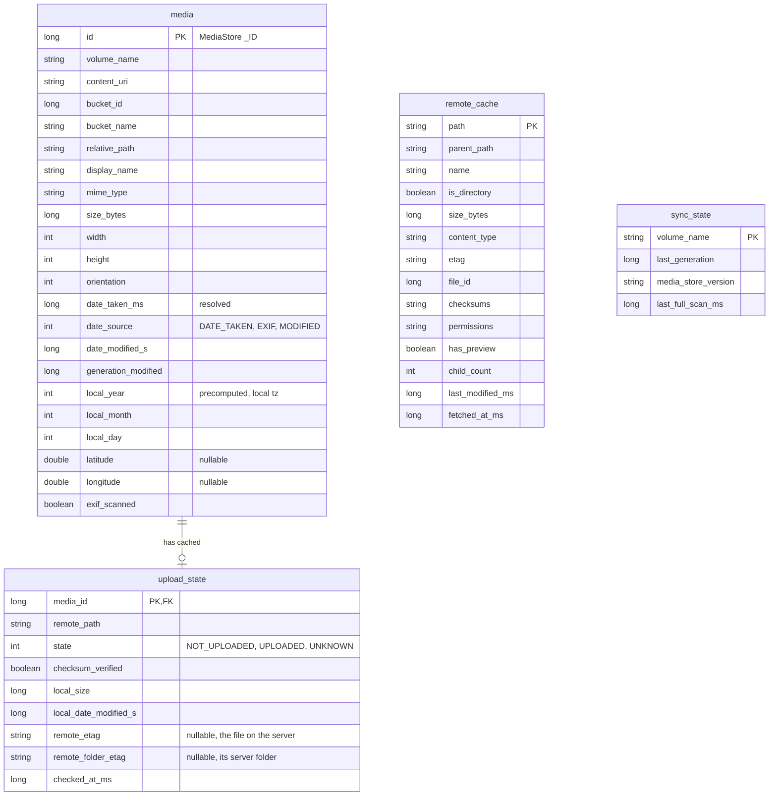

Notes:

- **Indexes**: `media(bucket_id, date_taken_ms)`, `media(date_taken_ms)`, `media(local_year, local_month, local_day)`, `media(volume_name)`, `remote_cache(parent_path)`. There is no index on the location columns.
- `upload_state.media_id` has an `ON DELETE CASCADE` foreign key to `media`, so a row goes away with its image; `media` is written with upserts, which keep the rows.
- `local_year/month/day` are computed at index time in the device time zone. They are not recomputed when the time zone changes; only rows written again by a later scan get the new zone.
- `sync_state.media_store_version` stores `MediaStore.getVersion(volume)`; if it changes, generation numbers are invalid and a full scan runs.
- `remote_cache` is keyed by full remote path; `checksums` is the raw `oc:checksums` string (e.g. `SHA1:… MD5:…`).
- Grids query `media` only. An image outside the added folders is never inserted, and a change to the added folders runs a full scan that deletes and inserts the affected rows (index-time filtering). A virtual folder is only a query over its members' `bucket_id IN (...)`, with the same sort as a folder, so it needs no schema change. There is no query-time filtering: until that scan has finished, views show the previous state.

### 4.2 DataStore

| Store | Content |
| --- | --- |
| `settings.preferences_pb` | Added folders and virtual folders (string sets with one entry per folder; default none; an unreadable entry is skipped; the old `folder_rules` and `exclude_patterns` values are ignored), grid columns, theme mode, accent colour, tile server address, whether the location prompt was shown, the remote root; later phases add the save-copy-vs-overwrite default and pen colour/width. A corrupt file is replaced by the defaults. |
| `trusted_certs.preferences_pb` | Pinned certificates: host → SHA-256 fingerprint and the details shown when it was accepted. |
| `credentials.preferences_pb` | One Tink-encrypted, Base64-encoded blob: server URL, login name, user id, app password. |

## 5. Key flows

### 5.1 Initial indexing and incremental sync

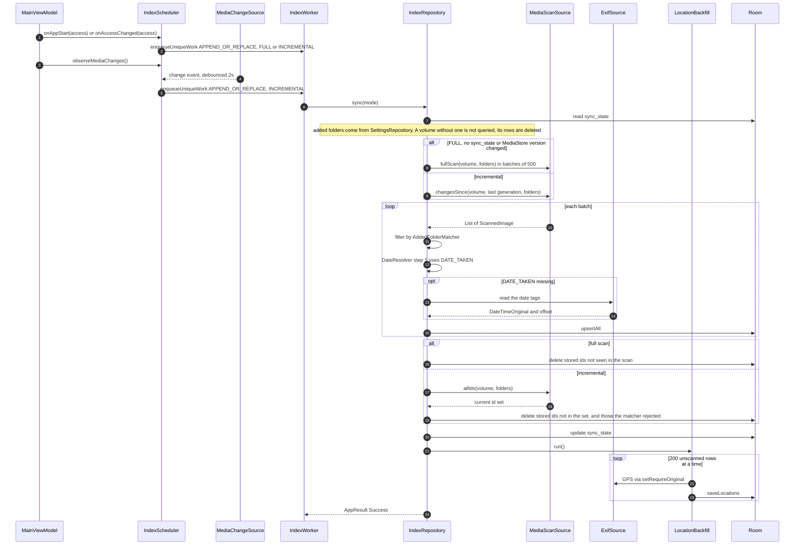

Details:

- Deletions are not reported by generation queries, so each sync compares ID sets. A full scan deletes the stored ids it did not see. An incremental sync asks `allIds()` (a projection-only cursor; fast even at 50k rows) and deletes the stored ids not in it, plus those the matcher rejected in a batch. Both only cover the added folders, so this also removes images moved out of them and the images of a removed folder; an image moved into a dot folder below an added folder is removed because the matcher rejects it. Rows are removed in chunks of 900 (SQLite variable limit).
- EXIF reading is the expensive part. The scan reads EXIF only for an image without `DATE_TAKEN`, and then only the date. GPS is read only for JPEG/HEIF/WebP, in a **second pass** (`LocationBackfill`, on `exif_scanned = false` rows, 200 at a time) at the end of every sync, after the grid-relevant data is committed, so folders appear quickly on first launch. An interrupted pass continues at the next sync. A later scan keeps the stored location unless the file's size or modification date changed. Date fallback order: `DATE_TAKEN` → EXIF `DateTimeOriginal` (with `OffsetTimeOriginal` when present) → `DATE_MODIFIED`.
- Without `ACCESS_MEDIA_LOCATION` Android hides the GPS tags, so the second pass does nothing and the rows stay unscanned, and the map shows a card asking for the permission. When it is granted, `IndexScheduler.onPhotoLocationsAllowed()` queues a sync, which runs the pass.
- With partial access, the scan only sees user-selected images. The selection cannot be read from the permission state, so the index is rebuilt (full scan) whenever the permission dialog or photo selection closes (`MainEvent.AccessRequestFinished`) and whenever the access level changes.
- `.nomedia`: MediaStore already excludes folders that contain a `.nomedia` file from the image collection, so the indexer does not check for it, and adding such a folder shows no images (D53) (confirmed on the Pixel 10a by the instrumented `MediaStoreScannerTest`). MediaStore applies it when it scans, so the image disappears after the next scan of that folder, not at the moment the `.nomedia` file is created.
- Added folders: `AddedFolderObserver` runs from `NextGalleryApplication`, so a change still reaches the index when the user leaves the app right after it. Only killing the process within the 2 s debounce loses the rescan: a newly added folder then stays empty until the next full scan, for example after removing and adding it again.
- Every `FULL` index request is expedited (falling back to normal work when out of quota), so folders appear quickly; incremental syncs run as normal work. `IndexWorker` does not report progress (`setProgress`); `IndexRepository.status` only says whether a sync is running or failed.

### 5.2 Opening a folder grid with paging

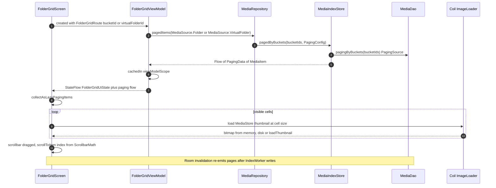

- Page size 120 (multiple of common column counts), prefetch distance 2 pages, `enablePlaceholders = true` so the total count is known and the fast scroll thumb maps 1:1 to positions, and a jump threshold of 3 pages, so a scrollbar jump loads the target page directly instead of every page in between.
- Upload badges: the screen reports the images on screen (`VisibleMediaIdsEffect`, debounced, so a fast scroll causes no query); the ViewModel passes them to `UploadStateRepository.observeBadges(visibleIds)`, and each cell looks up its entry in the resulting map. There is no SQL join, so the paging query stays simple and cheap, and the screen does not wait for the badges. A cell without an entry shows no badge: that is a cell that just scrolled in, or any cell while logged out (D35).

### 5.3 Full-screen viewer

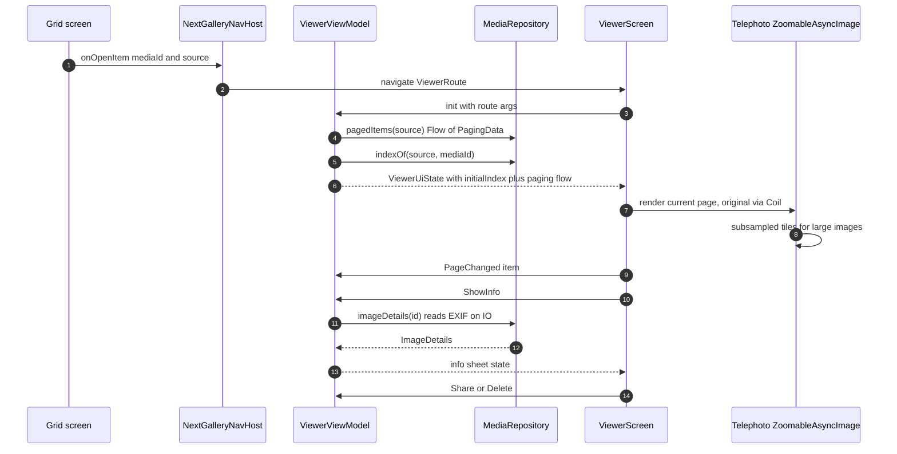

- The viewer pages through the same paged list as the grid (`MediaSource`), so the pager knows its size from the placeholders, items are loaded per page, and deleted images disappear through Room invalidation. If an image disappears, the next one takes its place; if none are left, the viewer closes. `ViewerRoute(mediaId, bucketId, mapBounds, bucketIds)` picks the source: `mapBounds` set → `MediaSource.Map`, else `bucketIds` set → `VirtualFolder`, else `bucketId` set → `Folder`, else `Timeline`. Server images use `RemoteViewerRoute(path)` in `:feature:remote`.
- The adjacent pages are composed ahead (`beyondViewportPageCount = 1`), so Coil loads them before they are swiped to; full-resolution tiles only for the visible page.
- The viewer always uses `NextGalleryViewerTheme`, hides the bottom bar, and hides the system bars together with its controls.
- Another app can open an image (`ACTION_VIEW` with an `image/*` content URI). `ExternalImageScreen` then shows just that image with zooming: it need not be in the index, and no media permission is needed.
- Share uses `Intent.ACTION_SEND`/`ACTION_SEND_MULTIPLE` with MediaStore content URIs and `FLAG_GRANT_READ_URI_PERMISSION`.

### 5.4 Editing and saving

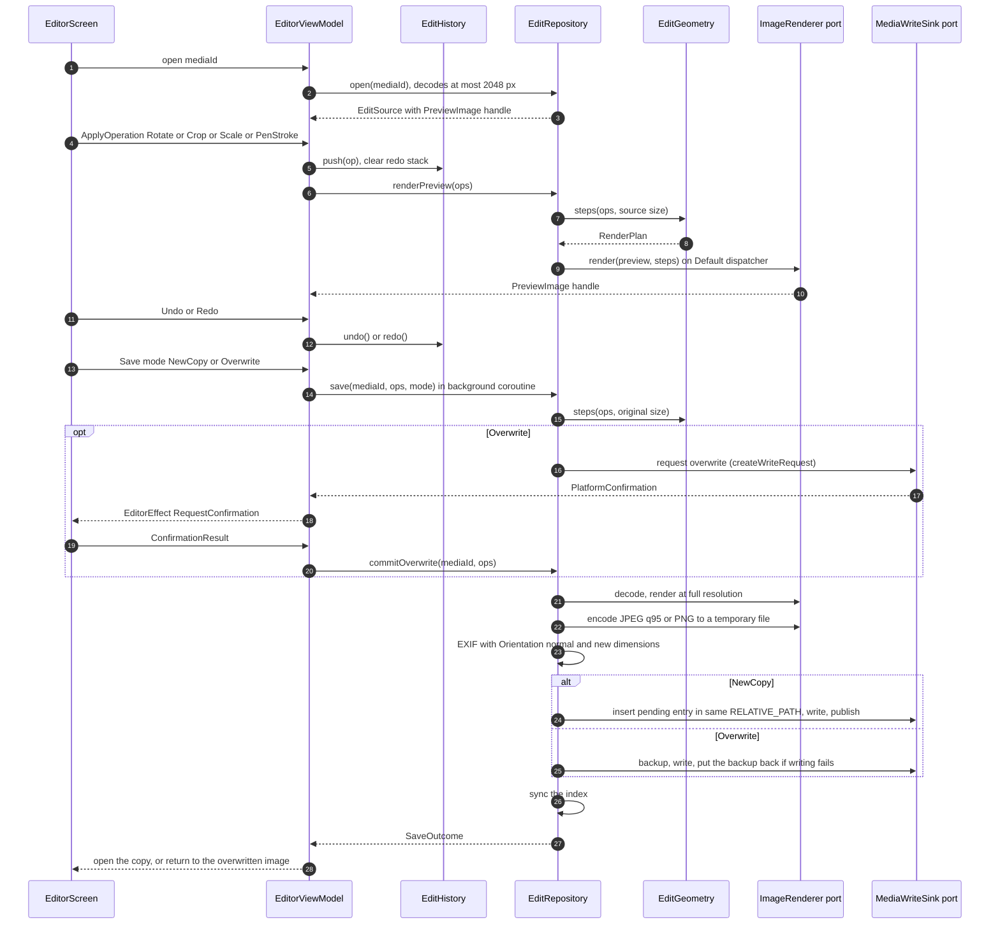

- `EditHistory` is a plain immutable class (`operations`, `push`, `undo`, `redo`, `canUndo`, `canRedo`) — fully unit-testable without Android.
- `EditGeometry` (pure, `:core:data`) flattens the operations into one `RenderPlan` for a given source size: the output size, one 3×3 matrix from source to output pixels, and the strokes in output pixels. The size of the output does the clipping, because every later crop lies inside the earlier ones. So an edit needs exactly two bitmaps, and scaling down and up again loses nothing. Crops end on whole pixels, so they do not resample. For the preview, `RenderPlan.fittedTo(2048)` shrinks the same plan, which makes preview and full-resolution rendering identical in output geometry. The `BitmapImageRenderer` adapter only applies the plan with `Matrix`, `Canvas` and `Path`.
- `EditorReducer` holds the state changes of the editor that need nothing but the state; the ViewModel renders when the history changed. Until a crop is applied, the frame lives in `EditorUiState.cropRect`. The design has no apply button: leaving the Crop tool, any other action and saving apply it, and undo first resets the frame.
- The pen width is in pixels of the preview ("8 px"), stored as a fraction of the longer side, so a stroke looks on the saved image as it did on the screen.
- Saving never endangers an image. Rendering, encoding and EXIF happen in temporary files in the cache, where a failure or a cancellation does no harm. A new copy stays a pending, hidden entry until it is complete, and is removed if anything fails. An overwrite first copies the original to a temporary backup and puts it back if writing fails; if the backup fails, the original was not touched. One risk remains: if the process dies during the short write of an overwrite, the image can be incomplete, because MediaStore has no atomic replace. Overwriting always needs the system confirmation.
- After saving, the index syncs inline, so the viewer can open the new copy at once; a queued sync later picks up what the media scanner adds. An overwritten image keeps its URI, so the route clears Coil's memory cache.
- Rendered images cross the port as an opaque `PreviewImage(handle, width, height)`; `:core:ui` draws it, so `EditorViewModel` never touches `Bitmap`.
- Original EXIF orientation is applied first (bake-in): `ImageDecoder` delivers upright pixels, and all sizes in the plan are upright sizes. That is why the output orientation is reset to normal. A wide-gamut colour space is kept; an Ultra HDR gain map is not.
- Memory guard (D30): `MemoryBudget` (pure, `:core:data`) estimates the bytes a step needs (source + output bitmap, 4 bytes per pixel) and compares them with `MemoryInfoSource.availableBytes()` (`:core:platform`, from `ActivityManager.MemoryInfo` minus the low-memory threshold and a safety margin, and at most half of the RAM, because Android 17 limits each app but has no API to read the limit (D40); bitmap pixels live in native memory, so the Java heap limit is not the right measure). An `OutOfMemoryError` during rendering becomes the same refusal. It is checked when a `Scale` is applied and before the full-resolution render on save. If the estimate does not fit, the operation is refused with `AppError.InsufficientMemory(requiredBytes, availableBytes)` and the editor shows why. Nothing is ever saved at a reduced size without the user asking for it.
- Only JPEG and PNG sources can be edited, and the output keeps the source format (D29). The viewer hides the Edit action for other formats.

### 5.5 Delete with trash

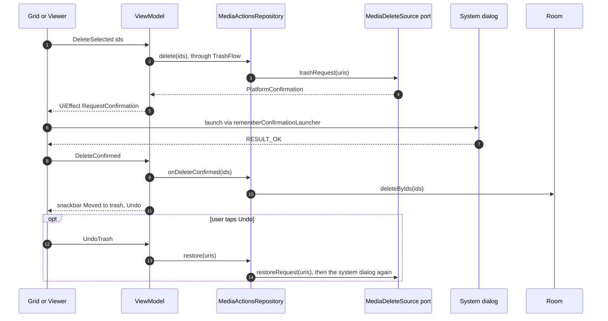

- Room rows are removed optimistically after confirmation so the grid updates instantly; the next `IndexWorker` run reconciles regardless. Untrash re-inserts via the next incremental sync (the item gets a new generation).
- `createDeleteRequest` (permanent) is available through `MediaActionsRepository.delete(ids, permanent = true)`; no screen offers it yet.

### 5.6 Nextcloud Login Flow v2

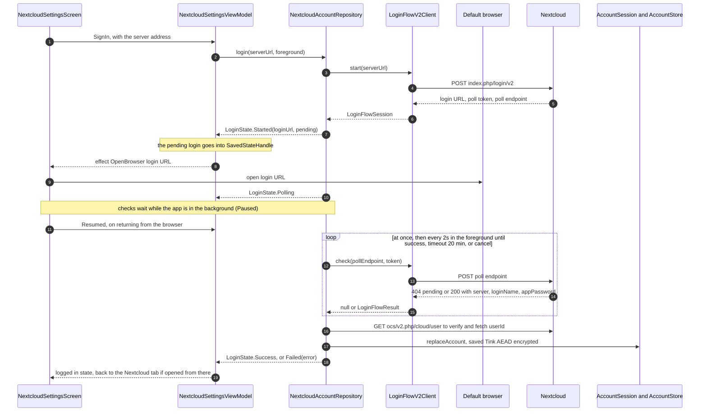

- Server URL normalization: add `https://` if missing, strip trailing `/` and `/index.php`; `http://` is rejected in release builds (see 11).
- Checking runs in `viewModelScope`; leaving the screen cancels it. The login opens in the default browser as a separate task, and checks only run while the screen is resumed, because Android may freeze the app and cut its network in the background (D54). A network failure or a 5xx answer only means the next check decides; 20 minutes after the start the login expires, also when returning later.
- The pending login (server, poll endpoint, poll token, start time) is kept in `SavedStateHandle`, so it survives the system killing the app while the user is in the browser; the new ViewModel continues it with `resumeLogin`. This is the only use of `SavedStateHandle` in the app. It is not written to the app's files, is cleared when the login ends, and `toString` hides the token.
- `ACCESS_LOCAL_NETWORK` (D39) is requested when the user starts the login, after a short explanation; a denied permission only matters for local addresses, where connection failures then become `LocalNetworkBlocked`.
- The session ended (401): the browser shows a banner that opens the same form again with the server filled in; a successful login replaces the app password.
- The poll endpoint must have the scheme, host and port of the address the user entered, the poll does not follow redirects, and the returned `server` is normalised and must have that origin too; otherwise the login fails with `AppError.ServerMismatch`. Login JSON is limited to 1 MiB. A password that does not end up stored (user id failed, login cancelled, wrong server) is revoked best effort on the entered server, as is the password a new login replaces, but never the one in use.
- Logout (D35): `AccountSession.logOut()` reads the account, then runs `AccountStore.clear()` and clears `remote_cache`, `upload_state` and Coil's remote cache entries, each step regardless of the others and not cancellable by the screen. Only then `DELETE ocs/v2.php/core/apppassword` goes out, best effort, in the background with the account read before: `OcsClient` puts the credentials on the request itself, so this works without a stored account. If the process dies first, the revoke is lost. Upload states follow with their table in Phase 9. A remote call whose account is no longer signed in when it ends has its result dropped (`NotLoggedIn`), and listings and shared files of such a call are neither stored nor shown. While logged out, `RemoteCallRunner` returns `AppError.NotLoggedIn` for every remote call without touching the network; the Nextcloud tab shows a login-required hint, and badges and the Upload action are hidden.
- Untrusted certificate (D32): any remote call can fail with `UntrustedCertificate(info)`. The ViewModel emits an effect that shows `CertificateWarningDialog`; on Accept, `TrustedCertificateRepository.accept(info)` pins it and the call is retried.

### 5.7 Upload-state check

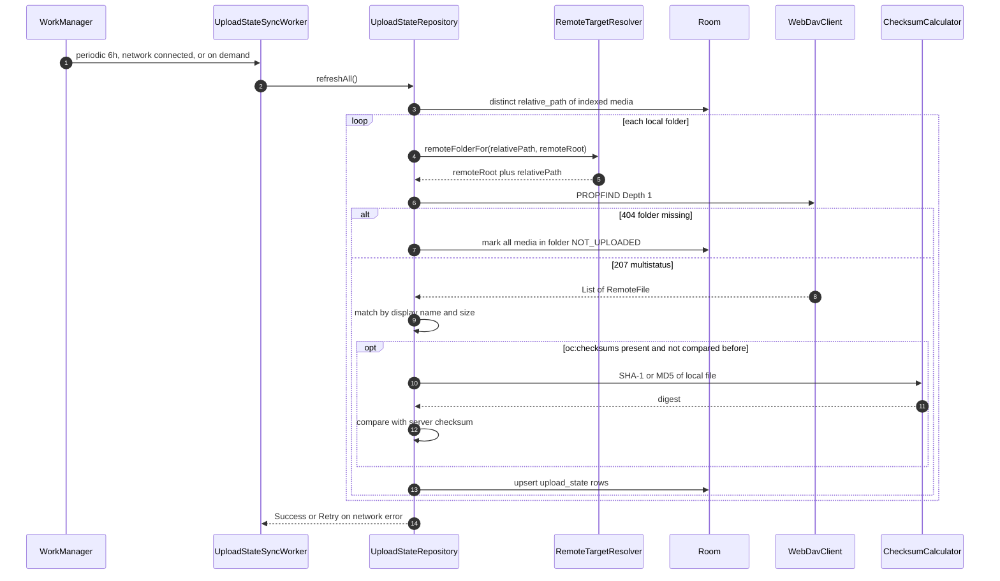

- Logged out, `refreshAll()` does nothing and succeeds, without network access (D35). A logout or an account change during the check ends it without storing anything.
- Errors: a network, disk or server error ends the check and the worker retries. A rejected password, an untrusted certificate or a blocked local network end it without a retry; the next periodic run looks again. Any other error (such as no permission for one folder) only skips that folder.
- Skip rule: a folder is not re-compared if the server folder's `etag` (`remote_folder_etag`) is unchanged and every image has a row for the same remote path, size and modification date.
- Checksums are only computed for name+size matches, and not again for the same local file (`local_size`, `local_date_modified_s`) and server file (`remote_etag`) once they confirmed the match or found a difference. A difference means `NotUploaded`. An image that can't be read leaves the match unconfirmed (`Uploaded(verifiedByChecksum = false)`).
- The local checksum uses the original bytes (`MediaStore.setRequireOriginal`): otherwise the system blanks the location in the file. Without `ACCESS_MEDIA_LOCATION` the system refuses that, and a match stays unconfirmed.
- Grid badges read `upload_state` only; a missing row, or one for an older version of the image (size or date differ), means `Unknown`.
- A check also runs right after a login and after the remote root changed (`UploadStateSyncObserver`).
- Nextcloud does not always compute checksums for files uploaded via other clients; absence of `oc:checksums` means "Uploaded (size match)".

### 5.8 Upload hand-off to the Nextcloud app

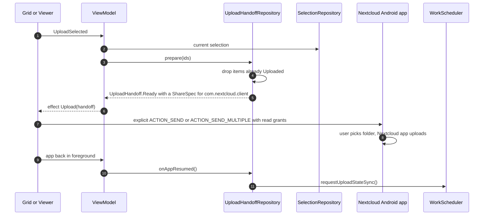

- The Nextcloud app handles target folder, name conflicts, chunking, retries and progress; NextGalleryApp cannot see its progress.
- Badges update once the next upload-state check finds the files on the server. If the user chose a folder outside the configured remote root, or the Nextcloud app renamed a file, the badge stays "not uploaded" (D13).
- The app's only part in an upload is that one intent; there is no queue and no foreground service (D31). The refresh runs when the user comes back, so an upload the Nextcloud app has not finished by then shows up at the next periodic check.
- If `NextcloudAppSource.isInstalled()` is false, the Upload action is drawn at 38 % and a tap shows "Install the Nextcloud app to upload photos." The tap still goes through `prepare`, so an app installed in the meantime works right away; each resume also looks for it again.
- If all images are on the server, a tap shows "Already on your Nextcloud." If the system refuses the intent (for example too many images for one transaction), a tap shows a message instead of ending the app.
- While logged out, the action is not shown at all (D35).

### 5.9 Deleting on the server

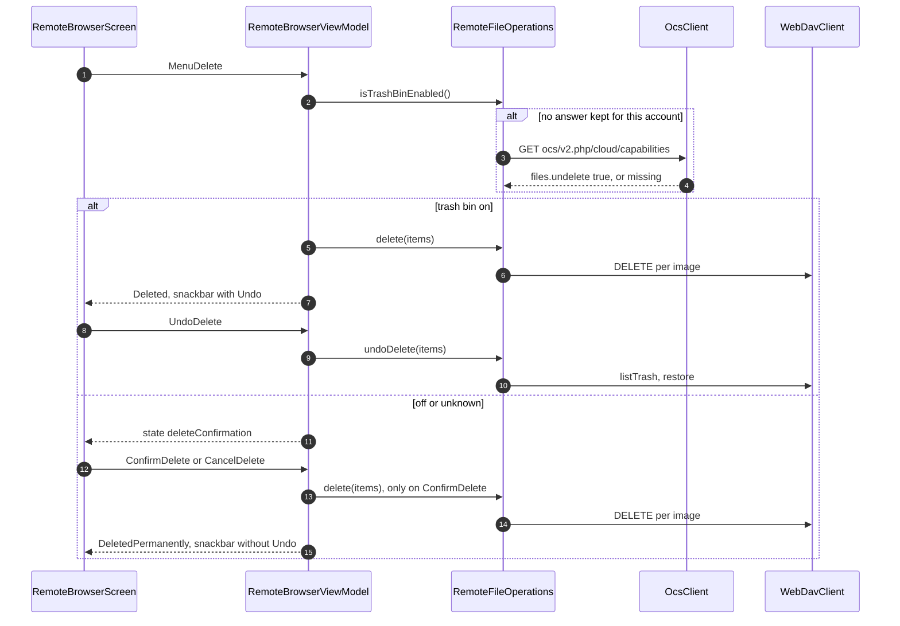

- `RemoteActionsController` holds the steps. Unknown counts as off (D56): not reported, `false`, a failed or unreadable answer, or logged out.
- `DefaultRemoteFileOperations` is a singleton, and its `TrashBinCheck` keeps a known answer with the server and user id, never the password, until the process ends; a failed check is asked again at the next delete. Nothing is stored on disk.
- The capabilities request goes through the client without redirects, with the account's credentials put on by `OcsClient`, like the other OCS calls.
- An account change closes an open confirmation, so it cannot delete paths on the next account.

### 5.10 Adding a folder

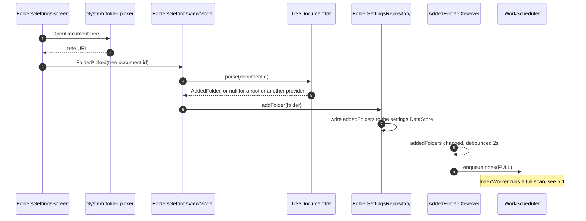

- The picker's URI is only read for its document id; no URI grant is kept (D55). A storage root or a folder of another provider is refused with a message (`addFailed`).
- Removing a folder goes the same way; the full scan then deletes its rows.
- A virtual folder (`createVirtualFolder`, `updateVirtualFolder`) only stores a name and member `bucketId`s, so it starts no scan: its grid queries the index for those buckets (`MediaSource.VirtualFolder`).

## 6. Navigation

Single activity, Navigation Compose with type-safe `@Serializable` routes. Each feature exposes its route types and a `NavGraphBuilder` extension; `:app` connects them. Bottom navigation for the four top-level destinations; settings from the top app bar.

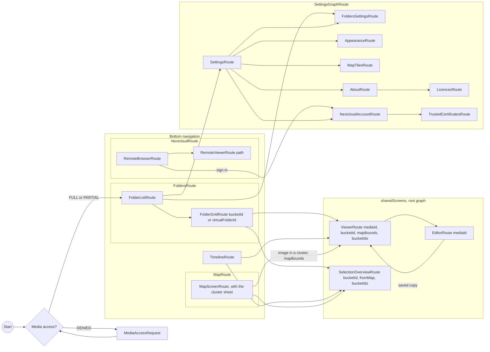

Rules:

- The viewer, the editor and the selection overview are opened from several tabs, so they sit directly in the root graph (`sharedScreens` in `:app`) and hide the bottom navigation. The Folders, Map, Nextcloud and settings screens are nested graphs, so a tab stays selected and keeps its back stack; the settings graph hides the bottom navigation as well. The map's cluster sheet is part of the map screen, not a route.
- Route arguments carry only IDs/paths, never full objects. A map cluster is passed as its bounds (`GeoBounds.encode()`), which hold exactly its images, so no list of IDs has to travel.
- Feature screens receive navigation lambdas (for example `folderGridScreen(onOpenViewer: (id: MediaId, bucketId: Long?, virtualBucketIds: List<Long>?) -> Unit, …)`) instead of a `NavController`.
- `ACTION_VIEW` of an image opens `ExternalImageScreen` instead of the navigation graph (see 5.3).

## 7. State management

Pattern per screen:

```kotlin
data class FolderGridUiState(
    val title: String = "",
    val virtualBucketIds: List<Long>? = null, // the members of a virtual folder; null in a real folder
    val selectedIds: Set<MediaId> = emptySet(), // app-wide, from SelectionRepository
    val selecting: Boolean = selectedIds.isNotEmpty(), // also true after the Select action, before anything is selected
    val uploadBadges: Map<MediaId, UploadState> = emptyMap(), // images on screen; empty while logged out
    val uploadAvailability: UploadAvailability = UploadAvailability.HIDDEN,
)

sealed interface FolderGridEvent {
    data class ItemClicked(val id: MediaId) : FolderGridEvent
    data class ItemLongPressed(val id: MediaId) : FolderGridEvent
    data object StartSelecting : FolderGridEvent
    data object SelectAll : FolderGridEvent
    data object ClearSelection : FolderGridEvent
    data object DeleteSelected : FolderGridEvent
    data object ShareSelected : FolderGridEvent
    data object UploadSelected : FolderGridEvent
    data class VisibleItemsChanged(val ids: Set<MediaId>) : FolderGridEvent
    data object Resumed : FolderGridEvent // possibly back from the Nextcloud app
    data class ConfirmationResult(val confirmed: Boolean) : FolderGridEvent
    data object UndoDelete : FolderGridEvent
}

sealed interface FolderGridEffect {
    data class OpenViewer(val id: MediaId, val virtualBucketIds: List<Long>? = null) : FolderGridEffect
    data class Share(val spec: ShareSpec) : FolderGridEffect
    data class Upload(val handoff: UploadHandoff) : FolderGridEffect
    data class Trash(val effect: TrashEffect) : FolderGridEffect // confirmation, message with undo, failure
}

@HiltViewModel(assistedFactory = FolderGridViewModel.Factory::class)
class FolderGridViewModel @AssistedInject constructor(
    @Assisted private val route: FolderGridRoute,
    private val mediaRepository: MediaRepository,
    folderRepository: FolderRepository,
    private val selectionRepository: SelectionRepository,
    private val actions: MediaActionsRepository,
    private val trashFlow: TrashFlow,
    uploadStates: UploadStateRepository,
    private val uploadHandoff: UploadHandoffRepository,
) : ViewModel() {
    @AssistedFactory interface Factory { fun create(route: FolderGridRoute): FolderGridViewModel }
    // A real folder pages MediaSource.Folder(route.bucketId); a virtual folder pages MediaSource.VirtualFolder(members),
    // again whenever its members change (flatMapLatest over observeVirtualFolder).
    val items: Flow<PagingData<MediaItem>> = /* ... */.cachedIn(viewModelScope)
    val state: StateFlow<FolderGridUiState> = /* combine(...).stateIn(viewModelScope, WhileSubscribed(5_000), FolderGridUiState()) */
    val effects: Flow<FolderGridEffect> = /* Channel(BUFFERED).receiveAsFlow() */
    fun onEvent(event: FolderGridEvent) { /* ... */ }
}
```

`PagingData` is exposed as a separate flow (not inside `UiState`) because it must be `cachedIn` and collected with `collectAsLazyPagingItems`.

Other screens (abbreviated):

| Screen | UiState fields |
| --- | --- |
| Folders | `Loading`, `NoFolders`, `NoImages` or `Content(folders, virtualFolders)` |
| Timeline | `index: TimelineIndex?`, `today`, `selectedIds`, `selecting` (+ separate paging flow of the images) |
| Map | `clusters: List<MapCluster>` for current viewport + zoom, `camera`, `currentLocation`, `openCluster`, `showPhotoLocationCard`, `showNoGeotaggedCard`, `tileUrl`, `selectedIds` (+ separate paging flow for the open cluster) |
| Viewer | `initialIndex` (null until the opened image's position is known), `current: MediaItem?`, `chromeVisible`, `details: ImageDetails?` (info sheet open when set), `uploadAvailability` (+ separate paging flow of the images) |
| Editor | `displayName`, `isLoading`, `loadFailed`, `preview: PreviewImage?`, `sourceSize`, `imageSize`, `history: EditHistory`, `tool: EditorTool?` (`CROP`, `DRAW`), `cropRect`, `aspect`, `penColor`, `penWidth`, `isScaleDialogShown`, `isDiscardDialogShown`, `isSaving`, `message: EditorMessage?`; `canUndo`, `canRedo` derived |
| Remote browser | `loginRequired`, `path`, `folders`, `images: List<RemoteItem>`, `urls: RemoteImageUrls?`, `isLoading`, `isRefreshing`, `isConnected`, `serverUnreachable` (`isOffline` derived: shows cached `remote_cache` data), `sessionEnded`, `error`, `certificate`, `selection`, `selecting`, `menu`, `move`, `share` |
| Nextcloud account (`NextcloudSettingsUiState`) | `serverAddress`, `isSigningIn`, `accountLabel` (set while signed in), `showForm`, `remoteRoot`, `error`, `certificate`, `showLocalNetworkExplanation`, `rootPicker: RemoteRootPickerState?` |
| Folders settings | `addedFolders`, `virtualFolders`, `folders` (real folders with images, to choose members from), `addFailed`, `editor: VirtualFolderEditor?` |
| Appearance | `themeMode`, `gridColumns`, `accentColor` |

Process death: the route is restored by Navigation and passed in again through the assisted factory (`hiltViewModel<FolderGridViewModel, FolderGridViewModel.Factory>(creationCallback = { it.create(route) })`). The selection lives in the in-memory `SelectionRepository` singleton, and the editor's operations in its ViewModel, so both are lost with the process. The only `SavedStateHandle` use is the pending Nextcloud login (5.6).

## 8. Threading and concurrency

| Work | Where it runs |
| --- | --- |
| Compose rendering, state collection | Main |
| Room queries | Room's own executor (suspend DAOs / Flow / PagingSource) |
| MediaStore cursors, EXIF, file I/O, checksums, OkHttp | `Dispatchers.IO` via injected `DispatcherProvider` |
| Bitmap transforms (editor preview/full render), clustering, section index computation | `Dispatchers.Default` |
| Indexing, upload-state sync | WorkManager `CoroutineWorker`s (survive process death; unique work names) |

Rules:

- No `GlobalScope`. The MediaStore change observer runs in `MainViewModel`'s `viewModelScope`, i.e. while the UI exists; changes made while the app is closed are picked up by the incremental sync on the next start.
- Unique work names: `index` (one at a time; every trigger uses `APPEND_OR_REPLACE`, so a sync requested during a running one is not lost; the 2 s debounce keeps the chain short), `upload-state-sync` (periodic, every 6 h, needs a network, `UPDATE`; plus a one-shot `upload-state-refresh` after a hand-off, a login or a new remote root, needs a network, `REPLACE`).
- Room writes go through the DAOs, each batch as one `@Upsert` or `@Transaction` method (there is no `withTransaction`); the indexer yields between batches (`ensureActive()`), so cancellation is prompt.
- Editor full-resolution save runs in `viewModelScope` with `NonCancellable` around the final MediaStore commit (write + clear `IS_PENDING`), so a half-written entry is never left visible. A pending entry left by a crash is cleaned up on next start (pending items older than 1 day are deleted by `MediaWriteSink.cleanupPending()`).
- Flows from repositories are cold; ViewModels convert with `stateIn(viewModelScope, SharingStarted.WhileSubscribed(5_000), initial)`.

## 9. Caching

### 9.1 Thumbnails and images

- Single Coil 3 `ImageLoader` (app singleton) with:
  - Memory cache: 20 % of app memory.
  - Disk cache: `cacheDir/image_cache`, 250 MB (configurable later).
  - Custom `MediaThumbnailFetcher` for local grid cells: `ContentResolver.loadThumbnail(uri, Size, signal)` — uses the system thumbnail cache, which is faster than decoding originals; if that fails, it decodes the original at the requested size. Cache key includes `id + date_modified + size bucket`, so edited images refresh. Local thumbnails are kept in the memory cache and the system thumbnail cache, not again in the Coil disk cache, which is meant for remote images (9.2).
  - Size buckets (256 / 512 px) instead of exact sizes to maximise cache hits across grid densities.
- Viewer: Telephoto's `ZoomableAsyncImage` uses Coil for the screen-sized image and sub-sampled tiles for full resolution; tiles are not disk-cached (originals are local).
- Hardware bitmaps enabled for grids; disabled in the editor (needs software bitmaps).

### 9.2 Remote previews and files

- The `@RemoteImageLoader` requests `core/preview?fileId=…&x=…&y=…` through the authenticated OkHttp client (`coil-network-okhttp`); cache key is `fileId + etag + size` (`remoteImageCacheKey`), so a changed remote file is re-fetched. It has its own memory cache and a 500 MB disk cache (D37) in `remote_image_cache`, so logging out wipes them without touching local thumbnails.
- Opening a remote image full screen shows a large preview first (2048 px) and loads the original via WebDAV `GET` for the page on screen only, with its progress below the image. Originals are streamed into Coil's disk cache, never into the MediaStore. There is no offline mode for remote files; the Nextcloud app's "available offline" covers that (D37).
- `remote_cache` table holds the last PROPFIND result per folder for instant display and offline browsing; refreshed on open (stale-while-revalidate) and on pull-to-refresh.

### 9.3 Index and upload state

- The Room index is the cache of MediaStore; it is reconciled incrementally, so app start shows data immediately and syncs in background.
- `upload_state` caches server comparison results; badges never wait on the network.
- The timeline's layout (`TimelineIndex`: headers, rail dates) is computed from a `GROUP BY` query on the precomputed `local_year/month/day` columns (D7), and only rebuilt when the number of images of a day changes.

## 10. Error handling

- Data sources throw; **repositories catch** and return `AppResult` / emit errors in flows. `CancellationException` is always rethrown (`runCatchingCancellable`).
- `AppError` reaches the screen in the `UiState` or an effect, and the screen picks the text: `AppError.remoteMessage()` in `:core:ui` for Nextcloud errors, a feature's own type where it needs more (the editor's `EditorMessage`).
- Categories:
  - **Permission**: missing media permission → `MediaAccessRequest`; partial access → `LimitedAccessBanner` with "select more"; missing `ACCESS_MEDIA_LOCATION` → map hint, no crash.
  - **User confirmation**: trash, delete and write requests → `UiEffect.RequestConfirmation(PlatformConfirmation)`; this is a normal flow, not an error.
  - **Stale data**: item deleted outside the app while opened → `NotFound`; the viewer skips to the next page and the grid refreshes via index sync.
  - **Network** (`IOException`, timeouts): remote browser shows cached data with an offline banner; workers return `Result.retry()`.
  - **Auth** (401): account marked as "needs re-login"; workers stop with failure; a persistent banner links to login.
  - **Server** (`AppError.Server(code)`): a screen shows the error; `UploadStateSyncWorker` retries (as for `Network` and `Io`). There is no upload queue (D31), so no upload can fail here.
  - **Decode/encode** (corrupt file): thumbnail shows an error placeholder; editor refuses to save with a message.
  - **Insufficient memory** (`AppError.InsufficientMemory`): the editor refuses the scale or save and tells the user how much memory the image needs and how much is available (D30).
- Crashes: no crash reporting service (no tracking). Uncaught exceptions use the default handler; an opt-in local log export may be added later.
- Logging: the app has no logging code (no `android.util.Log` calls); only StrictMode logs in debug builds (12). Any logging added later must not log URLs with credentials, app passwords, or file names.

## 11. Security and privacy

- **Credentials**: Login Flow v2 only; the account password is never seen by the app. The app password is stored in a DataStore file encrypted with a Tink `Aead` (AES256-GCM); the Tink keyset is encrypted by an Android Keystore master key (`AndroidKeysetManager`, `android-keystore://` URI). Tink silently falls back to a clear text keyset if the Keystore fails when the keyset is created; `KeystoreSecretCipher` refuses that (`isUsingKeystore()`) and removes the keyset. Any failure to decrypt reads as logged out. No `EncryptedSharedPreferences` (deprecated).
- No backup (D42): `android:allowBackup="false"` stops cloud backup, and `data_extraction_rules.xml` also excludes all app data from device transfer, so credentials can never leave the device this way.
- **TLS**: platform defaults via OkHttp; `network_security_config.xml` disallows cleartext traffic, so v1 accepts `https://` servers only (cleartext for debug builds only, via a debug-only config). User-installed CAs (`<certificates src="user"/>`) are trusted in addition to system CAs. Any other certificate is only trusted after the user accepts it in a warning dialog; it is then pinned per host by SHA-256 fingerprint (`PinningTrustManager`, D32). A changed certificate triggers the warning again. The same OkHttp client is used for WebDAV, the preview API and Coil, so all remote traffic follows the same rule.
- Authorization header added only for requests to the configured server's scheme, host and port (network interceptor, so it decides again per redirect); redirects to other hosts never get credentials, https → http redirects are not followed, and requests that change something on the server don't follow redirects at all.
- OkHttp only speaks TLS unless `allowCleartext` (debug builds); server URLs and the URLs in login responses are checked the same way. Nothing logs URLs with credentials or the app password; `toString` of the account and of the login flow's types hides the secrets.
- Responses are limited, so that a server can't exhaust the memory: login and OCS JSON 1 MiB; a multistatus response 64 MiB of XML (well over 50,000 entries of a folder) and 100,000 entries, keeping only the properties the app reads. Beyond that the call fails with a normal error. A DOCTYPE fails the parse.
- Everything that comes from the server is treated as untrusted when it ends up in a path: dot segments and encoded slashes in hrefs are dropped, `RemotePathMapper` refuses dot segments, and shared files keep only a sanitised last name part inside the temporary folder.
- **Network entry points**, which are all there are. No analytics, tracking or crash reporting code or library is in the app, and the build refuses Play Services and Firebase:
  - `WebDavClient`, `OcsClient` and `LoginFlowV2Client` go through `NextcloudHttpModule` to the server the user entered. Login Flow may name other URLs on that server; the checks above apply.
  - The remote Coil loader (`RemoteImageLoader`) uses the authenticated client for the account's previews and images. The local loader has no network fetcher at all.
  - osmdroid's tile downloader goes to the tile server in Settings (OpenStreetMap by default).
  - Two links open outside the app, when tapped: the login page in the default browser, and the source code link in About, in the browser.
- **No tracking**: no analytics, no crash reporting SDKs, no Google Play Services. osmdroid tile requests go over HTTPS to the OSM tile server (or the one set in Settings) with the user agent `NextGalleryApp (Android, osmdroid)`, which names the app, as the OSM tile usage policy requires, and carries no personal data. This is the only third-party network traffic and is triggered only by opening the map. Place names are looked up on the phone (D45), and tiles are cached in the app's cache folder.
- **Least privilege**: only `READ_MEDIA_IMAGES`, `READ_MEDIA_VISUAL_USER_SELECTED`, `ACCESS_MEDIA_LOCATION`, `ACCESS_COARSE_LOCATION` (optional, D44), `INTERNET`, `ACCESS_NETWORK_STATE`, `ACCESS_LOCAL_NETWORK` (D39), plus a `<queries>` entry for `com.nextcloud.client`. No foreground service or notification permission (uploads are done by the Nextcloud app). The folder picker needs no permission and no URI grant is kept (D55); without an added folder, the app reads no image data from MediaStore. Destructive actions go through system dialogs.
- Shared local images use MediaStore content URIs with temporary read grants. Server images are downloaded first and shared through a `FileProvider` limited to one temporary cache folder (D48); the rest of the app's storage stays private.

### 11.1 Accessibility

- Every action has a name and a 48 dp touch target (`minTouchTarget`; screen tests check this on the key screens). Where the design's visual is smaller, as with breadcrumbs and pen swatches, the touch target surrounds it.
- A thumbnail says its file name and date (`thumbnailDescription`), its upload badge and its state: selected or not while selecting, unavailable in this view, or could not be loaded. A long-press announces what it does.
- A scrollbar's thumb is a slider for a screen reader (`scrollbarSemantics`): it reads the position, as the date in the timeline, and accepts `ACTION_SET_PROGRESS` and scroll forward and backward. The date rail's texts are hidden from the screen reader, because the thumb says the same.
- Known gaps: the map's markers are drawn by osmdroid on a `View`, and the crop handles and the pen canvas only follow gestures. So clusters can't be reached with TalkBack, though a photo's place can be read in the viewer's details and all photos are in the other views; and cropping and drawing need sight. Rotating and scaling use ordinary buttons and fields.

## 12. Performance

Targets (measured on the reference Pixel 10a, Android 17): warm start to first folder grid < 1 s with an existing index; no dropped frames at the display refresh rate when scrolling and fast scrolling a 50 000-image library; first full index of 50 000 images in under ~1 minute without EXIF pass.

- **Query only Room** for grids; MediaStore is touched only by the indexer.
- **Paging 3 with placeholders** gives a stable item count, so `LazyVerticalGrid` can jump anywhere; Room's `PagingSource` uses `LIMIT/OFFSET` on indexed columns. For very deep jumps, the grid requests the page around the target via `scrollToItem` and placeholders render until loaded.
- **Timeline index** (the folder grid maps the thumb directly to positions): computed once per data version via aggregated SQL (`SELECT local_year, local_month, local_day, COUNT(*) … GROUP BY …`), turned into cumulative row offsets. A lookup is O(log n) (binary search in days), so the rail's dates do not depend on loaded images, and the thumb jumps with `scrollToItem`, dropping positions the grid has not reached yet.
- **Timeline headers**: the grid's rows come from `TimelineIndex`, which also maps a row to its position in the paged image list; the images load through Paging as in the other grids. `PagingData.insertSeparators` is not used, because it only sees loaded pages: the row count and the headers' positions would change while scrolling, and the rail could not jump. The images are ordered by local date first, so each day's images are contiguous and match the day counts. The sticky month is the month of the first visible row, and the rail's current day is the row in the vertical middle.
- **Stable keys and content types** in lazy grids (`key = id`, `contentType = header/item`) to avoid recomposition and enable reuse.
- **Thumbnails**: system `loadThumbnail` + size buckets + memory cache; no crossfade during fast scroll; requests cancelled when cells leave the screen (Coil does this per composable).
- **Indexing**: projection limited to needed columns; batched transactions; EXIF read deferred to a second pass; ContentObserver debounced; incremental sync via generation numbers touches only changed rows.
- **Map**: clustering computed on `Default` for the viewport only, from a lightweight `(id, lat, lon)` projection; recomputed on zoom/pan with debounce.
- **Memory**: viewer limits decoded size to screen size except visible tiles; editor preview max 2048 px side.
- **Baseline profiles** and Macrobenchmark are in `:benchmark` (cold start, folder grid scroll, timeline fast-scroll, viewer swipe), and release builds use R8 full mode. Both need a real device, so they have not run yet and there is no profile in the repository (TODO 10.1).
- **StrictMode** logs main-thread disk and network use and leaks in debug builds (`enableStrictMode`, tag `StrictMode`).
- Compose stability: `UiState` classes are immutable data classes with read-only Kotlin collections; `@Immutable` is only used on the theme's classes. `kotlinx-collections-immutable` is in the version catalog but no module uses it.

## 13. Testing strategy

Principles: every function gets a unit test; tests are small, independent and non-overlapping (each behaviour is asserted in exactly one test at the lowest layer that owns it). Tools: JUnit 4, MockK, Turbine, kotlinx-coroutines-test (`runTest`, `StandardTestDispatcher` via an injected `DispatcherProvider`), Robolectric for the thin Android adapters, Room in-memory databases, OkHttp `MockWebServer`, Compose UI tests. Because the logic sits in pure JVM modules (section 2), the large majority of tests are plain JUnit tests without any Android runtime. Instrumented tests run locally only, where Robolectric cannot reproduce the behaviour (see 13.1).

| Layer / module | What is tested | How | Runs on CI |
| --- | --- | --- | --- |
| `:core:model`, `:core:common` | Model validation (`GeoPoint` ranges, `NormalizedRect`), `AppResult` helpers, `RelativePaths`, `runCatchingCancellable`, `ScrollbarMath` | Plain JVM JUnit | Yes |
| `:core:data` | All domain logic: `MediaIndexer` (full vs incremental vs version change), `IndexScheduler`, `DateResolver`/`ExifDateParser`, `AddedFolderMatcher`, `TreeDocumentIds`, `MediaAccessRepository`, `RemoteTargetResolver`, `UploadStateMatcher`, `UploadHandoffRepository`, `SelectionRepository` and `SelectionRepresentability`, checksums, `EditGeometry`/`MemoryBudget`/`DefaultEditRepository`, `GridClusterer`, repositories, `AccountStore` (fake `SecretCipher`) | Plain JVM JUnit + hand-written fake ports, MockK, Turbine | Yes |
| `:core:nextcloud` | PROPFIND parsing, request building (headers, depth, body), Login Flow v2 polling states, error mapping, auth interceptor host check incl. redirects, URL normalisation, `PinningTrustManager` and `PinningHostnameVerifier` through real TLS handshakes (CA-signed, pinned, unknown, changed, expired, hostname mismatch, removed pin) | Plain JVM JUnit, `MockWebServer` (with `okhttp-tls` `HeldCertificate`s), kxml2 parser | Yes |
| ViewModels (feature modules) | Event → state transitions, effects emitted, paging flow wiring | Local unit tests without Robolectric: `runTest` + Turbine, MockK repositories, route passed to the constructor | Yes |
| `:core:database` | Each DAO query (paging order, bucket and bounds filters, day-count aggregation, cascade deletes), migrations, entity ↔ model mapping | Robolectric + in-memory Room; `MigrationTestHelper` with exported schemas | Yes |
| `:core:media` | Cursor → `ScannedImage` mapping (`MatrixCursor`), EXIF tag extraction from fixture files, request construction, rendering and encoding on real pixels (native graphics), writes against a stand-in provider | Robolectric, fixtures in `src/test/resources` | Yes |
| `:core:platform` | Workers map `AppResult` to `Result` (success / retry / failure), `WorkManagerScheduler` enqueues the right unique work | Robolectric, `TestListenableWorkerBuilder`, `WorkManagerTestInitHelper` | Yes |
| UI | Key screens: folder grid (selection, fast-scroll label), viewer (paging, info sheet), editor (undo/redo buttons enabled state), login steps, the access gate (`MediaAccessViewsTest`, `NextGalleryAppContentTest`) | Compose UI tests (`createComposeRule`) on Robolectric | Yes |
| Platform behaviour | See 13.1 | Instrumented tests (`src/androidTest`) | No – local emulator / Pixel 10a |
| Performance | Startup, grid scroll jank | Macrobenchmark on the Pixel 10a (later) | No |

Test doubles: hand-written fakes live in each module's `src/test` (for example the port fakes in `:core:data`'s `fakes/Fakes.kt`); there are no shared `testFixtures`. Feature ViewModel tests mock their repositories with MockK, which is also used for leaf collaborators. Test names follow `functionName_condition_expectedResult`.

CI (`.github/workflows/ci.yml`) runs on every branch push (direct pushes and merges into `main`) and on pull requests: ktlint, detekt, lint, `test` (the JVM modules' tests and the Android modules' local unit tests, including Robolectric), the build-logic tests, the debug and instrumented-test builds, and the JaCoCo coverage reports (`coverageReport`). On pull requests and on `main` it then runs the SonarCloud scan (`sonar-project.properties`, D41), which needs the `SONAR_TOKEN` repository secret and is skipped without it. There is no emulator in CI: instrumented tests run locally with `./gradlew connectedDebugAndroidTest` on an API 37 emulator or the Pixel 10a before merging changes that touch an adapter.

The documentation site (`.github/workflows/pages.yml`, D58) is built when a GitHub release is published, or by hand from the Actions tab. It copies `README.md`, `docs/` and the Jekyll config in `.github/pages/` into one folder, builds it with GitHub's Jekyll (`actions/jekyll-build-pages`) and deploys it to GitHub Pages. `README.md` becomes the start page, links between the Markdown files become links between pages, and links to other repository files point to GitHub at the released commit. Mermaid diagrams are drawn in the browser by a script in `.github/pages/_includes/head-custom.html`.

Security checks (D59, D60): `.github/workflows/security.yml` runs CodeQL for Kotlin and for the workflows on pushes to `main`, on pull requests and weekly; the Kotlin build for it runs on the runner with the JDK and Android SDK installed there, because CodeQL must trace the compiler. The same workflow submits the resolved Gradle dependencies to GitHub's dependency graph and runs a dependency review on pull requests. `.github/workflows/scorecard.yml` runs OpenSSF Scorecard. Dependabot (`.github/dependabot.yml`) proposes weekly updates for Gradle, the actions and the devcontainer image.

### 13.1 Robolectric and on-device tests

Robolectric 4.17 is the first release that supports SDK 37. Since `minSdk` is 37, it is the minimum usable version. Robolectric's SDK 36+ runtimes need JDK 21, so the build toolchain, local development and CI all use JDK 21. The `--add-opens` JVM flags from the Robolectric setup guide are set in the test convention plugin.

Robolectric's shadows do not reproduce some platform behaviour. These parts are covered by instrumented tests in `src/androidTest`, run locally on an API 37 emulator or the Pixel 10a with `./gradlew connectedDebugAndroidTest`. Since adapters hold no logic, these tests only check that the platform call works; everything around it is tested on the JVM.

| Area | Why Robolectric is not enough | On-device test |
| --- | --- | --- |
| MediaStore queries (`MediaStoreScanner`) | The shadow `ContentResolver` has no real MediaStore provider (`GENERATION_MODIFIED`, `IS_TRASHED`, `.nomedia` handling). `MediaStoreScannerTest` (`:core:media`). | Insert test images through `MediaStore`, assert the scanner's results, delete them afterwards. |
| `ContentResolver.loadThumbnail` (Coil fetcher) | Not backed by the system thumbnail cache. | `MediaThumbnailFetcherTest` (`:core:ui`): the thumbnail is no larger than requested. |
| EXIF GPS with `setRequireOriginal` | Location redaction depends on the real permission and provider. | `AndroidExifSourceGpsTest`: GPS read with `ACCESS_MEDIA_LOCATION` granted; `ContentResolverContentSourceDeviceTest`: the bytes for checksums. Without the permission is a manual check, because a test app that owns the file sees its location anyway. |
| Android Keystore (`KeystoreSecretCipher`) | Robolectric has no `AndroidKeyStore` provider. | `KeystoreSecretCipherTest` (`:core:platform`): encrypt/decrypt round trip with a Keystore-wrapped keyset, ciphertext without the plaintext, a changed ciphertext fails. |
| TLS on Android's own stack (`NextcloudHttpModule`, pinning) | The JVM tests use the JDK's TLS and trust store. | `NextcloudTlsDeviceTest` (`:core:platform`): a TLS 1.2 server connects; an unknown certificate becomes `AppError.UntrustedCertificate` with its fingerprint. The server runs on the device. |
| XML parsing (`MultistatusParser`) | The JVM tests run on kxml2, not Android's `XmlPullParser`. | `MultistatusParserDeviceTest` (`:core:platform`): a DOCTYPE fails the parse, a normal response parses. |
| HEIC display (viewer, thumbnails) | Native graphics in Robolectric may not include the platform HEIF codec. | No instrumented test; a manual check. |
| Trash, delete and write requests | The system confirmation dialogs only exist on a device. | `MediaStoreDeleterTest` (`:core:media`): trash, restore and delete requests return an `IntentSender`; the write request is in `MediaStoreWriterTest`. Confirming the dialogs is a manual check. |
| Saving to MediaStore (`MediaStoreWriter`) | The real provider decides on pending entries, folders and permissions. Robolectric tests use a stand-in provider for what the writer asks. | `MediaStoreWriterTest` (`:core:media`): pending, publish, write, cleanup on entries it inserted itself, deleted afterwards. |
| App start (`MainActivity`) | Hilt, the manifest and the real activity lifecycle. | `MainActivityTest` (`:app`): the activity reaches the resumed state. |
| osmdroid map | `MapView` rendering and tile loading need a real view hierarchy and network. | `OsmdroidMapRendererDeviceTest`: clusters appear as markers on a laid-out map, and the first layout reports the viewport. Tiles are a manual check. |

A behaviour tested on the device is not tested again in Robolectric (no overlap); the JVM tests cover the logic around it with fakes.
