# NextGalleryApp – Architecture

This document describes the architecture of the NextGalleryApp Android app. The product scope, feature list and roadmap live in the [README](../README.md); the reasoning behind choices and open questions are in [DESIGN_DECISIONS.md](DESIGN_DECISIONS.md); implementation steps are in [TODO.md](TODO.md).

## Contents

1. [Goals and constraints](#1-goals-and-constraints)
2. [Layered overview](#2-layered-overview)
3. [Modules](#3-modules)
4. [Data model](#4-data-model)
5. [Key flows](#5-key-flows)
6. [Navigation](#6-navigation)
7. [State management](#7-state-management)
8. [Threading and concurrency](#8-threading-and-concurrency)
9. [Caching](#9-caching)
10. [Error handling](#10-error-handling)
11. [Security and privacy](#11-security-and-privacy)
12. [Performance](#12-performance)
13. [Testing strategy](#13-testing-strategy)

---

## 1. Goals and constraints

The goals are in the [README](../README.md#goals). The ones that shape the architecture:

| Constraint | Architectural consequence |
| --- | --- |
| Fast with tens of thousands of images | Local Room index is the only thing grids query; Paging 3 everywhere; precomputed section index for fast scroll. |
| Local first, offline | Nextcloud is an optional layer; no screen except `:feature:remote` blocks on the network. Upload badges come from a Room cache. |
| No tracking, no Google Play Services | Only AndroidX, Kotlin, OkHttp, Coil, Telephoto, osmdroid, Tink. No Firebase, no Play Services location/maps, no analytics. |
| Min SDK 29, latest target SDK | API-level branches isolated in `:core:media` (incremental sync, trash/delete, partial media access). |
| v1 scope: images only | JPEG, PNG, WebP, HEIC/HEIF, GIF (static first frame). Video is excluded at query time (`MediaStore.Images` only). |
| Single Nextcloud account in v1 | Credential store and settings hold one account; the schema does not key data by account. |

## 2. Layered overview

The app uses **MVVM with unidirectional data flow**. Each screen's ViewModel exposes one immutable `StateFlow<UiState>` and accepts UI events through a single `onEvent(event)` function. Repositories are the single source of truth: the UI never talks to MediaStore, Room or WebDAV directly. Room is the source of truth for the local index. Kotlin coroutines and `Flow` are used throughout.

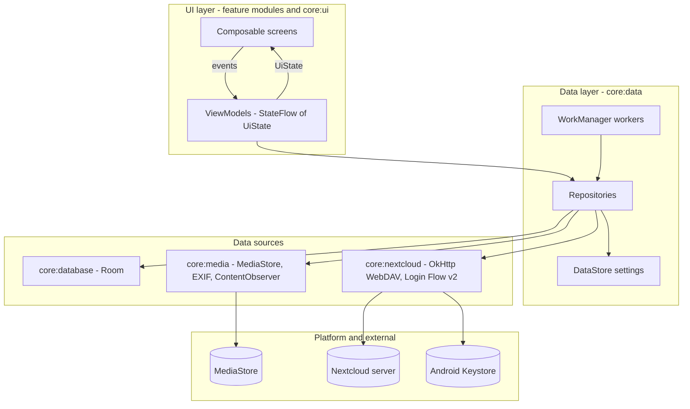

Rules:

- **UI layer**: Compose only renders `UiState` and emits events. No business logic in composables.
- **ViewModel**: maps repository flows into `UiState`, handles events, launches one-shot work in `viewModelScope`. Exposes one-off effects (system dialogs via `IntentSender`, snackbars, navigation) through a `Channel`-backed `Flow<UiEffect>`.
- **Repository**: combines sources, owns caching policy, maps entities/DTOs to `:core:model` types. Returns `Flow` for observable data and `suspend` functions returning `AppResult` for commands.
- **Data sources**: thin wrappers around one technology each; no cross-source logic.
- **Domain models** (`:core:model`) are plain Kotlin classes used across all layers; Room entities and WebDAV DTOs never leave their modules.

## 3. Modules

### 3.1 Build setup

- Gradle Kotlin DSL; dependencies and versions in `gradle/libs.versions.toml`.
- Convention plugins in `build-logic/convention`:
  - `nextgallery.android.application` – `:app` defaults (SDK levels, Java/Kotlin toolchain 17, R8 config).
  - `nextgallery.android.library` – Android library defaults.
  - `nextgallery.android.library.compose` – enables Compose and adds the Compose BOM.
  - `nextgallery.android.feature` – library + compose + Hilt + dependencies every feature needs (`:core:ui`, `:core:data`, `:core:model`, Navigation Compose, lifecycle-viewmodel-compose).
  - `nextgallery.android.hilt` – Hilt + KSP.
  - `nextgallery.android.room` – Room + KSP + schema export directory (`<module>/schemas`).
  - `nextgallery.jvm.library` – pure Kotlin modules (`:core:model`, `:core:common`).
  - `nextgallery.android.test` – shared test dependencies (JUnit 4, MockK, Turbine, coroutines-test, Robolectric).

### 3.2 Module dependency graph

Feature modules depend only on core modules, never on each other. `:app` is the only module that knows all features and wires navigation between them.

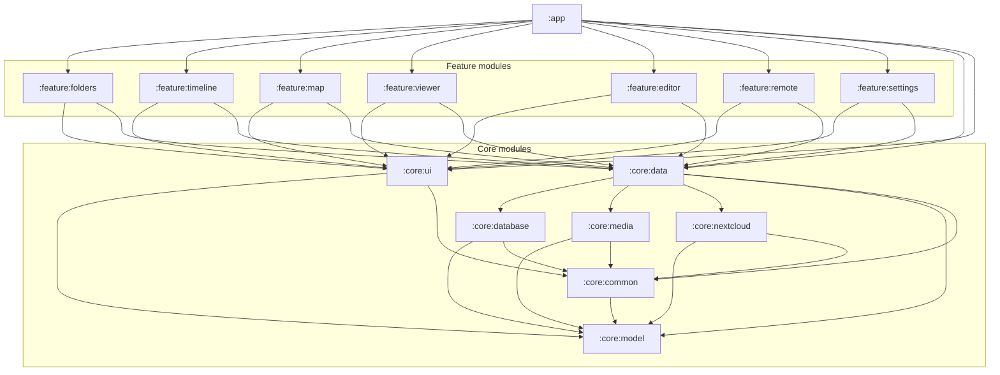

`:core:ui` additionally depends on Coil (it provides the shared image loading composables); the Coil `ImageLoader` itself is configured in `:app` (see [9.1](#91-thumbnails-and-images)).

### 3.3 Module responsibilities

Package root: `de.drehtuer.nextgallery` (placeholder; final name tracked in DESIGN_DECISIONS.md). Class names below are the intended public surface; internals may grow.

#### `:app`

| Class | Responsibility |
| --- | --- |
| `NextGalleryApplication` | `@HiltAndroidApp`; implements `Configuration.Provider` (HiltWorkerFactory) and `SingletonImageLoader.Factory` (Coil). Triggers `IndexScheduler.onAppStart()`. |
| `MainActivity` | Single activity, edge-to-edge, hosts `NextGalleryNavHost`. Handles `ACTION_VIEW`/`ACTION_SEND` intents later. |
| `NextGalleryNavHost` | Navigation Compose graph; maps each feature's navigation callbacks to routes of other features. |
| `TopLevelDestination` | Enum of bottom-bar destinations (Folders, Timeline, Map, Nextcloud). |
| `ImageLoaderModule` | Hilt module building the Coil `ImageLoader` (memory + disk cache, MediaStore thumbnail fetcher, authenticated Nextcloud preview fetcher). |

#### `:core:model` (pure Kotlin)

| Type | Notes |
| --- | --- |
| `MediaItem` | `id: Long` (MediaStore `_ID`), `contentUri: String`, `relativePath`, `displayName`, `mimeType`, `sizeBytes`, `width`, `height`, `orientation`, `dateTakenMillis` (resolved, see 5.1), `dateModifiedMillis`, `location: GeoPoint?`, `bucketId`. |
| `Folder` | `bucketId`, `relativePath`, `displayName`, `itemCount`, `coverItemId`, `latestDateMillis`. |
| `FolderRule` | `relativePath`, `type: RuleType { INCLUDE, EXCLUDE }`. |
| `GeoPoint` | `latitude`, `longitude` (validated ranges). |
| `RemoteFile` | `path`, `name`, `isDirectory`, `sizeBytes`, `contentType`, `etag`, `fileId`, `lastModifiedMillis`, `checksums: Map<ChecksumType, String>`, `hasPreview`. |
| `UploadState` | sealed: `Unknown`, `NotUploaded`, `Uploaded(verifiedByChecksum: Boolean)`, `Queued`, `Uploading(progress)`, `Failed(reason)`. |
| `UploadJob` | `id`, `mediaId`, `targetPath`, `status`, `attempts`, `lastError`. |
| `EditOperation` | sealed: `Rotate(quarterTurns)`, `Crop(rect: NormalizedRect, aspect)`, `Scale(targetWidth, targetHeight)`, `PenStroke(points: List<NormalizedPoint>, colorArgb, widthFraction)`. Coordinates are normalized (0..1) relative to the image *after* previous operations, so they are resolution independent. |
| `AspectRatio` | `Free`, `Original`, `Square`, `FourThree`, `SixteenNine`. |
| `NextcloudAccount` | `serverUrl`, `loginName`, `userId` (no secret). |
| `TimelineSection` | `year`, `month`, `day`, `firstIndex`, `count` (for headers and fast-scroll index). |
| `SortOrder`, `GridDensity`, `AppSettings` | User preferences. |

#### `:core:common` (pure Kotlin)

- `AppResult<T>` – `Success(value)` / `Failure(error: AppError)`; `AppError` sealed (`Io`, `PermissionRequired(intentSender-free token)`, `NotFound`, `Network`, `Auth`, `Server(code)`, `Cancelled`, `Unknown(cause)`).
- `DispatcherProvider` interface (`io`, `default`, `main`) + `@Dispatcher(IO|DEFAULT)` qualifier; Hilt bindings live in `:core:data`.
- `Clock` abstraction (testable time), `TimeZoneProvider`.
- Utilities: `RelativePaths` (normalize, `isUnder`, join), `debounceLatest`, `runCatchingCancellable` (never swallows `CancellationException`), byte/size formatting helpers.

#### `:core:database`

- `GalleryDatabase` (Room, `exportSchema = true`, explicit `Migration`s from v1 on; schemas checked in).
- Entities: `MediaEntity`, `FolderEntity` (Room view or table, see 4), `FolderRuleEntity`, `UploadStateEntity`, `UploadQueueEntity`, `RemoteFileCacheEntity`, `SyncStateEntity`.
- DAOs:
  - `MediaDao` – `upsertAll`, `deleteByIds`, `deleteNotIn(generation)`, `pagingByBucket(bucketId): PagingSource<Int, MediaEntity>`, `pagingTimeline(): PagingSource`, `observeWithLocation(bounds)`, `getById`, `observeIdsInBucket` (viewer pager), `timelineSections(tzOffset...)`.
  - `FolderDao` – `observeFolders(sort)`.
  - `FolderRuleDao` – `observeRules`, `replaceAll`.
  - `UploadStateDao` – `observeForMedia(ids)`, `upsertAll`, `deleteForFolder`.
  - `UploadQueueDao` – `enqueue`, `nextPending`, `updateStatus`, `observeQueue`.
  - `RemoteFileCacheDao` – `replaceFolder(parentPath, files)`, `observeFolder(parentPath)`.
  - `SyncStateDao` – last generation / last date_modified per volume.
- `Converters` for enums.
- Mappers `MediaEntity.toModel()` are in `:core:data`, not here, so the database module stays storage-only.

#### `:core:media`

| Class | Responsibility |
| --- | --- |
| `MediaStoreScanner` | Queries `MediaStore.Images.Media` per external volume. `fullScan(): Flow<List<ScannedImage>>` (batched cursors, e.g. 500 rows) and `changesSince(token): Flow<List<ScannedImage>>` using `GENERATION_MODIFIED` (API 30+) or `DATE_MODIFIED` (API 29). Also `allIds()` for deletion detection. |
| `MediaChangeObserver` | Registers a `ContentObserver` on `MediaStore.Images.Media.EXTERNAL_CONTENT_URI`; exposes `Flow<Unit>` via `callbackFlow`, debounced (e.g. 2 s) by the consumer. |
| `ExifReader` | `androidx.exifinterface` on `MediaStore.setRequireOriginal(uri)` streams: `DateTimeOriginal` + offset, GPS lat/long, camera fields for the info sheet. |
| `ExifWriter` | Copies EXIF tags from source to destination file, resets `Orientation` to normal, updates `PixelXDimension`/`PixelYDimension`. |
| `NoMediaDetector` | Determines folders containing `.nomedia` (queries `MediaStore.Files` for `_display_name = '.nomedia'`; caches per scan). |
| `MediaWriter` | Inserts new image into MediaStore (`IS_PENDING` on API 29+), returns output stream; overwrite path via `createWriteRequest` (API 30+) or `RecoverableSecurityException` (API 29). |
| `MediaDeleter` | Builds `IntentSender` for `createTrashRequest` / `createDeleteRequest` (API 30+); on API 29 attempts `ContentResolver.delete` per item and surfaces `RecoverableSecurityException.userAction.actionIntent`. |
| `MediaPermissions` | Computes `MediaAccess { FULL, PARTIAL, DENIED }` incl. Android 14 `READ_MEDIA_VISUAL_USER_SELECTED`; required permission sets per API level. |
| `SdkVersion` | Injectable wrapper around `Build.VERSION.SDK_INT` for testability. |

#### `:core:nextcloud`

| Class | Responsibility |
| --- | --- |
| `NextcloudHttpClient` | Provides the base `OkHttpClient` (TLS defaults, timeouts, user agent `NextGalleryApp/<version>`) and the authenticated client with `BasicAuthInterceptor` reading from `CredentialStore`. |
| `LoginFlowV2Client` | `POST <server>/index.php/login/v2` → `{ login URL, poll token, endpoint }`; `poll()` until success, timeout (20 min) or cancellation. |
| `WebDavClient` | `propfind(path, depth)` → `List<RemoteFile>` (requested props: `d:getcontentlength`, `d:getcontenttype`, `d:getetag`, `d:getlastmodified`, `d:resourcetype`, `oc:fileid`, `oc:checksums`, `nc:has-preview`); `get(path): InputStream`; `put(path, body, contentLength)`; `mkcol(path)`; `ensureDirectories(path)`. Paths are under `remote.php/dav/files/<userId>/`. Chunked upload (`remote.php/dav/uploads/...`) is a later addition behind the same interface. |
| `PropfindParser` | XmlPullParser-based multistatus parser; pure, fully unit-tested. |
| `PreviewUrlBuilder` | Builds `index.php/core/preview?fileId=…&x=…&y=…&a=1` URLs. |
| `CredentialStore` | Stores `NextcloudAccount` + app password in DataStore, encrypted with a Tink AEAD whose keyset is wrapped by an Android Keystore master key. `observeAccount()`, `save()`, `clear()`. |
| `NextcloudErrorMapper` | Maps HTTP codes / IO exceptions to `AppError`. |

#### `:core:data`

Repositories (interfaces + `Default…` implementations, bound with Hilt):

| Repository | Responsibility |
| --- | --- |
| `MediaRepository` | Paged folder/timeline grids, item lookup, viewer id lists, location items for map, image details (EXIF on demand), share URIs. |
| `FolderRepository` | Folder list with counts/covers, filtered by folder rules. |
| `FolderRulesRepository` | Include/exclude rules; changes trigger re-index of the affected scope. |
| `IndexRepository` | Full scan, incremental sync, deletion detection; publishes `IndexStatus` flow. |
| `DeleteRepository` | Delete/trash requests; removes rows after confirmed result. |
| `EditRepository` | Decode, render and save edits (`EditRenderer`), EXIF handling, MediaStore write. |
| `NextcloudRepository` | Login flow, account state, remote browsing (with `remote_cache`), preview requests. |
| `UploadStateRepository` | Folder mapping, PROPFIND comparison, checksum confirmation, `upload_state` cache. |
| `UploadRepository` | Enqueue uploads, observe queue, execute single upload. |
| `SettingsRepository` | DataStore (Preferences) for `AppSettings` (sort, grid density, remote root, upload-only-on-unmetered, etc.). |

Other classes:

- `IndexScheduler` – enqueues unique `IndexWorker` work on app start, on debounced `MediaChangeObserver` events, and after folder-rule changes.
- Workers (`@HiltWorker`): `IndexWorker`, `UploadWorker`, `UploadStateSyncWorker` (see 5.7, 5.8).
- `FolderMapping` – pure function: local relative path → `<remoteRoot>/<relative path>`.
- `DateResolver` – `DATE_TAKEN` → EXIF `DateTimeOriginal` → `DATE_MODIFIED`.
- `FolderRuleMatcher` – pure: is a relative path indexed given include/exclude rules and `.nomedia` set?
- `ChecksumCalculator` – streams SHA-1 / MD5 of a content URI.
- Hilt modules: `DataModule`, `DispatchersModule`, `WorkModule`.

#### `:core:ui`

- `NextGalleryTheme` (Material 3, dynamic color on API 31+, dark theme).
- `ThumbnailGrid` – `LazyVerticalGrid` driven by `LazyPagingItems<GridItem>`; supports headers (`GridItem.Header`), selection, upload badges, stable keys.
- `FastScrollbar` – draggable thumb, maps drag fraction to item index using a `SectionIndex` (list of `(firstIndex, label)`), shows a bubble label (e.g. "March 2024").
- `SelectionTopBar` – count, select all, share, delete, upload actions.
- `MediaThumbnail` – Coil `AsyncImage` with placeholder, fixed size request, badge slot.
- `PermissionGate` – requests media permissions, shows rationale, handles partial access ("Manage selected photos").
- `ErrorState`, `EmptyState`, `LoadingState` composables; `UiText` (string resource or raw).

#### Feature modules

Each feature contains: `XxxRoute` (serializable route object/class), `XxxScreen` (stateless composable), `XxxViewModel`, `XxxUiState`, `XxxEvent`, and `NavGraphBuilder.xxxScreen(onNavigate…)` extension consumed by `:app`.

| Module | Screens | Notes |
| --- | --- | --- |
| `:feature:folders` | Folder list, folder grid | Default start destination. |
| `:feature:timeline` | Timeline grid | Sticky year/month/day headers; scrollbar label = month/year. |
| `:feature:map` | Map | `MapRenderer` interface + `OsmdroidMapRenderer` (AndroidView); clustering; tapping a cluster opens a grid of its items. |
| `:feature:viewer` | Full-screen pager, info sheet | `HorizontalPager` + Telephoto `ZoomableAsyncImage`; also used for remote images through a different source argument. |
| `:feature:editor` | Editor | `EditSession`, crop overlay, pen canvas, save dialog. |
| `:feature:remote` | Nextcloud login, remote folder browser | Remote grid uses preview API thumbnails. |
| `:feature:settings` | Settings, folder rules, Nextcloud account, upload target | |

## 4. Data model

### 4.1 Room schema

`media` is a mirror of the subset of MediaStore that passes the folder rules, enriched with resolved date and GPS. Folders are derived from `media` (an aggregated query/`@DatabaseView`), so no separate write path can get out of sync.

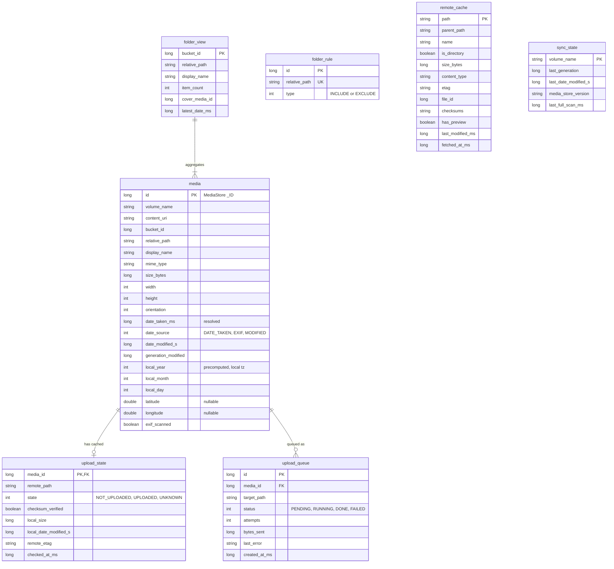

Notes:

- **Indexes**: `media(bucket_id, date_taken_ms DESC)`, `media(date_taken_ms DESC)`, `media(local_year, local_month, local_day)`, `media(latitude, longitude)` partial use via `WHERE latitude IS NOT NULL`, `remote_cache(parent_path)`, `upload_queue(status, created_at_ms)`.
- `upload_state.media_id` and `upload_queue.media_id` have `ON DELETE CASCADE` foreign keys to `media`.
- `local_year/month/day` are computed at index time in the device time zone. On time zone change (`ACTION_TIMEZONE_CHANGED`) `IndexWorker` recomputes them (cheap bulk update; no MediaStore access).
- `sync_state.media_store_version` stores `MediaStore.getVersion(volume)`; if it changes, generation numbers are invalid and a full scan runs.
- `remote_cache` is keyed by full remote path; `checksums` is the raw `oc:checksums` string (e.g. `SHA1:… MD5:…`).
- Grids query `media` only. A folder excluded by rules is never inserted; rule changes delete/insert affected rows (index-time filtering). Query-time filtering (`FolderRuleMatcher` translated to SQL `relative_path` prefix conditions) covers the window between a rule change and the re-index finishing.

### 4.2 DataStore

| Store | Content |
| --- | --- |
| `settings.preferences_pb` | Sort order, grid density, start destination, remote root, upload network constraint, save-copy-vs-overwrite default, pen colour/width. |
| `credentials.pb` | Tink-encrypted blob: server URL, login name, user id, app password. |

## 5. Key flows

### 5.1 Initial indexing and incremental sync

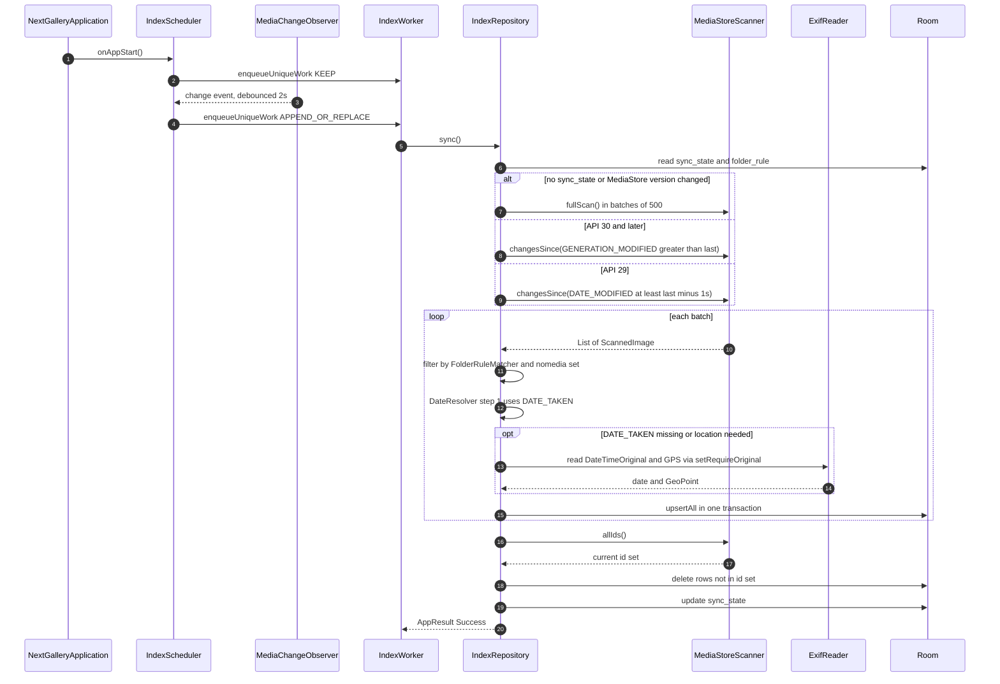

Details:

- Deletions are not reported by generation queries, so each sync compares ID sets (`allIds()` is a projection-only cursor; ~fast even at 50k rows). Rows are removed in chunks of 900 (SQLite variable limit).
- EXIF reading is the expensive part. GPS is read only for JPEG/HEIF/WebP during the scan, and in a **second pass** (`exif_scanned = false` rows) after the grid-relevant data is committed, so folders appear quickly on first launch. Date fallback order: `DATE_TAKEN` → EXIF `DateTimeOriginal` (with `OffsetTimeOriginal` when present) → `DATE_MODIFIED`.
- Without `ACCESS_MEDIA_LOCATION`, `setRequireOriginal` throws / GPS is redacted; location is then left null and the map shows a hint.
- With Android 14 partial access, the scan only sees user-selected images; the index is rebuilt from scratch whenever the selection changes (detected on resume via the permission state).
- `IndexWorker` is expedited for the first scan, runs as normal work otherwise, and reports progress through `setProgress` for the UI's indexing indicator.

### 5.2 Opening a folder grid with paging

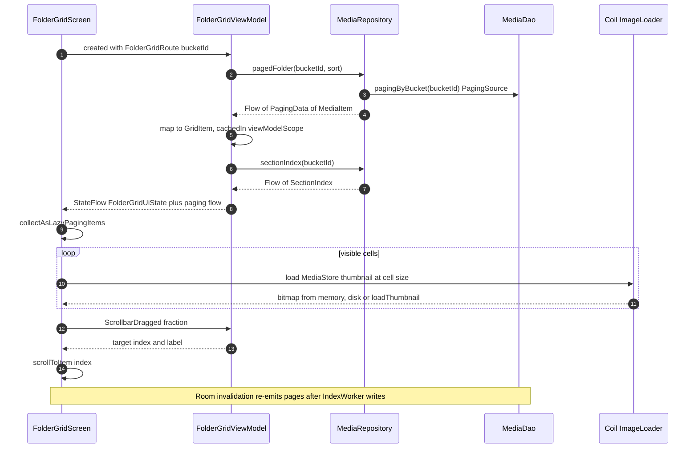

- Page size 120 (multiple of common column counts), prefetch distance 2 pages, `enablePlaceholders = true` so the total count is known and the fast scroll thumb maps 1:1 to positions.
- Upload badges: the grid collects `UploadStateRepository.observeStates(visibleIds)`; the map is combined per cell, not via a SQL join, so the paging query stays simple and cheap.

### 5.3 Full-screen viewer

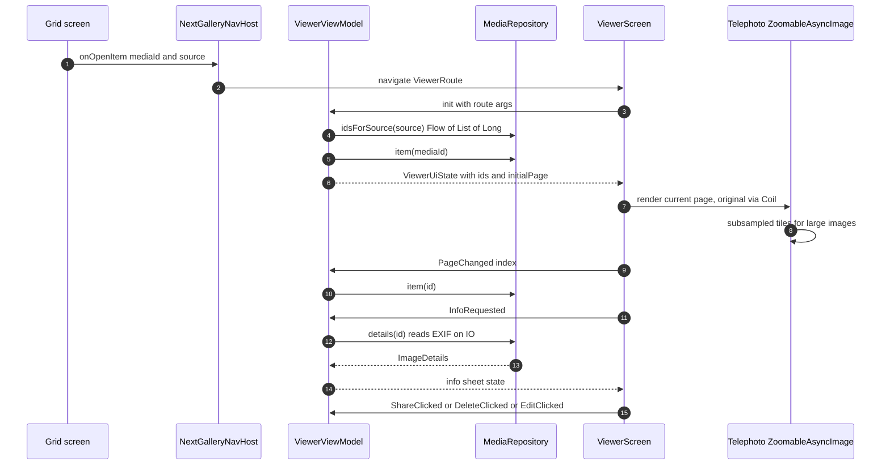

- `source` is a sealed route argument: `Folder(bucketId)`, `Timeline`, `MapCluster(ids)`, `Remote(parentPath)`. The id list is a lightweight `Flow<List<Long>>` (50k longs ≈ 400 KB) so the pager knows its size; items are loaded per page.
- Adjacent pages are preloaded at screen size via Coil; full-resolution tiles only for the visible page.
- Share uses `Intent.ACTION_SEND`/`ACTION_SEND_MULTIPLE` with MediaStore content URIs and `FLAG_GRANT_READ_URI_PERMISSION`.

### 5.4 Editing and saving

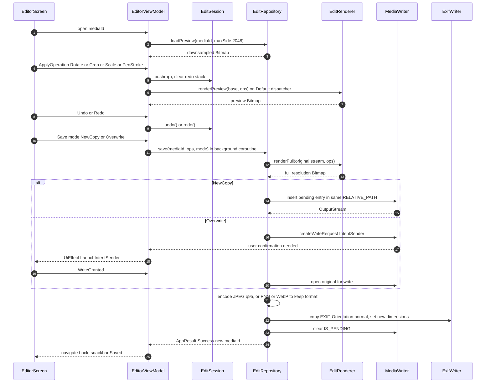

- `EditSession` is a plain class (`operations`, `undoStack`, `redoStack`, `canUndo`, `canRedo`) — fully unit-testable without Android.
- `EditRenderer` applies operations in order; normalized coordinates make preview and full-resolution rendering identical in output geometry. Pen strokes are drawn with `Canvas` + `Path` scaled to the current image size.
- Original EXIF orientation is applied first (bake-in), which is why the output orientation is reset to normal.
- Full-resolution rendering guards memory: decode with `ImageDecoder`; if `width * height * 4` bytes exceeds a budget (e.g. 1/4 of `Runtime.maxMemory()`), the editor warns and saves at the largest size that fits. The exact policy is an open question in [DESIGN_DECISIONS.md](DESIGN_DECISIONS.md).
- HEIC output is written as JPEG (no platform HEIC encoder guarantee on API 29); GIF is written as PNG.
- On API 29 overwrite goes through `RecoverableSecurityException`.

### 5.5 Delete with trash

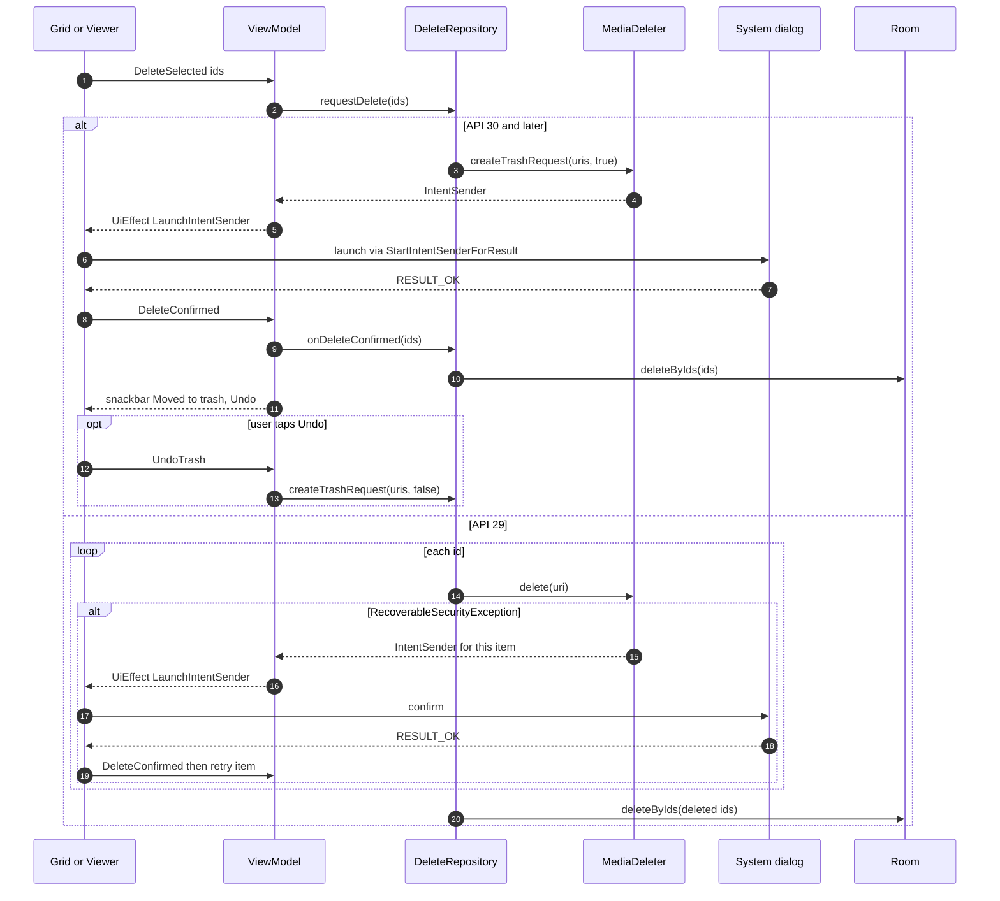

- Room rows are removed optimistically after confirmation so the grid updates instantly; the next `IndexWorker` run reconciles regardless. Untrash re-inserts via the next incremental sync (the item gets a new generation).
- `createDeleteRequest` (permanent) is offered as a secondary action in API 30+ (setting or long-press option).
- Android 10 has no trash; the confirmation dialog states that deletion is permanent.

### 5.6 Nextcloud Login Flow v2


- Server URL normalization: add `https://` if missing, strip trailing `/` and `/index.php`; `http://` is rejected in release builds (see 11).
- Polling runs in `viewModelScope`; leaving the screen cancels it. The poll token is never persisted.
- Logout: `DELETE ocs/v2.php/core/apppassword` (best effort), then `CredentialStore.clear()`, clear `remote_cache`, `upload_state`, pending `upload_queue`, and Coil's remote cache entries.

### 5.7 Upload-state check

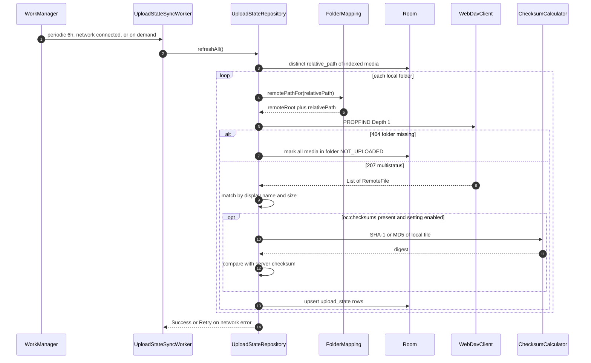

- Skip rule: a folder whose remote `etag` and local max(`date_modified`) are unchanged since `checked_at_ms` is not re-compared.
- Checksums are only computed for name+size matches, and only once per (`media_id`, `local_date_modified_s`) since the result is stored with `checksum_verified`.
- Grid badges read `upload_state` only; a missing row means `Unknown` (no badge or a neutral one).
- Nextcloud does not always compute checksums for files uploaded via other clients; absence of `oc:checksums` means "Uploaded (size match)".

### 5.8 Upload queue

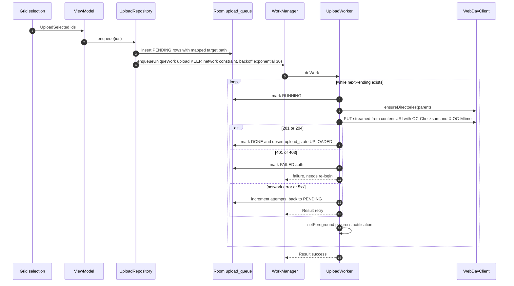

- `UploadWorker` runs as a foreground service worker (`dataSync` type) with a progress notification when more than one item or large files are pending.
- Name conflicts: if the target exists with a different size, the worker does not overwrite; it marks the row `FAILED(conflict)` and surfaces it in the queue UI (policy tracked in DESIGN_DECISIONS.md).
- Max attempts per item: 5; after that `FAILED` until the user retries.
- Chunked upload (Nextcloud chunking v2) for files above a threshold is a later enhancement behind `WebDavClient`.

## 6. Navigation

Single activity, Navigation Compose with type-safe `@Serializable` routes. Each feature exposes its route types and a `NavGraphBuilder` extension; `:app` connects them. Bottom navigation for the four top-level destinations; settings from the top app bar.

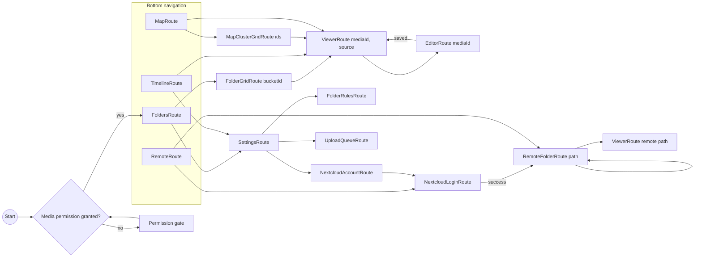

Rules:

- Route arguments carry only IDs/paths, never full objects. Large ID lists (map clusters) are passed via a short-lived `SavedStateHandle`-backed holder in the repository keyed by a token, not through the route.
- Feature screens receive navigation lambdas (`onOpenItem: (Long, ViewerSource) -> Unit`) instead of a `NavController`.
- Deep links (`ACTION_VIEW` of an image) open `ViewerRoute` directly (post-v1).

## 7. State management

Pattern per screen:

```kotlin
data class FolderGridUiState(
    val title: String = "",
    val sectionIndex: SectionIndex = SectionIndex.Empty,
    val selection: Set<Long> = emptySet(),
    val uploadBadgesEnabled: Boolean = false,
    val isIndexing: Boolean = false,
    val error: UiText? = null,
)

sealed interface FolderGridEvent {
    data class ItemClicked(val id: Long) : FolderGridEvent
    data class ItemLongPressed(val id: Long) : FolderGridEvent
    data object ClearSelection : FolderGridEvent
    data object DeleteSelected : FolderGridEvent
    data object ShareSelected : FolderGridEvent
    data object UploadSelected : FolderGridEvent
    data class DeleteResult(val confirmed: Boolean) : FolderGridEvent
}

sealed interface FolderGridEffect {
    data class OpenViewer(val id: Long) : FolderGridEffect
    data class LaunchIntentSender(val sender: IntentSender) : FolderGridEffect
    data class Share(val uris: List<String>) : FolderGridEffect
    data class ShowMessage(val text: UiText, val undo: Boolean) : FolderGridEffect
}

@HiltViewModel
class FolderGridViewModel @Inject constructor(
    savedStateHandle: SavedStateHandle,
    private val media: MediaRepository,
    private val delete: DeleteRepository,
    private val upload: UploadRepository,
) : ViewModel() {
    private val route = savedStateHandle.toRoute<FolderGridRoute>()
    val items: Flow<PagingData<GridItem>> = media.pagedFolder(route.bucketId).cachedIn(viewModelScope)
    val state: StateFlow<FolderGridUiState> = /* combine(...).stateIn(viewModelScope, WhileSubscribed(5_000), FolderGridUiState()) */
    val effects: Flow<FolderGridEffect> = /* Channel(BUFFERED).receiveAsFlow() */
    fun onEvent(event: FolderGridEvent) { /* ... */ }
}
```

`PagingData` is exposed as a separate flow (not inside `UiState`) because it must be `cachedIn` and collected with `collectAsLazyPagingItems`.

Other screens (abbreviated):

| Screen | UiState fields |
| --- | --- |
| Folders | `folders: List<Folder>`, `access: MediaAccess`, `isIndexing`, `indexProgress` |
| Timeline | `sectionIndex` (year/month labels), `selection`, `isIndexing` (+ separate paging flow with `GridItem.Header`) |
| Map | `clusters: List<MapCluster>` for current viewport + zoom, `itemsWithoutLocation: Int`, `locationPermissionMissing: Boolean` |
| Viewer | `ids: List<Long>`, `currentIndex`, `current: MediaItem?`, `details: ImageDetails?`, `chromeVisible`, `infoSheetVisible` |
| Editor | `preview: ImageBitmap?`, `tool: EditTool`, `cropRect`, `aspect`, `penColor`, `penWidth`, `canUndo`, `canRedo`, `isSaving`, `saveMode` |
| Remote browser | `path`, `entries: List<RemoteFile>`, `isRefreshing`, `isOffline` (shows cached `remote_cache` data), `error` |
| Login | `serverUrl`, `step: Idle / WaitingForBrowser / Verifying / Done`, `error` |
| Settings | `settings: AppSettings`, `rules: List<FolderRule>`, `account: NextcloudAccount?`, `queueCount` |

Process death: route args come from `SavedStateHandle`; transient UI (selection, editor operations) is saved via `SavedStateHandle` where cheap (selection as `LongArray`, editor operations serialized with kotlinx.serialization).

## 8. Threading and concurrency

| Work | Where it runs |
| --- | --- |
| Compose rendering, state collection | Main |
| Room queries | Room's own executor (suspend DAOs / Flow / PagingSource) |
| MediaStore cursors, EXIF, file I/O, checksums, OkHttp | `Dispatchers.IO` via injected `DispatcherProvider` |
| Bitmap transforms (editor preview/full render), clustering, section index computation | `Dispatchers.Default` |
| Indexing, upload-state sync, uploads | WorkManager `CoroutineWorker`s (survive process death; unique work names) |

Rules:

- No `GlobalScope`. Long-lived app-level collectors (ContentObserver → scheduler) run in an `@ApplicationScope CoroutineScope` (`SupervisorJob + Default`) provided by Hilt.
- Unique work names: `index` (one at a time; `APPEND_OR_REPLACE` coalesces triggers), `upload` (`KEEP`), `upload-state-sync` (periodic, `UPDATE`).
- Room writes in batches inside `withTransaction`; the indexer yields between batches (`ensureActive()`), so cancellation is prompt.
- Editor full-resolution save runs in `viewModelScope` with `NonCancellable` around the final MediaStore commit (write + clear `IS_PENDING`), so a half-written entry is never left visible. A pending entry left by a crash is cleaned up on next start (pending items older than 1 day are deleted by `MediaWriter.cleanupPending()`).
- Flows from repositories are cold; ViewModels convert with `stateIn(viewModelScope, SharingStarted.WhileSubscribed(5_000), initial)`.

## 9. Caching

### 9.1 Thumbnails and images

- Single Coil 3 `ImageLoader` (app singleton) with:
  - Memory cache: 20 % of app memory.
  - Disk cache: `cacheDir/image_cache`, 250 MB (configurable later).
  - Custom `MediaStoreThumbnailFetcher` for local grid cells: `ContentResolver.loadThumbnail(uri, Size, signal)` — uses the system thumbnail cache, which is faster than decoding originals. Cache key includes `id + date_modified + size bucket`, so edited images refresh.
  - Size buckets (e.g. 256 / 512 px) instead of exact sizes to maximise cache hits across grid densities.
- Viewer: Telephoto's `ZoomableAsyncImage` uses Coil for the screen-sized image and sub-sampled tiles for full resolution; tiles are not disk-cached (originals are local).
- Hardware bitmaps enabled for grids; disabled in the editor (needs software bitmaps).

### 9.2 Remote previews and files

- `NextcloudPreviewFetcher` requests `core/preview?fileId=…&x=…&y=…` through the authenticated OkHttp client; cache key is `fileId + etag + size bucket`, so a changed remote file is re-fetched. Stored in the same Coil disk cache.
- Opening a remote image full screen fetches a large preview first (e.g. 2048 px), and the original via WebDAV `GET` only when zooming beyond preview resolution. Originals are streamed into Coil's disk cache, never into the MediaStore.
- `remote_cache` table holds the last PROPFIND result per folder for instant display and offline browsing; refreshed on open (stale-while-revalidate) and on pull-to-refresh.

### 9.3 Index and upload state

- The Room index is the cache of MediaStore; it is reconciled incrementally, so app start shows data immediately and syncs in background.
- `upload_state` caches server comparison results; badges never wait on the network.
- Section indexes (timeline headers / fast scroll labels) are computed via `GROUP BY` queries on precomputed `local_year/month/day` columns and cached in the ViewModel until Room invalidates.

## 10. Error handling

- Data sources throw; **repositories catch** and return `AppResult` / emit errors in flows. `CancellationException` is always rethrown (`runCatchingCancellable`).
- `AppError` is mapped to user-visible `UiText` in the ViewModel (one mapper per feature, using shared strings in `:core:ui`).
- Categories:
  - **Permission**: missing media permission → `PermissionGate`; partial access → banner with "select more"; missing `ACCESS_MEDIA_LOCATION` → map hint, no crash.
  - **User confirmation**: `RecoverableSecurityException` / write and delete requests → `UiEffect.LaunchIntentSender`; this is a normal flow, not an error.
  - **Stale data**: item deleted outside the app while opened → `NotFound`; the viewer skips to the next page and the grid refreshes via index sync.
  - **Network** (`IOException`, timeouts): remote browser shows cached data with an offline banner; workers return `Result.retry()`.
  - **Auth** (401): account marked as "needs re-login"; workers stop with failure; a persistent banner links to login.
  - **Server** (5xx, 507 insufficient storage): queue entry `FAILED` with reason; retry for 5xx, no retry for 507.
  - **Decode/encode** (corrupt file, OOM risk): thumbnail shows an error placeholder; editor refuses to save with a message.
- Crashes: no crash reporting service (no tracking). Uncaught exceptions use the default handler; an opt-in local log export may be added later.
- Logging: a thin `Logger` interface in `:core:common`, backed by `android.util.Log` in debug and stripped below `WARN` in release via R8 rules. Never log URLs with credentials, app passwords, or file names in release.

## 11. Security and privacy

- **Credentials**: Login Flow v2 only; the account password is never seen by the app. The app password is stored in a DataStore file encrypted with a Tink `Aead` (AES256-GCM); the Tink keyset is encrypted by an Android Keystore master key (`AndroidKeysetManager`, `android-keystore://` URI). No `EncryptedSharedPreferences` (deprecated).
- Credentials excluded from backup: `android:dataExtractionRules` / `fullBackupContent` exclude the credentials store and Tink keyset prefs (Keystore keys do not survive restore anyway).
- **TLS**: platform defaults via OkHttp; `network_security_config.xml` disallows cleartext traffic, so v1 accepts `https://` servers only (cleartext for debug builds only, via a debug-only config). Whether to trust user-installed CAs (`<certificates src="user"/>`, common for self-hosted Nextcloud with a private CA) is an open question in [DESIGN_DECISIONS.md](DESIGN_DECISIONS.md).
- Authorization header added only for requests to the configured server host (interceptor checks host), so redirects to other hosts never leak credentials.
- **No tracking**: no analytics, no crash reporting SDKs, no Google Play Services. osmdroid tile requests go to OSM tile servers with a proper user agent (required by OSM tile usage policy); this is the only third-party network traffic and is triggered only by opening the map.
- **Least privilege**: only `READ_MEDIA_IMAGES`/`READ_EXTERNAL_STORAGE`(maxSdk 32), `READ_MEDIA_VISUAL_USER_SELECTED`, `ACCESS_MEDIA_LOCATION`, `INTERNET`, `ACCESS_NETWORK_STATE`, `POST_NOTIFICATIONS`, `FOREGROUND_SERVICE` + `FOREGROUND_SERVICE_DATA_SYNC` (uploads). Destructive actions go through system dialogs.
- Shared URIs are MediaStore content URIs with temporary read grants; no `FileProvider` exposing app storage.

## 12. Performance

Targets: cold start to first folder grid < 1 s with an existing index; 60/120 fps scrolling and fast scrolling on a 50 000-image library; first full index of 50 000 images in under ~1 minute without EXIF pass.

- **Query only Room** for grids; MediaStore is touched only by the indexer.
- **Paging 3 with placeholders** gives a stable item count, so `LazyVerticalGrid` can jump anywhere; Room's `PagingSource` uses `LIMIT/OFFSET` on indexed columns. For very deep jumps, the grid requests the page around the target via `scrollToItem` and placeholders render until loaded.
- **Fast-scroll section index**: computed once per data version via aggregated SQL (`SELECT local_year, local_month, COUNT(*) … GROUP BY …`), turned into cumulative `firstIndex` offsets. Dragging the thumb is O(log n) (binary search in sections) and does not load items until the drag settles (throttled `scrollToItem`, e.g. every 32 ms).
- **Timeline headers**: header items are inserted with `PagingData.insertSeparators` (day changes); sticky header text is derived from the first visible item's date, not from a separate list.
- **Stable keys and content types** in lazy grids (`key = id`, `contentType = header/item`) to avoid recomposition and enable reuse.
- **Thumbnails**: system `loadThumbnail` + size buckets + memory cache; no crossfade during fast scroll; requests cancelled when cells leave the screen (Coil does this per composable).
- **Indexing**: projection limited to needed columns; batched transactions; EXIF read deferred to a second pass; ContentObserver debounced; incremental sync via generation numbers touches only changed rows.
- **Map**: clustering computed on `Default` for the viewport only, from a lightweight `(id, lat, lon)` projection; recomputed on zoom/pan with debounce.
- **Memory**: viewer limits decoded size to screen size except visible tiles; editor preview max 2048 px side.
- **Baseline profiles** (`:baselineprofile` module, added once screens are stable) and R8 full mode for release builds; Macrobenchmark for startup and grid scrolling.
- Compose stability: `UiState` classes are immutable data classes with `kotlinx.collections.immutable` collections or `@Immutable` where needed.

## 13. Testing strategy

Principles: every function gets a unit test; tests are small, independent and non-overlapping (each behaviour is asserted in exactly one test at the lowest layer that owns it). Tools: JUnit 4, MockK, Turbine, kotlinx-coroutines-test (`runTest`, `StandardTestDispatcher` via an injected `DispatcherProvider`), Robolectric where Android framework classes are needed, Room in-memory databases, OkHttp `MockWebServer`, Compose UI tests.

| Layer / module | What is tested | How |
| --- | --- | --- |
| `:core:model`, `:core:common` | Model validation (`GeoPoint` ranges, `NormalizedRect`), `AppResult` helpers, `RelativePaths`, `runCatchingCancellable` | Plain JVM JUnit |
| `:core:database` | Each DAO query (paging order, rule filtering, section aggregation, cascade deletes), migrations | Robolectric + in-memory Room; `MigrationTestHelper` with exported schemas |
| `:core:media` | Cursor-to-`ScannedImage` mapping, API-level branching (`SdkVersion` faked), EXIF parsing from fixture files, delete/trash request selection, permission state computation | Robolectric (`ShadowContentResolver`, fake cursors `MatrixCursor`), EXIF fixtures in `src/test/resources` |
| `:core:nextcloud` | PROPFIND XML parsing, request building (headers, depth, body), Login Flow v2 polling states, error mapping, auth interceptor host check, credential store round trip | `MockWebServer`; parser tests are pure JVM; `CredentialStore` with Tink test keyset (JVM) |
| `:core:data` | `DateResolver`, `FolderRuleMatcher`, `FolderMapping`, upload-state matching, indexer sync logic (full vs incremental vs version change), repository mapping and error handling, `EditSession` undo/redo | JVM + MockK fakes of data sources; Turbine for flows |
| Workers | `IndexWorker`, `UploadWorker`, `UploadStateSyncWorker` result codes (success / retry / failure) | `TestListenableWorkerBuilder` + Robolectric; repositories mocked |
| Editor rendering | Each `EditOperation` geometry on small bitmaps (rotate dimensions, crop rect, scale size, stroke pixels) | Robolectric with native graphics (`@GraphicsMode(NATIVE)`) |
| ViewModels | Event → state transitions, effects emitted, paging flow wiring | `runTest` + Turbine; fake repositories |
| UI | Key screens: folder grid (selection, fast-scroll label), viewer (paging, info sheet), editor (undo/redo buttons enabled state), login steps, permission gate | Compose UI tests (`createComposeRule`) on Robolectric for speed; a small instrumented smoke suite on emulator |
| Performance | Startup, grid scroll jank | Macrobenchmark (later) |

Test doubles: hand-written fakes for repositories (`FakeMediaRepository`) live next to the tests that need them; if they get duplicated across feature modules they move to Gradle `testFixtures` of `:core:data`. MockK is used for leaf collaborators. Test names follow `functionName_condition_expectedResult`.

CI (when added): `./gradlew lint testDebugUnitTest` on every push; Compose/instrumented tests on an emulator job.
