# NextGalleryApp – Architecture

This document describes the architecture of the NextGalleryApp Android app. The product scope, feature list and roadmap live in the [README](../README.md); the reasoning behind choices and open questions are in [DESIGN_DECISIONS.md](DESIGN_DECISIONS.md); implementation steps are in [TODO.md](TODO.md).

## Contents

1. [Goals and constraints](#1-goals-and-constraints)
2. [Layered overview](#2-layered-overview)
3. [Modules](#3-modules)
4. [Data model](#4-data-model)
5. [Key flows](#5-key-flows)
6. [Navigation](#6-navigation)
7. [State management](#7-state-management)
8. [Threading and concurrency](#8-threading-and-concurrency)
9. [Caching](#9-caching)
10. [Error handling](#10-error-handling)
11. [Security and privacy](#11-security-and-privacy)
12. [Performance](#12-performance)
13. [Testing strategy](#13-testing-strategy)

---

## 1. Goals and constraints

The goals are in the [README](../README.md#goals). The ones that shape the architecture:

| Constraint | Architectural consequence |
| --- | --- |
| Fast with tens of thousands of images | Local Room index is the only thing grids query; Paging 3 everywhere; precomputed section index for fast scroll. |
| Local first, offline | Nextcloud is an optional layer; no screen except `:feature:remote` blocks on the network. Upload badges come from a Room cache. |
| No tracking, no Google Play Services | Only AndroidX, Kotlin, OkHttp, Coil, Telephoto, osmdroid, Tink. No Firebase, no Play Services location/maps, no analytics. |
| Min/target SDK 37 (Android 17) only, reference device Pixel 10a | No API-level branches or legacy code paths; `GENERATION_MODIFIED`, trash/write requests and partial media access are always available. Performance targets (section 12) are measured on the Pixel 10a. |
| Visual design delivered later (Claude Design) | All visual values live in `NextGalleryTheme` in `:core:ui`; features use theme tokens only, so the design can be applied in one module. |
| v1 scope: images only | JPEG, PNG, WebP, HEIC/HEIF, GIF (static first frame) can be viewed; only JPEG and PNG can be edited (D29). Video is excluded at query time (`MediaStore.Images` only). |
| GPL v3, no public distribution yet (D27, D28) | Only GPL-3.0-compatible, non-proprietary dependencies, so an F-Droid release stays possible later. |
| Single Nextcloud account in v1 | Credential store and settings hold one account; the schema does not key data by account. |
| Uploads are done by the Nextcloud app (D31) | No upload queue, no foreground service, no upload notifications. The app only hands images over and checks the upload status. |

## 2. Layered overview

The app uses **MVVM with unidirectional data flow** on top of an **Android-independent core**. Each screen's ViewModel exposes one immutable `StateFlow<UiState>` and accepts UI events through a single `onEvent(event)` function. Repositories are the single source of truth: the UI never talks to MediaStore, Room or WebDAV directly. Room is the source of truth for the local index. Kotlin coroutines and `Flow` are used throughout.

All business logic (repositories, indexing, matching, editing geometry, clustering, upload-status logic) lives in pure Kotlin/JVM modules with no `android.*` dependency, so it is tested with plain JUnit on CI. Android APIs are reached through small interfaces (**ports**) declared in `:core:data` and implemented by thin **adapters** in Android modules (`:core:database`, `:core:media`, `:core:platform`). Adapters only translate between the platform and `:core:model` types; they make no decisions.

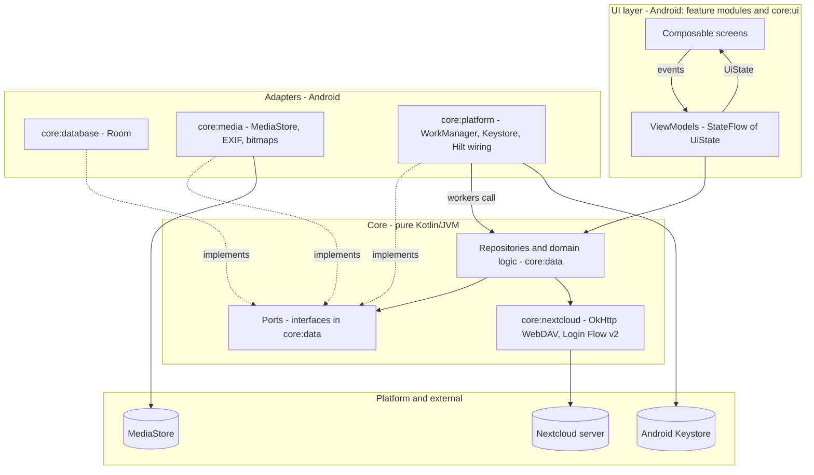

Rules:

- **UI layer**: Compose only renders `UiState` and emits events. No business logic in composables.
- **ViewModel**: maps repository flows into `UiState`, handles events, launches one-shot work in `viewModelScope`. Exposes one-off effects (system confirmation dialogs, snackbars, navigation) through a `Channel`-backed `Flow<UiEffect>`. ViewModels use no `android.*` classes: route arguments arrive through Hilt assisted injection (not `SavedStateHandle.toRoute`, which needs `Bundle`), and system dialogs are passed as an opaque `PlatformConfirmation` (see 3.3). ViewModel tests are plain JVM tests without Robolectric.
- **Repository** (`:core:data`): combines ports and the Nextcloud client, owns caching policy and all decisions. Returns `Flow` for observable data and `suspend` functions returning `AppResult` for commands.
- **Ports** (`:core:data`): interfaces in terms of `:core:model` types (content URIs as `String`, no `Uri`, `Bitmap` or `Cursor`).
- **Adapters**: thin wrappers around one platform technology each; no cross-source logic and no branching beyond mapping. Room entities, cursors and bitmaps never leave their adapter module.
- **Domain models** (`:core:model`) are plain Kotlin classes used across all layers.

## 3. Modules

### 3.1 Build setup

- Gradle Kotlin DSL; dependencies and versions in `gradle/libs.versions.toml`.
- Convention plugins in `build-logic/convention`:
  - `nextgallery.android.application` – `:app` defaults (SDK levels, application ID, Kotlin toolchain 21, R8 config).
  - `nextgallery.android.library` – Android library defaults.
  - `nextgallery.android.compose` – enables Compose and adds the Compose BOM.
  - `nextgallery.android.feature` – library + compose + Hilt + dependencies every feature needs (`:core:ui`, `:core:data`, `:core:model`, Navigation Compose, lifecycle-viewmodel-compose).
  - `nextgallery.android.hilt` – Hilt + KSP.
  - `nextgallery.android.room` – Room + KSP + schema export directory (`<module>/schemas`).
  - `nextgallery.jvm.library` – pure Kotlin/JVM modules (`:core:model`, `:core:common`, `:core:data`, `:core:nextcloud`): `kotlin("jvm")`, toolchain 21, `javax.inject` for `@Inject` constructors (Hilt bindings for them live in Android modules), JUnit/MockK/Turbine/coroutines-test.
  - `nextgallery.android.test` – shared Android test dependencies (Robolectric 4.17+, androidx.test), the `AndroidJUnitRunner` setup for instrumented tests and JaCoCo unit test coverage. Applied by the application and library plugins.
  - `nextgallery.detekt`, `nextgallery.ktlint` – static analysis (`config/detekt/detekt.yml`, `.editorconfig`), applied by every base plugin.
- Shared conventions:
  - Android namespaces are derived from the project path (`:core:database` → `net.drehtuer.nextgallery.core.database`; `:app` → `net.drehtuer.nextgallery`).
  - `compileSdk` 37 with `compileSdkMinor = 0` (platform `android-37.0`); AGP 9 compiles Kotlin itself (built-in Kotlin), so Android modules do not apply `org.jetbrains.kotlin.android`.
  - Lint runs with `warningsAsErrors`; `config/lint/lint.xml` only disables "newer version available" checks.
  - The feature plugin fails the build if a `:feature:*` module declares a dependency on another `:feature:*` module.
  - Espresso is pinned to 3.7.0 for tests, because the version pulled in by Compose UI test calls an API removed in SDK 37.
- The build environment is a devcontainer (`.devcontainer/`: JDK 21, Android SDK platform `android-37.0`, build-tools 36.0.0); CI builds inside the same image (`devcontainers/ci`).
- A JVM module cannot depend on an Android library (Gradle cannot resolve an AAR for a `kotlin("jvm")` module), so the Android-free core is enforced by the build itself.

### 3.2 Module dependency graph

Feature modules depend only on core modules, never on each other. `:app` is the only module that knows all features and wires navigation between them. Adapter modules depend on `:core:data` (to implement its ports), not the other way round.

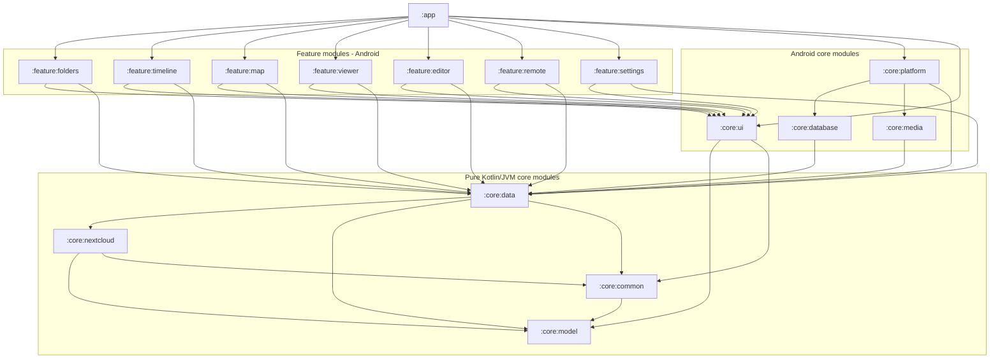

`:core:ui` additionally depends on Coil and paging-compose (it provides the shared image loading and grid composables); the Coil `ImageLoader` itself is configured in `:app` (see [9.1](#91-thumbnails-and-images)).

### 3.3 Module responsibilities

Package root and application ID: `net.drehtuer.nextgallery` (D26). Class names below are the intended public surface; internals may grow.

#### `:app`

| Class | Responsibility |
| --- | --- |
| `NextGalleryApplication` | `@HiltAndroidApp`; implements `Configuration.Provider` (HiltWorkerFactory) and `SingletonImageLoader.Factory` (Coil). Starts `RuleChangeObserver` in a scope not tied to an activity. |
| `MainActivity` | Single activity, edge-to-edge, hosts `NextGalleryNavHost`, applies the theme mode, accent and grid columns from `MainViewModel` to `NextGalleryTheme` and the system bars. Handles `ACTION_VIEW`/`ACTION_SEND` intents later. |
| `NextGalleryNavHost` | Navigation Compose graph; maps each feature's navigation callbacks to routes of other features. |
| `TopLevelDestination` | Enum of bottom-bar destinations (Folders, Timeline, Map, Nextcloud). |
| `ImageLoaderModule` | Hilt module building the Coil `ImageLoader` for local images (memory + disk cache, MediaStore thumbnail fetcher, no network fetcher) and the `@RemoteImageLoader` for server images (own memory and 500 MB disk cache, all requests through the authenticated OkHttp client). `RemoteImageCacheModule` wipes the latter at logout and provides `NextcloudHttpConfig` (`allowCleartext` only in debug builds). |

#### `:core:model` (pure Kotlin)

| Type | Notes |
| --- | --- |
| `MediaItem` | `id: Long` (MediaStore `_ID`), `contentUri: String`, `relativePath`, `displayName`, `mimeType`, `sizeBytes`, `width`, `height`, `orientation`, `dateTakenMillis` (resolved, see 5.1), `dateModifiedMillis`, `location: GeoPoint?`, `bucketId`. |
| `Folder` | `bucketId`, `name`, `relativePath`, `itemCount`, `coverItem: MediaItem` (newest image). |
| `FolderRule` | `relativePath`, `type: Type { INCLUDE, EXCLUDE }`. Covers the folder and its subfolders. |
| `DeviceFolder` | `name`, `relativePath`, `itemCount`: a folder MediaStore has images in, whether indexed or not. |
| `GeoPoint` | `latitude`, `longitude` (validated ranges); `formatted()` gives "45.62° N, 10.68° E". |
| `GeoBounds` | `south`, `west`, `north`, `east`; `west > east` crosses the antimeridian. `encode()` / `decode()` for route arguments. |
| `MapCamera`, `Viewport` | What the map should show (centre, zoom), and what it shows right now (with bounds). |
| `GeotaggedImage` | `id`, `location`, `dateTakenMillis`: the light form of an image for clustering. |
| `Cluster` | `center`, `items`; derives `count`, `coverId` (newest image) and `bounds` (holds exactly its images, because they come from one grid cell). |
| `Place`, `ClusterTitle`, `MapCluster` | A place from the bundled list; a cluster's name (largest place, number of other places); a cluster as the map shows it (with title and cover). |
| `RemoteItem` | `path` (decoded, relative to the user's files, root `/`), `name`, `isDirectory`, `size`, `mime`, `etag`, `lastModifiedMillis`, `fileId`, `checksums` (raw `oc:checksums`), `permissions` (raw `oc:permissions`), `hasPreview`, `childCount`. |
| `RemotePaths` | Decoded server paths: `normalize`, `parent`, `name`, `join`, `ancestors`, `isValidName`. |
| `RemoteImageUrls` | Preview and original URL of an item. Screens get this instead of the account, so its secret stays out of UI state. |
| `UploadState` | sealed: `Unknown`, `NotUploaded`, `Uploaded(verifiedByChecksum: Boolean)`. |
| `CertificateInfo` | `host`, `subject`, `issuer`, `notBeforeMillis`, `notAfterMillis`, `sha256Fingerprint`, `pinnedFingerprint` (the certificate accepted earlier, if this one differs), `changedFromPinned`. |
| `MediaSource` | The list a viewer pages through: `Folder(bucketId)`, `Timeline`, `Map(bounds)`. |
| `ImageDetails` | What the image info sheet shows: file values plus formatted EXIF values. |
| `ShareSpec` | Content URIs and MIME type to share; `:core:ui` turns it into an intent. |
| `TrashEffect` | The next UI step when moving images to the trash: confirmation, message with undo, or failure. |
| `ViewContext` | `Folder(bucketId)`, `Timeline`, `Map` – used by the selection overview to decide which selected items the current view can show. |
| `EditOperation` | sealed: `Rotate(quarterTurns)`, `Crop(rect: NormalizedRect)`, `Scale(targetWidth, targetHeight)`, `PenStroke(points: List<NormalizedPoint>, colorArgb, widthFraction)`. Coordinates are normalized (0..1) relative to the image *after* previous operations, so they are resolution independent. |
| `EditHistory`, `CropMath`, `ScaleMath`, `GeometryMapper` | Undo and redo over the operations; the crop frame and its ratios; sizes for the scale tool; normalized coordinates through operations. |
| `PreviewImage` | Opaque wrapper (`handle: Any`, width, height) around a rendered image. `:core:media` puts a `Bitmap` inside, `:core:ui` draws it. |
| `AspectRatio` | `FREE`, `ORIGINAL`, `SQUARE`, `R4_3`, `R16_9`. |
| `NextcloudAccount` | `serverUrl`, `loginName`, `userId`, `appPassword`. `toString` hides the password, so it can't reach a log. |
| `DayCount` | `date`, `count`: the number of images of a local date, from which `TimelineIndex` builds the timeline's layout. |
| `MediaAccess` | `Full`, `Partial`, `Denied`. |
| `PlatformConfirmation` | Opaque wrapper (`handle: Any`) around a system confirmation request. The `:core:media` adapter puts an `IntentSender` inside; `:core:ui` launches it. Core and ViewModels only pass it through, and tests use any placeholder object. |
| `UserSettings`, `ThemeMode` | User preferences: `folderRules`, `excludePatterns`, `gridColumns`, `themeMode`, `accentColor`, `remoteRoot`, `tileUrl`, `currentLocationAsked`, with their defaults. |

#### `:core:common` (pure Kotlin)

- `AppResult<T>` – `Success(value)` / `Failure(error: AppError)`; `AppError` sealed; implemented so far: `Io(message)`, `PermissionDenied`, `NotFound`, `InsufficientMemory(requiredBytes, availableBytes)`, `OriginalDamaged(recoveredAsCopy)`, `Unknown(cause)`, with `AppError.from(throwable)`, and for Nextcloud `Network`, `Auth`, `NotLoggedIn`, `Forbidden`, `Conflict`, `Server(code)`, `UntrustedCertificate(info: CertificateInfo)`, `LocalNetworkBlocked`, `InvalidServerUrl`, `LoginExpired`, `InvalidName`.
- `DispatcherProvider` interface (`io`, `default`) + `DefaultDispatcherProvider`; the Hilt binding lives in `:core:platform`. ViewModels use `viewModelScope`, so no main dispatcher is injected.
- `Clock` (`nowMillis()`, `zone()`) + `SystemClock`.
- Utilities: `RelativePaths` (`normalize`, case-insensitive `isUnder`), `runCatchingCancellable` (never swallows `CancellationException`), `ScrollbarMath` (fast scrollbar position ↔ first visible item; here rather than in `:core:data` because `:core:ui` uses it).

#### `:core:data` (pure Kotlin/JVM)

The heart of the app. Depends on `:core:model`, `:core:common`, `:core:nextcloud`, `paging-common`, `datastore-preferences-core` and `kotlinx-serialization-json` (all JVM artifacts). No Android dependency.

Ports (implemented by adapters):

| Port | Implemented in | Purpose |
| --- | --- | --- |
| `MediaScanSource` | `:core:media` | Per volume: `volumes()`, `mediaStoreVersion(volume)`, `currentGeneration(volume)`, `fullScan(volume)`, `changesSince(volume, generation)`, `allIds(volume)`. |
| `MediaChangeSource` | `:core:media` | `Flow<Unit>` of MediaStore change notifications. |
| `ExifSource` | `:core:media` | Raw EXIF values (date strings, offset, GPS, camera fields) for a content URI. |
| `MediaContentSource` | `:core:media` | `openInputStream(contentUri)`, size, for checksums. |
| `MediaWriteSink` | `:core:media` | Existing names in a folder, insert pending copy, write, publish, discard, overwrite request as `PlatformConfirmation`, temporary backup, cleanup after a crash. |
| `MediaDeleteSource` | `:core:media` | Trash, restore and permanent delete requests as `PlatformConfirmation`. |
| `ImageRenderer` | `:core:media` | Upright size of a file, decode at a sample size, apply a `RenderPlan` (matrix and strokes computed by `EditGeometry`), encode to a temporary file, release. |
| `ExifWriter` | `:core:media` | Reads tags of a source image, writes tags to an encoded image. |
| `MediaPermissionSource` | `:core:media` | Currently granted media and location permissions as strings. |
| `GeoIndexStore` | `:core:database` | The locations in the index: `observeGeotagged()`, `unscanned(limit)`, `saveLocations(locations)`, `pagedInBounds(bounds, config)`, `indexInBounds(bounds, id)`. |
| `PlaceSource` | `:core:platform` | The bundled GeoNames list (D45); empty if the app ships without it. |
| `LocationProvider` | `:core:platform` | The device's position from the platform `LocationManager` (D44). |
| `MediaIndexStore` | `:core:database` | Index reads/writes, folder list; paged queries returned as `Flow<PagingData<MediaItem>>` (the repository decides the `PagingConfig`; the Room adapter builds the `Pager` and maps entities). |
| `UploadStateStore`, `RemoteCacheStore`, `SyncStateStore` | `:core:database` | Room tables behind model-typed interfaces. |
| `ConnectivitySource` | `:core:platform` | `isOnline` flow from `ConnectivityManager`. |
| `LocalNetworkPermissionSource` | `:core:platform` | Whether `ACCESS_LOCAL_NETWORK` is granted (D39). |
| `RemoteShareCache` | `:core:platform` | The temporary folder and content URIs for sharing server images (D48). |
| `RemoteImageCache` | `:app` | Wipes the Coil caches of server images at logout. |
| `WorkScheduler` | `:core:platform` | `enqueueIndex(mode)`, `scheduleUploadStateSync()`, `requestUploadStateSync()`. |
| `NextcloudAppSource` | `:core:platform` | `isInstalled()` for `com.nextcloud.client`. |
| `SecretCipher` | `:core:platform` | `encrypt(bytes)` / `decrypt(bytes)` backed by Tink + Android Keystore. |
| `MemoryInfoSource` | `:core:platform` | `availableBytes()` from `ActivityManager.MemoryInfo`, minus a safety margin and at most half of the RAM. |

Repositories (interfaces + `Default…` implementations with `@Inject` constructors):

| Repository | Responsibility |
| --- | --- |
| `MediaRepository` | Paged lists per `MediaSource` (grid and viewer), position of an image in a list, item lookup, image details (EXIF on demand, with the place name). |
| `MapRepository` | `observeClusters(viewport)` (debounced, computed on `Default`, with titles and covers), `observeHasGeotagged()`, `startCamera(location)` (D44). |
| `FolderRepository` | Folder list with counts/covers from the index; `observeAllDeviceFolders()` lists the folders in MediaStore regardless of the rules, for the folder rules screen. |
| `IndexRepository` | Full scan, incremental sync, deletion detection (`MediaIndexer`); publishes `IndexStatus` flow. |
| `MediaActionsRepository` | Delete/trash and restore requests, removes rows and deselects after a confirmed result, `ShareSpec` for images. `TrashFlow` (one instance per ViewModel) holds the steps of request, confirmation and undo. |
| `EditRepository` | Edit pipeline: opening, preview, memory checks, and saving through `EditedImageWriter` (`EditGeometry` → `ImageRenderer` → `MediaWriteSink`, EXIF policy), then the index; cleanup after a crash. |
| `NextcloudAccountRepository` | Account state, `login(serverUrl): Flow<LoginState>` (`Started` → `Polling` → `Success`/`Failed`), `logout()` (wipe first, then revoke in the background; D35), `RemoteImageUrls` of the account. |
| `RemoteBrowseRepository` | `list(path): Flow<RemoteListing>`: the cached listing first, then the server's (`remote_cache`); folders and supported images only. |
| `AccountSession` | Singleton. Account changes (`replaceAccount`, `logOut`, not cancellable) and writes of an account's data (`writeFor`) exclude each other. A new login wipes the remote data unless the readable previous account is the same user on the same server. `AppPasswordRevoker` ends unused app passwords in its own scope, which outlives the screens. |
| `RemoteFileOperations` | Moving with a `ConflictPolicy` (`ASK`, `KEEP_BOTH`, `REPLACE`, `SKIP`; never overwrites a folder), `undoMove`, `delete`/`undoDelete` through the trash bin, `listFolder`, `createFolder`, `canWrite`, `nextFreeName` (D46). `RemoteMoveFlow` (one instance per ViewModel) holds the steps of a move: conflicts, "do the same for the others" (a "replace" never silently hits an image this move brought there: that asks again), undo (last moved first). |
| `RemoteShareRepository` | `prepare(items)`: downloads to the temporary folder with progress and returns a `ShareSpec`; removes old files first (D48). |
| `RemoteDownloads` | Progress of the original image being downloaded, for the viewer. |
| `UploadStateRepository` | Folder mapping, PROPFIND comparison, checksum confirmation, `upload_state` cache. |
| `UploadHandoffRepository` | Prepares a hand-off to the Nextcloud app: filters out items already uploaded, returns a `ShareSpec` targeted at `com.nextcloud.client`, and requests an upload-state refresh when the app returns to the foreground. |
| `SelectionRepository` | App-wide selection (`StateFlow<Set<MediaId>>`): toggle, range, select all, clear, and `observeOverview(context: ViewContext)` marking which selected items the given view can show. In-memory singleton. |
| `TrustedCertificateRepository` | Pinned certificates per host (`TrustedCertificateStore`, DataStore): accept, remove, list. |
| `SettingsRepository` | `observeSettings()` and one setter per setting, on top of `SettingsDataSource` (Preferences DataStore, JVM artifact), which maps `UserSettings` to preference keys; `:core:platform` provides the file location. To add a setting: a field in `UserSettings`, a key in `SettingsDataSource` and a setter here. |
| `AccountStore` | Account + app password in DataStore, encrypted as one blob through `SecretCipher`. Data that can't be decrypted reads as logged out. |

Pure logic (each class unit-tested on the JVM):

- `IndexScheduler` – decides full vs incremental, debounces `MediaChangeSource`, calls `WorkScheduler`.
- `MediaIndexer` – full/incremental sync algorithm, batching, deletion detection.
- `LocationBackfill` – the second indexing pass (see 5.1). `GpsParser` – raw GPS tags → `GeoPoint`.
- `MapPermissions` – granted permissions → may the app read photo locations, and the device's position.
- `DateResolver`, `ExifDateParser` – `DATE_TAKEN` → EXIF `DateTimeOriginal` (+ offset) → `DATE_MODIFIED`.
- `FolderRuleMatcher` – is a relative path indexed? The nearest rule decides; without one the folder is indexed unless an exclude pattern matches (D52). (`.nomedia` folders are already hidden by MediaStore, so there is no own `.nomedia` handling.)
- `ExcludePatterns` – the "Also exclude folders matching" field: text to patterns, pattern to `Regex` (`*` matches any characters, case-insensitive).
- `RuleChangeObserver` – rules or patterns changed → one debounced full scan, because a change can bring images back.
- `MediaAccessRepository` – granted permissions → `MediaAccess`, and the permissions to request.
- `FolderMapping` – local relative path → `<remoteRoot>/<relative path>`.
- `UploadStateMatcher`, `ChecksumCalculator` (streams SHA-1 / MD5 of an `InputStream`), `ChecksumParser`.
- `TimelineIndex` – the timeline's rows from the day counts: which row is a month header, a day header or an image, the month of a row, and the rail's dates. Binary searches; loads no image. `TimelineRepository.observeIndex()` provides it.
- `SelectionRepresentability` – can a view context show an item (Map: has GPS; Folder: same bucket; Timeline: always, since every item has a resolved date).
- `EditGeometry` (operations → `RenderPlan`), `MemoryBudget` (fits / refuse with required vs available bytes), `ExifPolicy` (tags of an edited image), `CopyNamer` (file name of a copy), `ImageFormat` (JPEG, PNG).
- `GridClusterer` – images → clusters: square cells of a grid fixed to the world (Web Mercator), so a cluster only changes with the zoom, not when the map pans. Keeps the clusters whose centre is in the viewport.
- `PlaceNamer`, `PlaceIndex`, `PlaceFileParser` – offline reverse lookup (D45): the nearest place within 30 km, from a grid of one-degree cells; a merged cluster is named after its largest place. The list is read once, on first use.
- `TileUrls` – what a tile server address must look like (`https://`, `{z}`, `{x}`, `{y}`).
- `RemoteCallRunner` – every remote call goes through it: without an account it returns `NotLoggedIn` and sends nothing (D35); it maps exceptions to `AppError`.
- `LocalNetworkPolicy` – a network failure on a local address without `ACCESS_LOCAL_NETWORK` becomes `LocalNetworkBlocked` (D39).

#### `:core:nextcloud` (pure Kotlin/JVM)

| Class | Responsibility |
| --- | --- |
| `NextcloudHttpModule` | The OkHttp clients: `base` (no credentials, for the login flow), `authenticated` (reads), `noRedirects` (changes on the server, never repeated elsewhere), `unauthenticatedNoRedirects` (for requests carrying credentials not yet stored). TLS only, unless `allowCleartext` (debug builds); no https → http redirects; user agent `NextGalleryApp/<version>`. `evictConnections()` also drops resumable TLS sessions, so a removed pin takes effect. |
| `AuthInterceptor` | Network interceptor: adds Basic auth and `OCS-APIRequest` through a `CredentialsProvider`, only for the account's scheme, host and port. It runs for each redirect, so credentials can't follow one to another host. |
| `LoginFlowV2Client` | `start(serverUrl)` → `{loginUrl, pollEndpoint, token}`; `poll()` until success or timeout (20 min); cancelling the coroutine cancels it. URLs from the server are only accepted as https. Token and password are hidden in `toString`. |
| `OcsClient` | The user id (`ocs/v2.php/cloud/user`) and revoking the app password (`ocs/v2.php/core/apppassword`). |
| `WebDavClient` | `list(path)`, `stat(path)`, `download(path, sink)`; `move` (`Overwrite: F` unless asked otherwise), `createFolder`, `delete`, `listTrash` and `restore` for reorganising server images (D46). Uploading is done by the Nextcloud app (D31). Paths are under `remote.php/dav/files/<userId>/`; the trash bin is under `remote.php/dav/trashbin/<userId>/`. |
| `PropfindRequestBuilder` | The PROPFIND bodies: `d:getcontentlength`, `d:getcontenttype`, `d:getetag`, `d:getlastmodified`, `d:resourcetype`, `oc:fileid`, `oc:checksums`, `oc:permissions`, `nc:has-preview`, `nc:contained-file-count`; for the trash bin the `nc:trashbin-*` properties. |
| `MultistatusParser` | Multistatus parser on the XmlPullParser API (`compileOnly`; provided by Android at runtime, kxml2 on the JVM test classpath). Only propstats with status 200 count. Hrefs outside the root and impossible names (dot segments, encoded slashes) are dropped. |
| `RemotePathMapper` | Builds the DAV, preview and trash-bin URLs with segment encoding; refuses dot segments. |
| `ServerUrlNormalizer` | Adds `https://`, strips trailing `/` and `/index.php`, query and fragment; rejects other schemes, `http` unless `allowCleartext`, and addresses with credentials. |
| `PinningTrustManager` | `X509ExtendedTrustManager` that first delegates to the platform trust manager (system + user CAs) and otherwise accepts only the certificate pinned for exactly that host; anything else fails with `UntrustedCertificateException`. Without a known host, pins don't apply. |
| `PinningHostnameVerifier` | The normal check, except that a certificate pinned for this host may have another name (D32). Any other mismatch fails with an `UntrustedCertificateException` as cause, so the user gets the same dialog. |
| `CertificateInfoMapper` | `X509Certificate` → `CertificateInfo` (subject, issuer, validity, SHA-256 as `AB:CD:…`). |
| `DownloadProgressTracker` | Network interceptor reporting the progress of original downloads per URL. |
| `NextcloudErrorMapper` | Maps HTTP codes / IO exceptions to `AppError`. Looks for `UntrustedCertificateException` in causes and suppressed exceptions, because with several server addresses OkHttp throws the first address's failure and adds the others as suppressed. |

#### `:core:database` (Android adapter)

- `GalleryDatabase` (Room, `exportSchema = true`, explicit `Migration`s from v1 on; schemas checked in).
- Entities: `MediaEntity`, `UploadStateEntity`, `RemoteCacheEntity`, `SyncStateEntity`. Schema version 2 added `remote_cache` (`MIGRATION_1_2`).
- DAOs:
  - `MediaDao` – `upsertAll`, `deleteByIds`, `deleteNotIn(generation)`, `pagingByBucket(bucketId): PagingSource<Int, MediaEntity>`, `observeWithLocation(bounds)`, `getById`, `observeIdsInBucket` (viewer pager).
  - `TimelineDao` – `paging()`, `ids()`, `indexOf(id)`, `observeDayCounts()`: all images by local date, behind the `TimelineStore` port.
  - `GeoDao` – the location side of the `media` table: `observeGeotagged()`, `unscanned(limit)`, `setLocations(rows)`, `pagingInBounds(...)`, `indexInBounds(...)`.
  - `FolderDao` – `observeFolders()`: `FolderRow` (the folder's newest image plus the image count), sorted by name.
  - `UploadStateDao` – `observeForMedia(ids)`, `upsertAll`, `deleteForFolder`.
  - `RemoteCacheDao` – `replaceFolder(parentPath, items)`, `getFolder(parentPath)`, `clear()`.
  - `SyncStateDao` – last generation per volume.
- `Room…Store` classes implementing the `:core:data` store ports, with entity ↔ model mappers; Hilt module binding them.

#### `:core:media` (Android adapter)

| Class | Implements | Responsibility |
| --- | --- | --- |
| `MediaStoreScanner` | `MediaScanSource` | Queries `MediaStore.Images.Media` per external volume in batches of 500, using `GENERATION_MODIFIED` for incremental scans. |
| `MediaStoreChangeObserver` | `MediaChangeSource` | `ContentObserver` on `MediaStore.Images.Media.EXTERNAL_CONTENT_URI` as `callbackFlow`. |
| `AndroidExifSource` | `ExifSource` | `androidx.exifinterface` on content URI streams, with `MediaStore.setRequireOriginal(uri)` when `ACCESS_MEDIA_LOCATION` is granted (D16); returns raw tag values, parsing happens in `ExifDateParser` and `GpsParser`. |
| `ContentResolverContentSource` | `MediaContentSource` | Opens content URIs. |
| `MediaStoreWriter` | `MediaWriteSink` | Inserts a pending copy (`IS_PENDING`), writes, publishes, builds the `createWriteRequest`, deletes own pending entries and temporary files after a crash. |
| `AndroidExifWriter` | `ExifWriter` | `androidx.exifinterface`; reads through `setRequireOriginal` when `ACCESS_MEDIA_LOCATION` is granted, so that a copy keeps the location. |
| `MediaStoreDeleter` | `MediaDeleteSource` | `createTrashRequest` / `createDeleteRequest` wrapped in `PlatformConfirmation`. |
| `BitmapImageRenderer` | `ImageRenderer` | `ImageDecoder` decode (upright, software), applies a `RenderPlan` with `Matrix`/`Canvas`/`Path`, keeps colour space and bit depth, encodes JPEG/PNG. |
| `AndroidMediaPermissionSource` | `MediaPermissionSource` | `checkSelfPermission` for the media and location permissions. |

#### `:core:platform` (Android adapter and wiring)

- Workers (`@HiltWorker`, thin): `IndexWorker` → `IndexRepository.sync()`, `UploadStateSyncWorker` → `UploadStateRepository.refreshAll()`. Each maps `AppResult` to `Result.success/retry/failure`.
- `WorkManagerScheduler` implements `WorkScheduler` (unique work names, constraints, backoff).
- `KeystoreSecretCipher` implements `SecretCipher` (Tink AEAD, keyset wrapped by an Android Keystore master key).
- `ActivityManagerMemoryInfo` implements `MemoryInfoSource`.
- `AssetPlaceSource` implements `PlaceSource`: reads `assets/geonames/cities15000.tsv` (name, country code, latitude, longitude, population; CC BY 4.0). `tools/build-places-asset.sh` rebuilds it from the GeoNames dump; the app build downloads nothing.
- `AndroidLocationProvider` implements `LocationProvider`: last known position, else one fresh fix with a 5 s limit.
- `PackageManagerNextcloudAppSource` implements `NextcloudAppSource` (manifest `<queries>` entry for `com.nextcloud.client`).
- `KeystoreSecretCipher` (Tink, Android Keystore), `AndroidConnectivitySource`, `AndroidLocalNetworkPermissionSource`, and `FileProviderShareCache` with its own `FileProvider`, limited to `cache/remote_share/` (D48).
- Hilt modules: `DispatchersModule`, `DataStoreModule` (file locations), `RepositoryModule` (binds `:core:data` interfaces to `Default…` implementations), `NextcloudModule`. Implemented so far: `PlatformModule` (dispatchers, clock, WorkManager, `WorkScheduler`), `RepositoryModule`, `NextcloudModule` (the HTTP clients, Tink cipher and stores) and `NextcloudRepositoryModule`; `:core:database` and `:core:media` bind their own adapters (`DatabaseModule`, `MediaModule`).

#### `:core:ui`

- `NextGalleryTheme` (Material 3, light/dark; spacing and sizes through `NextGalleryTheme.dimensions`). Colours, typography, shapes and dimensions come from [DESIGN.md](DESIGN.md) (D22). `NextGalleryViewerTheme` is the always-black variant for the viewer and the editor. Takes the theme mode, the accent colour (D34) and the grid columns (D51) from `UserSettings`, through `MainViewModel`; features read the column count from `NextGalleryTheme.dimensions`.
- `MediaGrid` – `LazyVerticalGrid` with a fixed column count (D51), driven by `LazyPagingItems<MediaItem>`, with selection and stable keys; `MediaGridPlaceholder` shows flat cells while the first page loads. The timeline has its own grid, because its rows include headers.
- `FastScrollbar` – draggable thumb; drag fraction ↔ index math lives in `ScrollbarMath` (`:core:common`); shows an optional bubble label. The timeline uses its own `DateRail` (D43) with the same math.
- `SelectionTopBar` – total selection count (across all views), clear, and an actions slot for select all, share, delete, upload (hand-off) and the selection overview.
- `CertificateWarningDialog` – shows `CertificateInfo` with a warning; Accept / Cancel.
- `ThumbnailCell` – square cell with Coil `AsyncImage`, paging placeholder, failed, selected, selecting (empty ring) and greyed-out states, badge slot. `MediaThumbnail` is its Coil model, with `MediaThumbnailKeyer` and `MediaThumbnailFetcher`.
- `PermissionGate` – requests media permissions, shows rationale, handles partial access ("Manage selected photos").
- `PreviewImageView` – draws a `PreviewImage`; `clearImageMemoryCache()` – after an overwrite, because the image keeps its URI.
- `rememberConfirmationLauncher()` – launches a `PlatformConfirmation` (unwraps the `IntentSender`) and reports the result.
- `ErrorState`, `EmptyState`, `LoadingState` composables; `UiText` (string resource or raw).

#### Feature modules

Each feature contains: `XxxRoute` (serializable route object/class), `XxxScreen` (stateless composable), `XxxViewModel` (assisted-injected with its route), `XxxUiState`, `XxxEvent`, and `NavGraphBuilder.xxxScreen(onNavigate…)` extension consumed by `:app`.

| Module | Screens | Notes |
| --- | --- | --- |
| `:feature:folders` | Folder list, folder grid, selection overview | Default start destination. The selection overview (D33) lists all selected images and greys out those the calling view (`ViewContext`) cannot show; other features open it through `:app` navigation. |
| `:feature:timeline` | Timeline grid | Sticky month headers, scrolling day headers ("Today · Friday 6 November"), `DateRail` (D43), selection as in the folder grid; opens the viewer and the selection overview through `:app`. |
| `:feature:map` | Map, cluster sheet | `MapRenderer` interface + `OsmdroidMapRenderer` (AndroidView), so that the map library can be replaced (D23). `MapRendererBinding` connects any renderer to the state; `OsmdroidSetup` (user agent, cache, zoom range, repetition) and the marker drawing are separate, so they can be tested without a map. Clusters come from `MapRepository`; tapping a cluster opens a sheet with a grid of its items, and tapping an image opens the viewer with `MediaSource.Map(cluster.bounds)`. Selecting works as elsewhere (D33). |
| `:feature:viewer` | Full-screen pager, info sheet | `HorizontalPager` + Telephoto `ZoomableAsyncImage`; also used for remote images through a different source argument. |
| `:feature:editor` | Editor | Tools, crop overlay, pen canvas, scale dialog, save menu; `EditHistory` from `:core:model`, in the ViewModel. |
| `:feature:remote` | Nextcloud tab: login hint, remote browser (selection, context menu, move sheet, conflict dialog, sharing), remote viewer | Grid with preview API thumbnails through `@RemoteImageLoader`; the viewer shows the preview, then the original through Telephoto. The login form itself is in `:feature:settings`. |
| `:feature:settings` | Settings root, folder rules, appearance (theme, grid columns, accent colour), map tile server (D23), About & licences, Nextcloud account (sign in, log out, remote root), accepted certificates | The screens open from the Folders top bar in a navigation graph of their own, without the bottom navigation. The Nextcloud row is a placeholder until Phase 8. The version comes from `:app`'s `BuildConfig` through `AboutInfo`. |

## 4. Data model

### 4.1 Room schema

`media` is a mirror of the subset of MediaStore that passes the folder rules, enriched with resolved date and GPS. Folders are derived from `media` (an aggregated query in `FolderDao`, no table or view), so no separate write path can get out of sync.

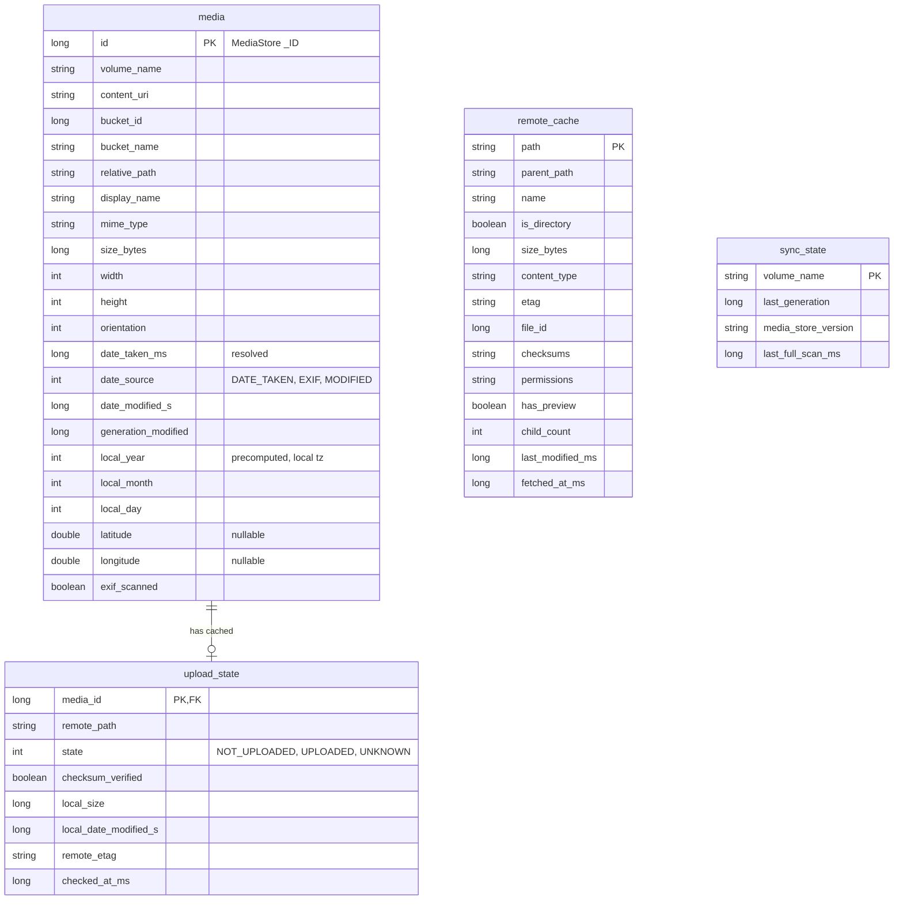

Notes:

- **Indexes**: `media(bucket_id, date_taken_ms DESC)`, `media(date_taken_ms DESC)`, `media(local_year, local_month, local_day)`, `media(latitude, longitude)` partial use via `WHERE latitude IS NOT NULL`, `remote_cache(parent_path)`.
- `upload_state.media_id` has an `ON DELETE CASCADE` foreign key to `media`.
- `local_year/month/day` are computed at index time in the device time zone. On time zone change (`ACTION_TIMEZONE_CHANGED`) `IndexWorker` recomputes them (cheap bulk update; no MediaStore access).
- `sync_state.media_store_version` stores `MediaStore.getVersion(volume)`; if it changes, generation numbers are invalid and a full scan runs.
- `remote_cache` is keyed by full remote path; `checksums` is the raw `oc:checksums` string (e.g. `SHA1:… MD5:…`).
- Grids query `media` only. A folder excluded by rules is never inserted, and a rule change runs a full scan that deletes and inserts the affected rows (index-time filtering). There is no query-time filtering: until that scan has finished, views show the previous state.

### 4.2 DataStore

| Store | Content |
| --- | --- |
| `settings.preferences_pb` | Folder rules (default: exclude `Android/data` and WhatsApp's `.Statuses`, removable like any rule), exclude patterns, grid columns, theme mode, accent colour, tile server address, whether the location prompt was shown, the remote root; later phases add the save-copy-vs-overwrite default and pen colour/width. A corrupt file is replaced by the defaults. |
| `trusted_certs.preferences_pb` | Pinned certificates: host → SHA-256 fingerprint and the details shown when it was accepted. |
| `credentials.preferences_pb` | One Tink-encrypted, Base64-encoded blob: server URL, login name, user id, app password. |

## 5. Key flows

### 5.1 Initial indexing and incremental sync

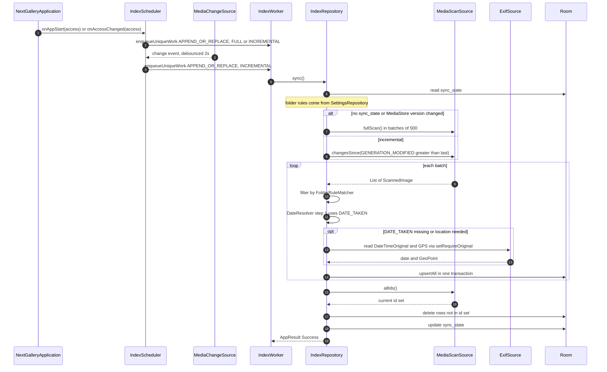

Details:

- Deletions are not reported by generation queries, so each sync compares ID sets (`allIds()` is a projection-only cursor; ~fast even at 50k rows). Rows are removed in chunks of 900 (SQLite variable limit).
- EXIF reading is the expensive part. GPS is read only for JPEG/HEIF/WebP, in a **second pass** (`LocationBackfill`, on `exif_scanned = false` rows, 200 at a time) at the end of every sync, after the grid-relevant data is committed, so folders appear quickly on first launch. An interrupted pass continues at the next sync. A later scan keeps the stored location unless the file's size or modification date changed. Date fallback order: `DATE_TAKEN` → EXIF `DateTimeOriginal` (with `OffsetTimeOriginal` when present) → `DATE_MODIFIED`.
- Without `ACCESS_MEDIA_LOCATION` Android hides the GPS tags, so the second pass does nothing and the rows stay unscanned, and the map shows a card asking for the permission. When it is granted, `IndexScheduler.onPhotoLocationsAllowed()` queues a sync, which runs the pass.
- With partial access, the scan only sees user-selected images. The selection cannot be read from the permission state, so the index is rebuilt (full scan) whenever the permission dialog or photo selection closes (`MainEvent.AccessRequestFinished`) and whenever the access level changes.
- `.nomedia`: MediaStore already excludes folders that contain a `.nomedia` file from the image collection, so the indexer does not check for it, and the folder rules screen cannot list these folders (D53) (confirmed on the Pixel 10a by the instrumented `MediaStoreScannerTest`). MediaStore applies it when it scans, so the image disappears after the next scan of that folder, not at the moment the `.nomedia` file is created.
- Rule changes: `RuleChangeObserver` runs from `NextGalleryApplication`, so a change still reaches the index when the user leaves the app right after it. Only killing the process within the 2 s debounce loses the rescan, until the next full scan.
- `IndexWorker` does not report progress yet.
- `IndexWorker` is expedited for the first scan, runs as normal work otherwise, and reports progress through `setProgress` for the UI's indexing indicator.

### 5.2 Opening a folder grid with paging

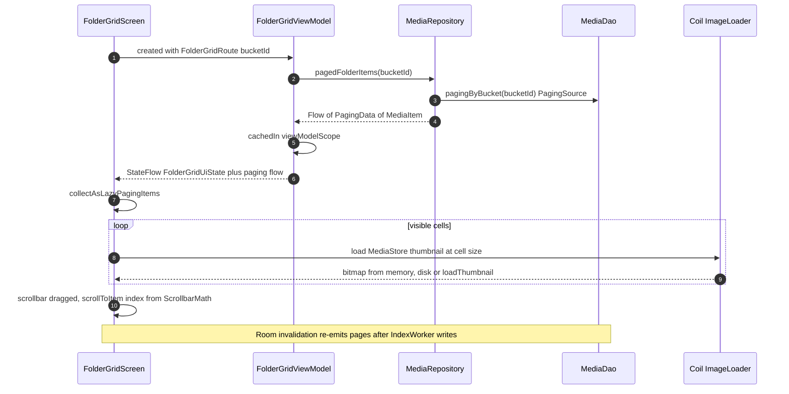

- Page size 120 (multiple of common column counts), prefetch distance 2 pages, `enablePlaceholders = true` so the total count is known and the fast scroll thumb maps 1:1 to positions, and a jump threshold of 3 pages, so a scrollbar jump loads the target page directly instead of every page in between.
- Upload badges: the grid collects `UploadStateRepository.observeStates(visibleIds)`; the map is combined per cell, not via a SQL join, so the paging query stays simple and cheap.

### 5.3 Full-screen viewer

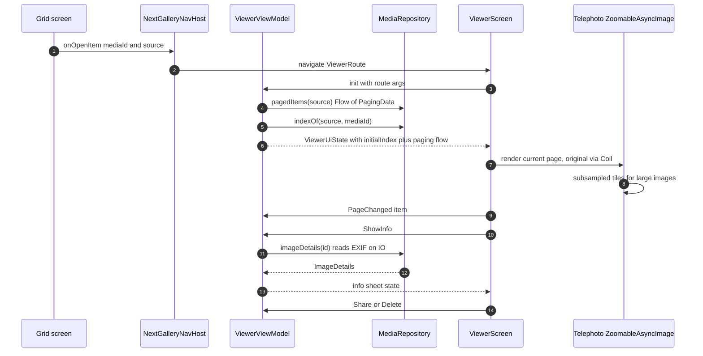

- The viewer pages through the same paged list as the grid (`MediaSource`), so the pager knows its size from the placeholders, items are loaded per page, and deleted images disappear through Room invalidation. If an image disappears, the next one takes its place; if none are left, the viewer closes. Currently `ViewerRoute(mediaId, bucketId)`, where a null `bucketId` means the timeline; the map adds its source in Phase 6, and remote images (Phase 8) get their own screen data.
- The adjacent pages are composed ahead (`beyondViewportPageCount = 1`), so Coil loads them before they are swiped to; full-resolution tiles only for the visible page.
- The viewer always uses `NextGalleryViewerTheme`, hides the bottom bar, and hides the system bars together with its controls.
- Another app can open an image (`ACTION_VIEW` with an `image/*` content URI). `ExternalImageScreen` then shows just that image with zooming: it need not be in the index, and no media permission is needed.
- Share uses `Intent.ACTION_SEND`/`ACTION_SEND_MULTIPLE` with MediaStore content URIs and `FLAG_GRANT_READ_URI_PERMISSION`.

### 5.4 Editing and saving

```mermaid
sequenceDiagram
    autonumber
    participant UI as EditorScreen
    participant VM as EditorViewModel
    participant S as EditHistory
    participant R as EditRepository
    participant G as EditGeometry
    participant Ren as ImageRenderer port
    participant MW as MediaWriteSink port

    UI->>VM: open mediaId
    VM->>R: open(mediaId), decodes at most 2048 px
    R-->>VM: EditSource with PreviewImage handle
    UI->>VM: ApplyOperation Rotate or Crop or Scale or PenStroke
    VM->>S: push(op), clear redo stack
    VM->>R: renderPreview(ops)
    R->>G: steps(ops, source size)
    G-->>R: RenderPlan
    R->>Ren: render(preview, steps) on Default dispatcher
    Ren-->>VM: PreviewImage handle
    UI->>VM: Undo or Redo
    VM->>S: undo() or redo()
    UI->>VM: Save mode NewCopy or Overwrite
    VM->>R: save(mediaId, ops, mode) in background coroutine
    R->>G: steps(ops, original size)
    opt Overwrite
        R->>MW: request overwrite (createWriteRequest)
        MW-->>VM: PlatformConfirmation
        VM-->>UI: EditorEffect RequestConfirmation
        UI->>VM: ConfirmationResult
        VM->>R: commitOverwrite(mediaId, ops)
    end
    R->>Ren: decode, render at full resolution
    R->>Ren: encode JPEG q95 or PNG to a temporary file
    R->>R: EXIF with Orientation normal and new dimensions
    alt NewCopy
        R->>MW: insert pending entry in same RELATIVE_PATH, write, publish
    else Overwrite
        R->>MW: backup, write; put the backup back if writing fails
    end
    R->>R: sync the index
    R-->>VM: SaveOutcome
    VM-->>UI: open the copy, or return to the overwritten image
```

- `EditHistory` is a plain immutable class (`operations`, `push`, `undo`, `redo`, `canUndo`, `canRedo`) — fully unit-testable without Android.
- `EditGeometry` (pure, `:core:data`) flattens the operations into one `RenderPlan` for a given source size: the output size, one 3×3 matrix from source to output pixels, and the strokes in output pixels. The size of the output does the clipping, because every later crop lies inside the earlier ones. So an edit needs exactly two bitmaps, and scaling down and up again loses nothing. Crops end on whole pixels, so they do not resample. For the preview, `RenderPlan.fittedTo(2048)` shrinks the same plan, which makes preview and full-resolution rendering identical in output geometry. The `BitmapImageRenderer` adapter only applies the plan with `Matrix`, `Canvas` and `Path`.
- `EditorReducer` holds the state changes of the editor that need nothing but the state; the ViewModel renders when the history changed. Until a crop is applied, the frame lives in `EditorUiState.cropRect`. The design has no apply button: leaving the Crop tool, any other action and saving apply it, and undo first resets the frame.
- The pen width is in pixels of the preview ("8 px"), stored as a fraction of the longer side, so a stroke looks on the saved image as it did on the screen.
- Saving never endangers an image. Rendering, encoding and EXIF happen in temporary files in the cache, where a failure or a cancellation does no harm. A new copy stays a pending, hidden entry until it is complete, and is removed if anything fails. An overwrite first copies the original to a temporary backup and puts it back if writing fails; if the backup fails, the original was not touched. One risk remains: if the process dies during the short write of an overwrite, the image can be incomplete, because MediaStore has no atomic replace. Overwriting always needs the system confirmation.
- After saving, the index syncs inline, so the viewer can open the new copy at once; a queued sync later picks up what the media scanner adds. An overwritten image keeps its URI, so the route clears Coil's memory cache.
- Rendered images cross the port as an opaque `PreviewImage(handle, width, height)`; `:core:ui` draws it, so `EditorViewModel` never touches `Bitmap`.
- Original EXIF orientation is applied first (bake-in): `ImageDecoder` delivers upright pixels, and all sizes in the plan are upright sizes. That is why the output orientation is reset to normal. A wide-gamut colour space is kept; an Ultra HDR gain map is not.
- Memory guard (D30): `MemoryBudget` (pure, `:core:data`) estimates the bytes a step needs (source + output bitmap, 4 bytes per pixel) and compares them with `MemoryInfoSource.availableBytes()` (`:core:platform`, from `ActivityManager.MemoryInfo` minus the low-memory threshold and a safety margin, and at most half of the RAM, because Android 17 limits each app but has no API to read the limit (D40); bitmap pixels live in native memory, so the Java heap limit is not the right measure). An `OutOfMemoryError` during rendering becomes the same refusal. It is checked when a `Scale` is applied and before the full-resolution render on save. If the estimate does not fit, the operation is refused with `AppError.InsufficientMemory(requiredBytes, availableBytes)` and the editor shows why. Nothing is ever saved at a reduced size without the user asking for it.
- Only JPEG and PNG sources can be edited, and the output keeps the source format (D29). The viewer hides the Edit action for other formats.

### 5.5 Delete with trash

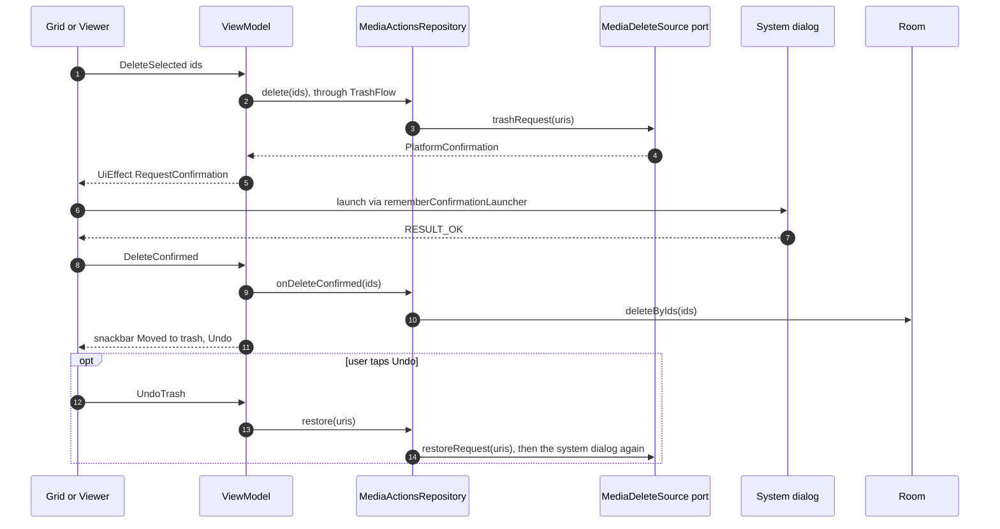

- Room rows are removed optimistically after confirmation so the grid updates instantly; the next `IndexWorker` run reconciles regardless. Untrash re-inserts via the next incremental sync (the item gets a new generation).
- `createDeleteRequest` (permanent) is available through `MediaActionsRepository.delete(ids, permanent = true)`; no screen offers it yet.

### 5.6 Nextcloud Login Flow v2

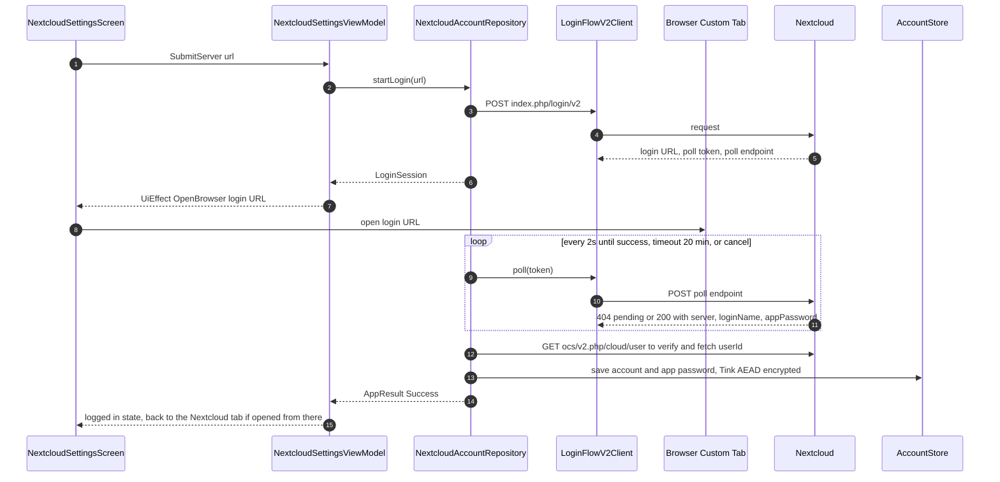

- Server URL normalization: add `https://` if missing, strip trailing `/` and `/index.php`; `http://` is rejected in release builds (see 11).
- Polling runs in `viewModelScope`; leaving the screen cancels it. The poll token is never persisted.
- `ACCESS_LOCAL_NETWORK` (D39) is requested when the user starts the login, after a short explanation; a denied permission only matters for local addresses, where connection failures then become `LocalNetworkBlocked`.
- The session ended (401): the browser shows a banner that opens the same form again with the server filled in; a successful login replaces the app password.
- The poll endpoint must have the scheme, host and port of the address the user entered, the poll does not follow redirects, and the returned `server` is normalised and must have that origin too; otherwise the login fails with `AppError.ServerMismatch`. Login JSON is limited to 1 MiB. A password that does not end up stored (user id failed, login cancelled, wrong server) is revoked best effort on the entered server, as is the password a new login replaces, but never the one in use.
- Logout (D35): `AccountSession.logOut()` reads the account, then runs `AccountStore.clear()` and clears `remote_cache`, `upload_state` and Coil's remote cache entries, each step regardless of the others and not cancellable by the screen. Only then `DELETE ocs/v2.php/core/apppassword` goes out, best effort, in the background with the account read before: `OcsClient` puts the credentials on the request itself, so this works without a stored account. If the process dies first, the revoke is lost. Upload states follow with their table in Phase 9. A remote call whose account is no longer signed in when it ends has its result dropped (`NotLoggedIn`), and listings and shared files of such a call are neither stored nor shown. While logged out, `RemoteCallRunner` returns `AppError.NotLoggedIn` for every remote call without touching the network; the Nextcloud tab shows a login-required hint, and badges and the Upload action are hidden.
- Untrusted certificate (D32): any remote call can fail with `UntrustedCertificate(info)`. The ViewModel emits an effect that shows `CertificateWarningDialog`; on Accept, `TrustedCertificateRepository.accept(info)` pins it and the call is retried.

### 5.7 Upload-state check

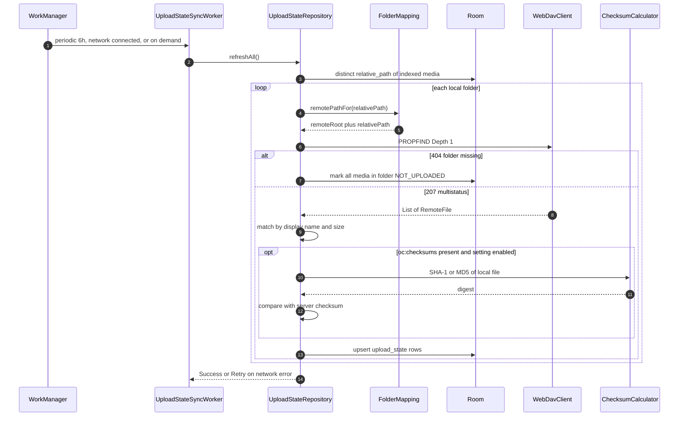

- Skip rule: a folder whose remote `etag` and local max(`date_modified`) are unchanged since `checked_at_ms` is not re-compared.
- Checksums are only computed for name+size matches, and only once per (`media_id`, `local_date_modified_s`) since the result is stored with `checksum_verified`.
- Grid badges read `upload_state` only; a missing row means `Unknown` (no badge or a neutral one).
- Nextcloud does not always compute checksums for files uploaded via other clients; absence of `oc:checksums` means "Uploaded (size match)".

### 5.8 Upload hand-off to the Nextcloud app

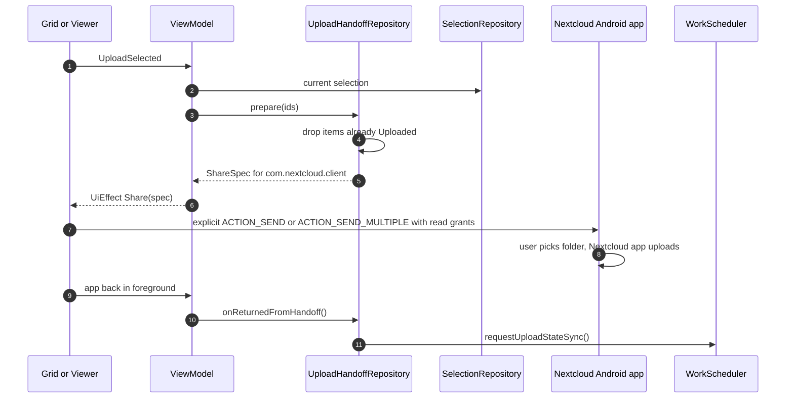

- The Nextcloud app handles target folder, name conflicts, chunking, retries and progress; NextGalleryApp cannot see its progress.
- Badges update once the next upload-state check finds the files on the server. If the user chose a folder outside the configured remote root, or the Nextcloud app renamed a file, the badge stays "not uploaded" (D13).
- If `NextcloudAppSource.isInstalled()` is false, the Upload action is disabled and explains that the Nextcloud app is required.

## 6. Navigation

Single activity, Navigation Compose with type-safe `@Serializable` routes. Each feature exposes its route types and a `NavGraphBuilder` extension; `:app` connects them. Bottom navigation for the four top-level destinations; settings from the top app bar.

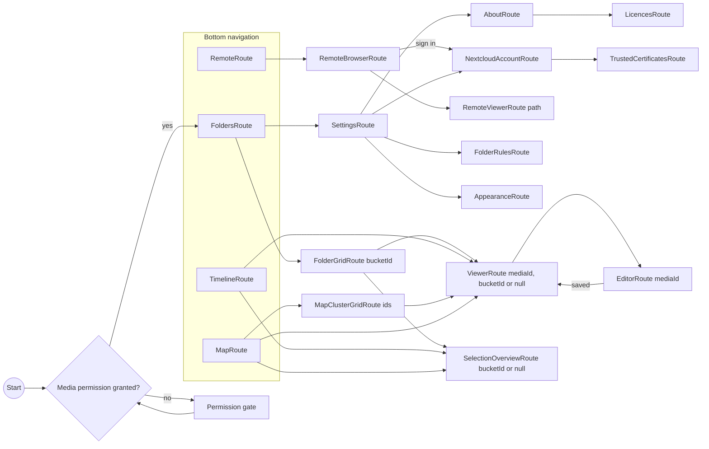

Rules:

- The viewer and the selection overview are opened from several tabs, so they sit directly in the root graph (`sharedScreens` in `:app`) and hide the bottom navigation.
- Route arguments carry only IDs/paths, never full objects. A map cluster is passed as its bounds (`GeoBounds.encode()`), which hold exactly its images, so no list of IDs has to travel.
- Feature screens receive navigation lambdas (`onOpenItem: (Long, ViewerSource) -> Unit`) instead of a `NavController`.
- `ACTION_VIEW` of an image opens `ExternalImageScreen` instead of the navigation graph (see 5.3).

## 7. State management

Pattern per screen:

```kotlin
data class FolderGridUiState(
    val title: String = "",
    val selectedIds: Set<MediaId> = emptySet(), // app-wide, from SelectionRepository
    val selecting: Boolean = selectedIds.isNotEmpty(), // also true after the Select action, before anything is selected
    val uploadBadgesEnabled: Boolean = false, // Phase 9: logged in and Nextcloud app installed
)

sealed interface FolderGridEvent {
    data class ItemClicked(val id: MediaId) : FolderGridEvent
    data class ItemLongPressed(val id: MediaId) : FolderGridEvent
    data object StartSelecting : FolderGridEvent
    data object SelectAll : FolderGridEvent
    data object ClearSelection : FolderGridEvent
    data object DeleteSelected : FolderGridEvent
    data object ShareSelected : FolderGridEvent
    data object UploadSelected : FolderGridEvent // Phase 9
    data class ConfirmationResult(val confirmed: Boolean) : FolderGridEvent
    data object UndoDelete : FolderGridEvent
}

sealed interface FolderGridEffect {
    data class OpenViewer(val id: MediaId) : FolderGridEffect
    data class Share(val spec: ShareSpec) : FolderGridEffect // also used for the Nextcloud hand-off
    data class Trash(val effect: TrashEffect) : FolderGridEffect // confirmation, message with undo, failure
}

@HiltViewModel(assistedFactory = FolderGridViewModel.Factory::class)
class FolderGridViewModel @AssistedInject constructor(
    @Assisted private val bucketId: Long,
    private val media: MediaRepository,
    private val folders: FolderRepository,
    private val selection: SelectionRepository,
    private val actions: MediaActionsRepository,
    private val trashFlow: TrashFlow,
    private val upload: UploadHandoffRepository, // Phase 9
) : ViewModel() {
    @AssistedFactory interface Factory { fun create(bucketId: Long): FolderGridViewModel }
    val items: Flow<PagingData<MediaItem>> = media.pagedItems(MediaSource.Folder(bucketId)).cachedIn(viewModelScope)
    val state: StateFlow<FolderGridUiState> = /* combine(...).stateIn(viewModelScope, WhileSubscribed(5_000), FolderGridUiState()) */
    val effects: Flow<FolderGridEffect> = /* Channel(BUFFERED).receiveAsFlow() */
    fun onEvent(event: FolderGridEvent) { /* ... */ }
}
```

`PagingData` is exposed as a separate flow (not inside `UiState`) because it must be `cachedIn` and collected with `collectAsLazyPagingItems`.

Other screens (abbreviated):

| Screen | UiState fields |
| --- | --- |
| Folders | `folders: List<Folder>`, `access: MediaAccess`, `isIndexing`, `indexProgress` |
| Timeline | `index: TimelineIndex?`, `today`, `selectedIds`, `selecting` (+ separate paging flow of the images) |
| Map | `clusters: List<MapCluster>` for current viewport + zoom, `camera`, `currentLocation`, `openCluster`, `showPhotoLocationCard`, `showNoGeotaggedCard`, `tileUrl`, `selectedIds` (+ separate paging flow for the open cluster) |
| Viewer | `ids: List<Long>`, `currentIndex`, `current: MediaItem?`, `details: ImageDetails?`, `chromeVisible`, `infoSheetVisible` |
| Editor | `preview: PreviewImage?`, `tool: EditTool`, `cropRect`, `aspect`, `penColor`, `penWidth`, `canUndo`, `canRedo`, `isSaving`, `saveMode` |
| Remote browser | `path`, `entries: List<RemoteFile>`, `isRefreshing`, `isOffline` (shows cached `remote_cache` data), `error` |
| Login | `serverUrl`, `step: Idle / WaitingForBrowser / Verifying / Done`, `error` |
| Folder rules | `rows: List<FolderRuleRow>` (device folders plus folders that only have a rule, each Include / Default / Exclude), `patterns` |
| Appearance | `themeMode`, `gridColumns`, `accentColor` |

Process death: the route is restored by Navigation and passed in again through the assisted factory (`hiltViewModel<FolderGridViewModel, FolderGridViewModel.Factory> { it.create(route.bucketId) }`); transient UI (selection, editor operations) is saved via `SavedStateHandle` where cheap (selection as `LongArray`, editor operations serialized with kotlinx.serialization).

## 8. Threading and concurrency

| Work | Where it runs |
| --- | --- |
| Compose rendering, state collection | Main |
| Room queries | Room's own executor (suspend DAOs / Flow / PagingSource) |
| MediaStore cursors, EXIF, file I/O, checksums, OkHttp | `Dispatchers.IO` via injected `DispatcherProvider` |
| Bitmap transforms (editor preview/full render), clustering, section index computation | `Dispatchers.Default` |
| Indexing, upload-state sync | WorkManager `CoroutineWorker`s (survive process death; unique work names) |

Rules:

- No `GlobalScope`. The MediaStore change observer runs in `MainViewModel`'s `viewModelScope`, i.e. while the UI exists; changes made while the app is closed are picked up by the incremental sync on the next start.
- Unique work names: `index` (one at a time; every trigger uses `APPEND_OR_REPLACE`, so a sync requested during a running one is not lost; the 2 s debounce keeps the chain short), `upload-state-sync` (periodic, `UPDATE`; plus a one-shot `upload-state-refresh` after a hand-off).
- Room writes in batches inside `withTransaction`; the indexer yields between batches (`ensureActive()`), so cancellation is prompt.
- Editor full-resolution save runs in `viewModelScope` with `NonCancellable` around the final MediaStore commit (write + clear `IS_PENDING`), so a half-written entry is never left visible. A pending entry left by a crash is cleaned up on next start (pending items older than 1 day are deleted by `MediaWriteSink.cleanupPending()`).
- Flows from repositories are cold; ViewModels convert with `stateIn(viewModelScope, SharingStarted.WhileSubscribed(5_000), initial)`.

## 9. Caching

### 9.1 Thumbnails and images

- Single Coil 3 `ImageLoader` (app singleton) with:
  - Memory cache: 20 % of app memory.
  - Disk cache: `cacheDir/image_cache`, 250 MB (configurable later).
  - Custom `MediaThumbnailFetcher` for local grid cells: `ContentResolver.loadThumbnail(uri, Size, signal)` — uses the system thumbnail cache, which is faster than decoding originals; if that fails, it decodes the original at the requested size. Cache key includes `id + date_modified + size bucket`, so edited images refresh. Local thumbnails are kept in the memory cache and the system thumbnail cache, not again in the Coil disk cache, which is meant for remote images (9.2).
  - Size buckets (256 / 512 px) instead of exact sizes to maximise cache hits across grid densities.
- Viewer: Telephoto's `ZoomableAsyncImage` uses Coil for the screen-sized image and sub-sampled tiles for full resolution; tiles are not disk-cached (originals are local).
- Hardware bitmaps enabled for grids; disabled in the editor (needs software bitmaps).

### 9.2 Remote previews and files

- The `@RemoteImageLoader` requests `core/preview?fileId=…&x=…&y=…` through the authenticated OkHttp client (`coil-network-okhttp`); cache key is `fileId + etag + size` (`remoteImageCacheKey`), so a changed remote file is re-fetched. It has its own memory cache and a 500 MB disk cache (D37) in `remote_image_cache`, so logging out wipes them without touching local thumbnails.
- Opening a remote image full screen shows a large preview first (2048 px) and loads the original via WebDAV `GET` for the page on screen only, with its progress below the image. Originals are streamed into Coil's disk cache, never into the MediaStore. There is no offline mode for remote files; the Nextcloud app's "available offline" covers that (D37).
- `remote_cache` table holds the last PROPFIND result per folder for instant display and offline browsing; refreshed on open (stale-while-revalidate) and on pull-to-refresh.

### 9.3 Index and upload state

- The Room index is the cache of MediaStore; it is reconciled incrementally, so app start shows data immediately and syncs in background.
- `upload_state` caches server comparison results; badges never wait on the network.
- The timeline's layout (`TimelineIndex`: headers, rail dates) is computed from a `GROUP BY` query on the precomputed `local_year/month/day` columns (D7), and only rebuilt when the number of images of a day changes.

## 10. Error handling

- Data sources throw; **repositories catch** and return `AppResult` / emit errors in flows. `CancellationException` is always rethrown (`runCatchingCancellable`).
- `AppError` is mapped to user-visible `UiText` in the ViewModel (one mapper per feature, using shared strings in `:core:ui`).
- Categories:
  - **Permission**: missing media permission → `PermissionGate`; partial access → banner with "select more"; missing `ACCESS_MEDIA_LOCATION` → map hint, no crash.
  - **User confirmation**: trash, delete and write requests → `UiEffect.RequestConfirmation(PlatformConfirmation)`; this is a normal flow, not an error.
  - **Stale data**: item deleted outside the app while opened → `NotFound`; the viewer skips to the next page and the grid refreshes via index sync.
  - **Network** (`IOException`, timeouts): remote browser shows cached data with an offline banner; workers return `Result.retry()`.
  - **Auth** (401): account marked as "needs re-login"; workers stop with failure; a persistent banner links to login.
  - **Server** (5xx, 507 insufficient storage): queue entry `FAILED` with reason; retry for 5xx, no retry for 507.
  - **Decode/encode** (corrupt file): thumbnail shows an error placeholder; editor refuses to save with a message.
  - **Insufficient memory** (`AppError.InsufficientMemory`): the editor refuses the scale or save and tells the user how much memory the image needs and how much is available (D30).
- Crashes: no crash reporting service (no tracking). Uncaught exceptions use the default handler; an opt-in local log export may be added later.
- Logging: a thin `Logger` interface in `:core:common`, backed by `android.util.Log` in debug and stripped below `WARN` in release via R8 rules. Never log URLs with credentials, app passwords, or file names in release.

## 11. Security and privacy

- **Credentials**: Login Flow v2 only; the account password is never seen by the app. The app password is stored in a DataStore file encrypted with a Tink `Aead` (AES256-GCM); the Tink keyset is encrypted by an Android Keystore master key (`AndroidKeysetManager`, `android-keystore://` URI). Tink silently falls back to a clear text keyset if the Keystore fails when the keyset is created; `KeystoreSecretCipher` refuses that (`isUsingKeystore()`) and removes the keyset. Any failure to decrypt reads as logged out. No `EncryptedSharedPreferences` (deprecated).
- No backup (D42): `android:allowBackup="false"` stops cloud backup, and `data_extraction_rules.xml` also excludes all app data from device transfer, so credentials can never leave the device this way.
- **TLS**: platform defaults via OkHttp; `network_security_config.xml` disallows cleartext traffic, so v1 accepts `https://` servers only (cleartext for debug builds only, via a debug-only config). User-installed CAs (`<certificates src="user"/>`) are trusted in addition to system CAs. Any other certificate is only trusted after the user accepts it in a warning dialog; it is then pinned per host by SHA-256 fingerprint (`PinningTrustManager`, D32). A changed certificate triggers the warning again. The same OkHttp client is used for WebDAV, the preview API and Coil, so all remote traffic follows the same rule.
- Authorization header added only for requests to the configured server's scheme, host and port (network interceptor, so it decides again per redirect); redirects to other hosts never get credentials, https → http redirects are not followed, and requests that change something on the server don't follow redirects at all.
- OkHttp only speaks TLS unless `allowCleartext` (debug builds); server URLs and the URLs in login responses are checked the same way. Nothing logs URLs with credentials or the app password; `toString` of the account and of the login flow's types hides the secrets.
- Responses are limited, so that a server can't exhaust the memory: login and OCS JSON 1 MiB; a multistatus response 64 MiB of XML (well over 50,000 entries of a folder) and 100,000 entries, keeping only the properties the app reads. Beyond that the call fails with a normal error. A DOCTYPE fails the parse.
- Everything that comes from the server is treated as untrusted when it ends up in a path: dot segments and encoded slashes in hrefs are dropped, `RemotePathMapper` refuses dot segments, and shared files keep only a sanitised last name part inside the temporary folder.
- **No tracking**: no analytics, no crash reporting SDKs, no Google Play Services. osmdroid tile requests go over HTTPS to the OSM tile server (or the one set in Settings) with the user agent `NextGalleryApp (Android, osmdroid)`, which names the app, as the OSM tile usage policy requires, and carries no personal data. This is the only third-party network traffic and is triggered only by opening the map. Place names are looked up on the phone (D45), and tiles are cached in the app's cache folder.
- **Least privilege**: only `READ_MEDIA_IMAGES`, `READ_MEDIA_VISUAL_USER_SELECTED`, `ACCESS_MEDIA_LOCATION`, `ACCESS_COARSE_LOCATION` (optional, D44), `INTERNET`, `ACCESS_NETWORK_STATE`, `ACCESS_LOCAL_NETWORK` (D39), plus a `<queries>` entry for `com.nextcloud.client`. No foreground service or notification permission (uploads are done by the Nextcloud app). Destructive actions go through system dialogs.
- Shared local images use MediaStore content URIs with temporary read grants. Server images are downloaded first and shared through a `FileProvider` limited to one temporary cache folder (D48); the rest of the app's storage stays private.

## 12. Performance

Targets (measured on the reference Pixel 10a, Android 17): warm start to first folder grid < 1 s with an existing index; no dropped frames at the display refresh rate when scrolling and fast scrolling a 50 000-image library; first full index of 50 000 images in under ~1 minute without EXIF pass.

- **Query only Room** for grids; MediaStore is touched only by the indexer.
- **Paging 3 with placeholders** gives a stable item count, so `LazyVerticalGrid` can jump anywhere; Room's `PagingSource` uses `LIMIT/OFFSET` on indexed columns. For very deep jumps, the grid requests the page around the target via `scrollToItem` and placeholders render until loaded.
- **Timeline index** (the folder grid maps the thumb directly to positions): computed once per data version via aggregated SQL (`SELECT local_year, local_month, local_day, COUNT(*) … GROUP BY …`), turned into cumulative row offsets. A lookup is O(log n) (binary search in days), so the rail's dates do not depend on loaded images, and the thumb jumps with `scrollToItem`, dropping positions the grid has not reached yet.
- **Timeline headers**: the grid's rows come from `TimelineIndex`, which also maps a row to its position in the paged image list; the images load through Paging as in the other grids. `PagingData.insertSeparators` is not used, because it only sees loaded pages: the row count and the headers' positions would change while scrolling, and the rail could not jump. The images are ordered by local date first, so each day's images are contiguous and match the day counts. The sticky month is the month of the first visible row, and the rail's current day is the row in the vertical middle.
- **Stable keys and content types** in lazy grids (`key = id`, `contentType = header/item`) to avoid recomposition and enable reuse.
- **Thumbnails**: system `loadThumbnail` + size buckets + memory cache; no crossfade during fast scroll; requests cancelled when cells leave the screen (Coil does this per composable).
- **Indexing**: projection limited to needed columns; batched transactions; EXIF read deferred to a second pass; ContentObserver debounced; incremental sync via generation numbers touches only changed rows.
- **Map**: clustering computed on `Default` for the viewport only, from a lightweight `(id, lat, lon)` projection; recomputed on zoom/pan with debounce.
- **Memory**: viewer limits decoded size to screen size except visible tiles; editor preview max 2048 px side.
- **Baseline profiles** (`:baselineprofile` module, added once screens are stable) and R8 full mode for release builds; Macrobenchmark for startup and grid scrolling.
- Compose stability: `UiState` classes are immutable data classes with `kotlinx.collections.immutable` collections or `@Immutable` where needed.

## 13. Testing strategy

Principles: every function gets a unit test; tests are small, independent and non-overlapping (each behaviour is asserted in exactly one test at the lowest layer that owns it). Tools: JUnit 4, MockK, Turbine, kotlinx-coroutines-test (`runTest`, `StandardTestDispatcher` via an injected `DispatcherProvider`), Robolectric for the thin Android adapters, Room in-memory databases, OkHttp `MockWebServer`, Compose UI tests. Because the logic sits in pure JVM modules (section 2), the large majority of tests are plain JUnit tests without any Android runtime. Instrumented tests run locally only, where Robolectric cannot reproduce the behaviour (see 13.1).

| Layer / module | What is tested | How | Runs on CI |
| --- | --- | --- | --- |
| `:core:model`, `:core:common` | Model validation (`GeoPoint` ranges, `NormalizedRect`), `AppResult` helpers, `RelativePaths`, `runCatchingCancellable`, `ScrollbarMath` | Plain JVM JUnit | Yes |
| `:core:data` | All domain logic: `MediaIndexer` (full vs incremental vs version change), `IndexScheduler`, `DateResolver`/`ExifDateParser`, `FolderRuleMatcher`, `MediaAccessRepository`, `FolderMapping`, `UploadStateMatcher`, `UploadHandoffRepository`, `SelectionRepository` and `SelectionRepresentability`, checksums, `EditGeometry`/`MemoryBudget`/`DefaultEditRepository`, `GridClusterer`, repositories, `AccountStore` (fake `SecretCipher`) | Plain JVM JUnit + hand-written fake ports, MockK, Turbine | Yes |
| `:core:nextcloud` | PROPFIND parsing, request building (headers, depth, body), Login Flow v2 polling states, error mapping, auth interceptor host check incl. redirects, URL normalisation, `PinningTrustManager` and `PinningHostnameVerifier` through real TLS handshakes (CA-signed, pinned, unknown, changed, expired, hostname mismatch, removed pin) | Plain JVM JUnit, `MockWebServer` (with `okhttp-tls` `HeldCertificate`s), kxml2 parser | Yes |
| ViewModels (feature modules) | Event → state transitions, effects emitted, paging flow wiring | Local unit tests without Robolectric: `runTest` + Turbine, fake repositories, route passed to the constructor | Yes |
| `:core:database` | Each DAO query (paging order, rule filtering, section aggregation, cascade deletes), migrations, entity ↔ model mapping | Robolectric + in-memory Room; `MigrationTestHelper` with exported schemas | Yes |
| `:core:media` | Cursor → `ScannedImage` mapping (`MatrixCursor`), EXIF tag extraction from fixture files, request construction, rendering and encoding on real pixels (native graphics), writes against a stand-in provider | Robolectric, fixtures in `src/test/resources` | Yes |
| `:core:platform` | Workers map `AppResult` to `Result` (success / retry / failure), `WorkManagerScheduler` enqueues the right unique work | Robolectric, `TestListenableWorkerBuilder`, `WorkManagerTestInitHelper` | Yes |
| UI | Key screens: folder grid (selection, fast-scroll label), viewer (paging, info sheet), editor (undo/redo buttons enabled state), login steps, permission gate | Compose UI tests (`createComposeRule`) on Robolectric | Yes |
| Platform behaviour | See 13.1 | Instrumented tests (`src/androidTest`) | No – local emulator / Pixel 10a |
| Performance | Startup, grid scroll jank | Macrobenchmark on the Pixel 10a (later) | No |

Test doubles: hand-written fakes for repositories (`FakeMediaRepository`) live next to the tests that need them; fakes of ports and repositories shared by several modules go into Gradle `testFixtures` of `:core:data`. MockK is used for leaf collaborators. Test names follow `functionName_condition_expectedResult`.

CI (`.github/workflows/ci.yml`) runs on every branch push (direct pushes and merges into `main`) and on pull requests: ktlint, detekt, lint, `test` (the JVM modules' tests and the Android modules' local unit tests, including Robolectric), the build-logic tests, the debug and instrumented-test builds, and the JaCoCo coverage reports (`coverageReport`). On pull requests and on `main` it then runs the SonarCloud scan (`sonar-project.properties`, D41), which needs the `SONAR_TOKEN` repository secret and is skipped without it. There is no emulator in CI: instrumented tests run locally with `./gradlew connectedDebugAndroidTest` on an API 37 emulator or the Pixel 10a before merging changes that touch an adapter.

### 13.1 Robolectric and on-device tests

Robolectric 4.17 is the first release that supports SDK 37. Since `minSdk` is 37, it is the minimum usable version. Robolectric's SDK 36+ runtimes need JDK 21, so the build toolchain, local development and CI all use JDK 21. The `--add-opens` JVM flags from the Robolectric setup guide are set in the test convention plugin.

Robolectric's shadows do not reproduce some platform behaviour. These parts are covered by instrumented tests in `src/androidTest`, run locally on an API 37 emulator or the Pixel 10a with `./gradlew connectedDebugAndroidTest`. Since adapters hold no logic, these tests only check that the platform call works; everything around it is tested on the JVM.

| Area | Why Robolectric is not enough | On-device test |
| --- | --- | --- |
| MediaStore queries (`MediaStoreScanner`) | The shadow `ContentResolver` has no real MediaStore provider (`GENERATION_MODIFIED`, `IS_TRASHED`, `.nomedia` handling). `MediaStoreScannerTest` (`:core:media`). | Insert test images through `MediaStore`, assert the scanner's results, delete them afterwards. |
| `ContentResolver.loadThumbnail` (Coil fetcher) | Not backed by the system thumbnail cache. | Thumbnail returned at the requested size bucket. |
| EXIF GPS with `setRequireOriginal` | Location redaction depends on the real permission and provider. | `AndroidExifSourceGpsTest`: GPS read with `ACCESS_MEDIA_LOCATION` granted. Without the permission is a manual check, because a test app that owns the file sees its location anyway. |
| Android Keystore (`KeystoreSecretCipher`) | Robolectric has no `AndroidKeyStore` provider. | Encrypt/decrypt round trip with a Keystore-wrapped keyset. |
| HEIC display (viewer, thumbnails) | Native graphics in Robolectric may not include the platform HEIF codec. | A HEIC fixture decodes and displays. |
| Trash, delete and write requests | The system confirmation dialogs only exist on a device. | Intent sender launches; confirmation itself is a manual check. |
| Saving to MediaStore (`MediaStoreWriter`) | The real provider decides on pending entries, folders and permissions. Robolectric tests use a stand-in provider for what the writer asks. | `MediaStoreWriterTest` (`:core:media`): pending, publish, write, cleanup on entries it inserted itself, deleted afterwards. |
| osmdroid map | `MapView` rendering and tile loading need a real view hierarchy and network. | `OsmdroidMapRendererDeviceTest`: clusters appear as markers on a laid-out map, and the first layout reports the viewport. Tiles are a manual check. |

A behaviour tested on the device is not tested again in Robolectric (no overlap); the JVM tests cover the logic around it with fakes.
